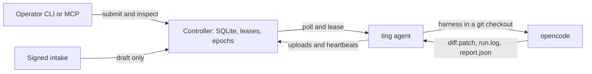

# lu

A job queue and dispatcher for finite coding-agent work against git repositories.

[](https://github.com/ddproxy/tuishou-lu/actions/workflows/ci.yml)
[](https://github.com/ddproxy/tuishou-lu/actions/workflows/codeql.yml)
[](https://scorecard.dev/viewer/?uri=github.com/ddproxy/tuishou-lu)
[](https://github.com/ddproxy/tuishou-lu/releases/latest)
[](LICENSE)

Status: stable — 0.7.0, store schema 7. Controllers and agents of adjacent releases interoperate;
the wire rules are in [Compatibility](docs/compatibility.md).

## What and why

An operator submits a repo, ref and task. The controller stores the job in SQLite and hands out
leases; a `ting` agent stages a checkout, runs the `opencode` harness and uploads a diff, log and
report. Agents dial out to the controller, which never connects back to them. Signed HTTP intake
can propose [drafts](docs/drafts.md) for an operator to approve. Lu is for bounded tasks that end
in a reviewable diff, not for interactive sessions or long-running services.



### When to use it

| Situation | Lu fits when | Look elsewhere when |
| --- | --- | --- |
| One-off code changes | You want a repeatable run against a git ref and a reviewable diff | You need a shared interactive terminal |
| Chained work | Later jobs wait for earlier ones and stack their diffs | Dependencies form cycles or must run everywhere |
| Several agents | Nodes advertise labels and you want exact routing, leases and cordons | You need broadcast or long-running services |
| Automation | You want an HTTP API or MCP tools to submit and inspect jobs | You need a hosted UI or managed workers |
| Untrusted events | You want signed events to propose work as drafts that an operator approves | You need senders to dispatch jobs directly |

## Install

Download the release archive for `x86_64-unknown-linux-musl` or `aarch64-unknown-linux-musl`,
verify it against the published checksum file, and put `lu` and `ting` on `PATH`. The archive
contains no installer; see [Install](docs/install.md) for paths, service units and
[release verification](#verify-a-release).

To build from source instead (Rust 1.99, `make`, `git`):

```sh
make build && make install
```

`make build` produces release binaries, with the `tui` feature for `lu`. `make install` puts them
in `$(PREFIX)/bin`, defaulting to `/usr/local` for root and `$HOME/.local` otherwise; `PREFIX` and
`DESTDIR` can be overridden. Root installs also install the `contrib/` systemd units. Upgrading an
existing agent host must follow the [Ting migration note](docs/migration-ting.md); there is no
compatibility shim.

## Quickstart

This runs a controller, one agent and the operator CLI on one machine. Prerequisites: `make`, a
Rust toolchain, `git`, `opencode` on `PATH` (or a `harness_wrapper` that starts it), a local git
repository, and three shells. Replace `/home/you` with your home directory and
`/home/you/src/demo` with your repository path. The commands use the binary from `make build`;
put `target/release` on `PATH` or run `make install` first.

1. Make a demo directory, then create one agent token and one operator token under it. Keep the
   plaintext token files: the controller stores only their SHA-256 hashes. The exact commands,
   file checks and ownership rules are in [Tokens and TLS](docs/tokens-and-tls.md).

   ```sh
   mkdir -p "$HOME/lu-demo"
   ```

2. Write `$HOME/lu-demo/lu.toml`. Add the controller agent and operator hash entries and the
   agent's token file setting exactly as described in
   [Tokens and TLS](docs/tokens-and-tls.md); keep the plaintext files private and out of version
   control. The agent creates `work_dir` recursively with mode `0700` at first start if it is
   missing. An existing path must be a real directory, not a symlink; staging rejects `/` and bare
   top-level directories such as `/srv`.

   ```toml
   [controller]
   listen = "127.0.0.1:7600"
   db = "/home/you/lu-demo/lu.db"
   artifacts_dir = "/home/you/lu-demo/artifacts"

   [agent]
   name = "node-a"
   controller_url = "http://127.0.0.1:7600"
   work_dir = "/home/you/lu-demo/work"
   harness = "opencode"

   [log]
   level = "info"
   format = "text"
   stderr = true
   ```

3. In shell 1, check the config and start the controller:

   ```sh
   lu check --config "$HOME/lu-demo/lu.toml"
   lu serve --config "$HOME/lu-demo/lu.toml"
   ```

   After the token entries are added, `lu check` prints
   `controller: listen 127.0.0.1:7600, 1 agent(s), 1 operator(s), tls off`,
   `agent: node-a -> http://127.0.0.1:7600, work dir /home/you/lu-demo/work` and
   `checks: config values` (more check names are added once the database exists).

4. In shell 2, start the agent. A successful start loads the agent token, heartbeats and polls
   the controller:

   ```sh
   ting --config "$HOME/lu-demo/lu.toml"
   ```

5. In shell 3, point the operator CLI at the controller. Set `LU_URL` and the private operator
   token file as described in [Tokens and TLS](docs/tokens-and-tls.md), then submit a job:

   ```sh
   export LU_URL=http://127.0.0.1:7600

   lu submit --repo /home/you/src/demo --ref main --task "run the test suite" --wait
   ```

   Expected output is a 26-character job id on stdout, then `state: done` on stderr. The command
   exits `0` for `done` and `3` for `failed` or `cancelled`. Without `--wait`, the id is printed
   immediately and the job stays `queued` until the agent picks it up.

6. Inspect the result:

   ```sh
   lu ls
   lu show <job-id>
   lu logs --follow <job-id>
   mkdir -p results
   lu fetch <job-id> --out results
   ```

   `lu ls` uses the header `ID STATE NODE ATTEMPT AFTER CREATED NOTE`. `lu show` prints key/value
   rows (`id`, `state`, `priority`, `group`, `node`, `assigned_provider`, `fallbacks`, `tolerates`,
   `attempt`, `epoch`, `created_at`, `started_at`, `finished_at`, `failure`, `waiting`, `summary`,
   `outcome_note`, `diff_bytes`). Terminal jobs report `diff_bytes`, so a failed job that wrote files before failing
   still advertises its partial diff. `lu logs --follow` streams stored output and stops when the job
   reaches a terminal state.
   `lu fetch` prints one `saved <path>` line per file: `results/diff.patch`, `results/run.log` and
   `results/report.json`. It also fetches artifacts of failed jobs. `lu stats` prints terminal-job
   counts, retries, busy seconds and duration percentiles per node; `--by repo` and `--by state`
   switch the table, and `--since 7d` narrows the window. See [Monitoring](docs/monitoring.md#node-contribution-statistics).

That is the proof: `state: done` and one `saved` line for each of the three artifacts.

A controller listening on a non-loopback address requires a `[tls]` table; plain HTTP is accepted
only on loopback. See [Tokens and TLS](docs/tokens-and-tls.md).

### Next steps: chaining work

To chain work, use idempotency keys instead of copying ids:

```sh
lu submit --key build --repo /home/you/src/demo --ref main --task "build"
lu submit --key test --after-key build --repo /home/you/src/demo --ref main --task "test"
```

The second job stays `blocked` while `build` is unfinished, then becomes `queued`. By default
its agent applies the first job's `diff.patch` to its own base tree before starting.
`--collect files` stages dependency artifacts under `.lu/inputs` without changing the base tree;
`--collect none` skips dependency diffs; `apply` and `both` also apply them, with `--on-conflict`
choosing `fail`, `markers` or `skip`. `lu collect build test --repo ... --ref main` creates one
job that merges, tests or reviews those inputs. See [Dependencies](docs/dependencies.md).

## How it works

1. An operator submits a job with the CLI, MCP tools or HTTP API. Signed intake can only create a
   `draft`; an operator approves it before it is queued.
2. The controller stores the job in SQLite, assigns a lease and a fencing epoch, and makes it
   `queued` when its dependencies are `done`. A late write from an old epoch is discarded.
3. The `ting` agent polls the controller over HTTPS (or loopback HTTP), stages a checkout in its
   `work_dir`, and runs the harness with run, idle and output caps.
4. The agent uploads `diff.patch`, `run.log` and `report.json`. Failure classes, retries, cordons
   and blocked dependents are recorded in the store and shown by `lu show`.
5. Operators inspect or fetch the result with `lu`, `lu mcp`, the [HTTP API](docs/api.md) or the
   optional hash-chained [audit record](docs/audit.md). See [Concepts](docs/concepts.md) and
   [Job Lifecycle](docs/lifecycle.md).

## Configuration

Config is TOML. `lu --config` defaults to `lu.toml`; `ting --config` defaults to
`/etc/ting/ting.toml`. Unknown keys are refused and values are validated at start, so run
`lu check --config <path>` before deploying. Config and secret files are not reloaded on `SIGHUP`.

| Key | Default | Meaning |
| --- | --- | --- |
| `[controller] listen` | required | Socket address. A non-loopback address requires `[tls]`. |
| `[controller] db`, `artifacts_dir` | required | Absolute paths for the SQLite database and artifacts. |
| `[controller] lease_secs` | `60` | Lease length; must be 5 to 3600. |
| `[controller] max_retries` | `1` | Automatic retries, 0 to 3. |
| `[controller] provider_cooldown_secs` | `1800` | Provider cordon cooldown, 60 to 86400. |
| `[controller] recovery_grace_secs` | `30` | Time to wait for a late write after a lease is lost. |
| `[controller] max_connections`, `max_connections_per_addr` | `256`, `64` | Listener connection caps. |
| `[controller] blocked_dependent_ttl` | `"24h"` | How long a dependent waits after a predecessor fails. |
| `[controller] read_per_minute` | `1200` | Read requests allowed per source address per minute. |
| `[agent] name`, `controller_url`, `token_file`, `work_dir`, `harness` | required | Node identity, controller address, private token file, staging root and harness name. |
| `[agent] heartbeat_secs` | `15` | Heartbeat interval, 2 to 300. |
| `[agent] base_source` | `"auto"` | Checkout source: `clone`, `controller` or `auto`. |
| `[agent] on_stuck`, `stuck_after_secs` | `"none"`, `1800` | Stuck policy and continuous-stuck threshold, 60 to 86400. |
| `[artifacts] scrub`, `scrub_patch` | `true`, `false` | Scrub logs and artifacts; leave patches byte-for-byte by default. |
| `[audit] path` | unset | JSON Lines audit file; auditing is off when omitted. |
| `[workspace] default`, `failed_ttl`, `keep_ttl` | `"ephemeral"`, `"6h"`, `"48h"` | Workspace policy and retention. |
| `[drafts] ttl`, `max_drafts` | `"7d"`, `10000` | Draft expiry and inventory cap. |
| `[scope] enabled` | `false` | Harness child-job scope, with per-job and per-minute caps. |
| `[log] level`, `format`, `stderr` | `"info"`, `"text"`, `true` | Logging; `RUST_LOG` overrides the level. |
| `[publish]` | absent | Publishing is disabled until a remote is configured. |

The minimal controller and agent examples in [Configuration examples](docs/config.md#examples)
both pass `lu check --config`; the docs check also validates the repository's `lu.toml` and the
`contrib/` deployment samples. Full key-by-key reference: [Configuration](docs/config.md).
Operator connection settings (`LU_URL`, `LU_TOKEN_FILE`, `LU_CA_FILE` or an operator file) are
separate from `--config`; see [Client guide](docs/client-guide.md).

## Updating a node

A node can take itself out of service with only its own agent token; no operator token or
controller-side command is needed. Run `ting` on the node being updated:

```sh
ting drain                                   # no new jobs; the running job finishes
ting wait-idle --timeout 10m                 # poll until drained and holding no job
# stop the old service, replace the binary, start the new service
ting status --json                           # check version and online: true
ting undrain                                 # allow new assignments again
```

`ting` reads `/etc/ting/ting.toml` by default; pass `--config <path>` if the file lives elsewhere.
`wait-idle` exits `0` when drained and idle and `3` on timeout. `status --json` prints the node's
own fixed-shape view. A drain started by an operator cannot be cleared by `ting undrain`; the
operator must clear it with `lu undrain <node>`. See [the `ting` reference](docs/ting.md),
[Updating in operations](docs/operations.md#upgrade) and the
[agent self-service API](docs/api.md#agent).

## Commands

Global flags: `--config <path>` (default `lu.toml`), `--json` (print the raw controller JSON where the command supports it).

| Command | What it does |
| --- | --- |
| `lu check` | Read the config file's structure and print a controller or agent summary. When `[controller] db` exists, it prints the database's `quick_check`, schema, size and consistency counts. It does not read TLS keys or token files. |
| `lu backup --out <file> [--force]` | Copy the live controller database into `<file>` with `VACUUM INTO`, verify it and set mode `0600`. Existing files need `--force`. |
| `lu restore <file>` | Install a backup as the controller database after stopping the controller. The previous file is moved to `<db>.pre-restore-<unix seconds>`. |
| `lu audit verify <path> [--head <hash>]` | Walk a hash-chained audit JSON Lines file and report the first break. `--head` also checks a trusted head hash recorded elsewhere, detecting removed trailing records. |
| `lu audit tail <path> [-l <lines>]` | Print the last audit records (`-l` / `--lines`, default `20`). |
| `lu audit head <path>` | Print the current head hash (and record count with `--json`) so it can be anchored elsewhere. |
| `lu status` | Show controller version, uptime, schema version, database size, recovered jobs, job counts by state (including drafts), oldest queued age and node counts. `--json` prints the raw response. |
| `lu stats [--by node|repo|state] [--since WHEN] [--node NAME]` | Show terminal-job counts, failures, retries, busy seconds and duration percentiles from the controller store. `--by` selects the table grouping (`node` by default), `--since` accepts Unix seconds, a UTC date or a duration such as `7d`, and `--node` restricts the report to one configured node. `--json` prints the full report with per-node and fleet aggregates. See [Monitoring](docs/monitoring.md#node-contribution-statistics). |
| `lu mcp` | Serve Lu tools over stdio using newline-delimited JSON-RPC 2.0. See [Use Lu from an agent](#use-lu-from-an-agent). |
| `lu repos` | List the configured repository mirrors with their last sync time and branch heads. `--json` prints the raw response. |
| `lu sync <name>` | Fetch one configured repository mirror and print its last sync time and branch heads. `--json` prints the raw response. |
| `lu serve` | Run the HTTP(S) controller. This is the default when no subcommand is given. |
| `lu top [--once]` | Live view of the nodes and recent jobs, including the draft count and oldest draft age, refreshed every two seconds, with a compact bordered dependency-graph panel under the job table. Job rows show priority in the `PRI` column after `STATE`. The Nodes, Jobs and Graph panes take focus in turn (`Tab` / `Shift+Tab`); the graph shares its selected job with the Jobs table and can be navigated with `h`/`l` (parent/child), `j`/`k` (sibling) and `Home`/`End`. In the Nodes and Jobs panes `s`/`S` cycle the sort column forwards/backwards and `r` reverses the direction; clicking a header sorts by that column, and the active sort is indicated in the header. Selection follows the same job or node across refreshes and re-sorts. Mouse clicks select rows or nodes, double clicks open a job's log, and the wheel scrolls the focused pane. Mouse capture is released when the TUI exits, so terminal copy and paste keep working. `--once` prints one snapshot as text and exits; global `--json` prints one snapshot as JSON and cannot be combined with `--once`. Only in a build with `--features tui`. |
| `ting` | Run the node agent loop (separate binary). It needs an `[agent]` config. The `mcp` subcommand serves the scoped harness tools; `drain`, `undrain`, `status [--json]` and `wait-idle --timeout` are the node's self-service commands ([reference](docs/ting.md)). |
| `lu submit` | Submit a job. In single-task mode, `--repo` and `--ref` are required. The task comes from `--task`, `--task-file` or stdin. Flags: `--harness` (default `opencode`), `--provider` (`any` picks a healthy provider published by the node), `--model`, `--timeout` (default `3600`), `--idle-timeout` (1 to 86400 seconds), `--on-stuck` (`none`, `cancel` or `retry`), `--stuck-after` (60 to 86400 seconds), `--after`, `--after-key`, `--collect`, `--on-conflict`, `--include-failed`, `--allow-empty`, `--expect-file`, `--expect-changed`, `--forbid-changed`, `--min-diff-bytes`, `--max-diff-bytes`, `--expect-mode`, `--workspace` (`ephemeral`, `keep_on_failure` or `keep`), `--cache-dir` (repeatable relative build-cache path), `--require`, `--tolerate`, `--fallback`, `--priority` (0 to 9, default 5; higher first), `--group` (1 to 64 letters, digits, `.`, `_` or `-`), `--allow-spawn`, `--spawn-inherit`, repeatable `--spawn-repo`, `--key` and `--wait`. `--allow-spawn` lets the harness submit children through its scoped socket; `--spawn-inherit` lets children submit their own children; `--spawn-repo` names an extra repository a child may use. `--tolerate` is repeatable, at most 8 taints. `--allow-empty` suppresses the `no changes` outcome note. `--fallback provider:model` is repeatable, at most 4; a fallback with only a provider keeps the job's model. `--after` and `--after-key` are repeatable, at most 16 dependencies in total; a key resolves to the newest job submitted with it. `--require` is repeatable, at most 8 labels. `--collect <mode>` selects `none`, `files`, `apply` or `both` (default `apply`, plus documented aliases); `files` and `both` write `.lu/inputs` before the harness starts. `--on-conflict <fail|markers|skip>` handles patches that do not apply; the default is `fail`. `--include-failed` accepts failed or cancelled dependencies as inputs when they stored a diff. `--wait` polls until the job is terminal. |
| `lu drafts [--limit <n>]` | List unapproved drafts, oldest first; expired drafts are counted in metrics but not listed. `lu show <draft>` shows one draft's spec, origin and context metadata. See [Drafts](docs/drafts.md). |
| `lu approve <draft> [--edit]` | Approve a draft: it becomes `queued`, or `blocked` if dependencies are unmet. `--edit` edits before approving. |
| `lu reject <draft> [--reason <text>]` | Reject a draft, cancelling it. The optional reason is stored as a coarse audit code, not job text. |
| `lu submit --batch <path> --key-prefix <prefix>` | Submit one idempotent job per task in a directory or Markdown checklist. `--defaults <file.toml>` supplies shared fields; `--chain` depends each job on all earlier jobs; `--max-parallel N` sets a runtime group cap; `--dry-run` prints the plan without contacting the controller or reading a token. Keys are `<prefix>-<slug>`, so a rerun targets the same jobs. See [Batch submissions](docs/batch.md). |
| `lu retry <id>` | Requeue a failed, cancelled, expired or deadline-missed job in place: it keeps its id, its attempt is incremented and its outcome is cleared. Plain output is `retried <id>; requeued N dependents`, plus `waiting_dependents N` when some remain blocked; with `--json` the reply has `job`, `requeued` and `waiting_dependents`. `--chain` restores blocked dependents transitively, keeping their ids. `--provider` and `--model` replace those fields; `--after` and `--after-key` replace the dependency list; `--require` replaces the label requirements and `--no-require` clears them; `--tolerate` replaces the tolerated taints and `--no-tolerate` clears them; `--fallback` replaces the provider choices and `--no-fallbacks` clears them. `--collect`, `--on-conflict` and `--include-failed` replace the collect mode, conflict policy and failed-input opt-in. `--on-stuck` and `--stuck-after` replace the stuck policy and interval. `--priority` and `--group` replace those fields and `--no-group` clears the group. `--expect-file`, `--expect-changed`, `--forbid-changed`, `--min-diff-bytes`, `--max-diff-bytes` and `--expect-mode` change the expectation; omitted expectation fields stay as they are. `--key` updates the idempotency mapping for this attempt, and `--wait` polls until it is terminal. A job in any other state (including `done`) or an unknown `--after-key` is a usage error. |
| `lu edit <id>` | Change a `queued` or `blocked` job in place; it keeps its id and dependents. For a draft it also changes task text, provider, model, priority, source ref and publish settings. `--provider` and `--model` replace those fields; `--fallback`/`--no-fallbacks`, `--require`/`--no-require` and `--tolerate`/`--no-tolerate` replace or clear the lists; `--after` and `--after-key` replace the dependencies, at most 16 and without a cycle. `--collect`, `--on-conflict` and `--include-failed` replace the collect mode, conflict policy and failed-input opt-in. `--on-stuck` and `--stuck-after` replace the stuck policy and interval. `--priority` and `--group` replace those fields and `--no-group` clears the group. `--expect-file`, `--expect-changed`, `--forbid-changed`, `--min-diff-bytes`, `--max-diff-bytes` and `--expect-mode` change the expectation; omitted fields stay as they are. `--provider any` cannot be combined with `--model` or `--fallback`. A job in another state, a cyclic dependency or a bad spec is an error. |
| `lu collect <key-or-id>...` | Create one job that merges, tests or reviews collected inputs. `--repo` and `--ref` are required; each positional argument resolves like `--after-key`. The job uses `collect = both`, `on_conflict = markers` and `include_failed` only when an input is failed with a stored diff. `--template <merge|test|review>` (default `merge`) picks the prompt; `--task-file F` appends extra instructions. Override a template with `$XDG_CONFIG_HOME/lu/templates/<name>.md` or `$HOME/.config/lu/templates/<name>.md` (64 KiB cap). `--key`, `--provider`, `--model`, `--timeout`, `--workspace`, `--cache-dir` and `--wait` behave as on `lu submit`; the new job id is printed. |
| `lu ls [--state <state>] [--limit <n>] [--tree]` | List jobs, newest first. `--state` accepts all twelve job states, including `draft`, `expired` and `deadline_missed`. `--tree` groups jobs by parent. `AFTER` counts dependencies still unfinished; `NOTE` shows `no changes` for a done job with an empty diff, or `expect failed` for a suspect expectation failure. |
| `lu show <id>` | Show one job, including each dependency and its state. Terminal jobs print `diff_bytes` (the size of the stored diff, even on failure); the `outcome_note` row shows `no changes` or `expect failed` when noted. It also prints the effective `publish_target` and the last `publish` attempt. |
| `lu graph [job]` | Draw the dependency graph as horizontal chains with short ids and clipped task titles, newest component first. With a job id, show only its component. `--json` prints a `nodes` array instead. |
| `lu publish <id>` | Publish a finished job's stored diff to its configured remote. Operator-only and opt-in; with `--json` it prints the full job view. See [Publishing](docs/publish.md). |
| `lu logs <id> [--follow]` | Print a job's stored log. `--follow` reads until the job reaches a terminal state. |
| `lu fetch <id> [--out <dir>] [--force]` | Save `diff.patch`, `run.log` and `report.json` into `--out` (default `.`) from any job that stored them, including failed jobs with a partial diff. Missing artifacts are skipped; existing files need `--force`. |
| `lu cancel <id> [--keep-children] [--keep-dependents]` | Ask the controller to cancel a job and its descendants. `--keep-children` leaves descendants running; `--keep-dependents` leaves blocked dependents waiting. |
| `lu nodes` | List known nodes, including the agent version, labels, taints and provider cordons each last reported. Taints and cordons are shown with a `!` prefix in separate columns. |
| `lu node <name>` | Show the host and job stats the node last reported, workspace counters, plus each cordon's source, reason, age and lift time. `--workspaces` lists each job's state, bytes, age and policy; `clean --all` or `clean --job <key>` asks the agent to delete kept workspaces on its next poll. |
| `lu uncordon <node> [<provider>]` | Clear one provider cordon, or every cordon on the node when the provider is omitted. |
| `lu drain <node>` | Stop assigning new jobs to a node. The node must have heartbeated at least once. |
| `lu undrain <node>` | Allow a drained node to take jobs again. The node must have heartbeated at least once. |

Operator connection settings come from `LU_URL` with `LU_TOKEN_FILE` and optional `LU_CA_FILE`, or from the first existing operator file at `$XDG_CONFIG_HOME/lu/operator.toml` (or `~/.config/lu/operator.toml`) or `/etc/lu/operator.toml`. An operator file uses `url`, `token_file` and optional `ca_file`; a leading `~/` is expanded. The token file must be private (mode `0600` or tighter) and hold an operator token. `--config` supplies controller or agent settings only: an agent token gets `401` on operator routes, so operator commands never read `[agent].token_file`.

### Exit codes

| Code | Meaning |
| --- | --- |
| `0` | Success, or `submit --wait` / `logs --follow` ended in `done`. |
| `1` | Any error: bad config, connection or HTTP failure, no artifacts available, bad token file, or a batch that fails after some jobs were submitted. |
| `2` | Command-line usage error (from clap), an unknown `--after-key`, batch validation failure, or `lu retry` given a job that is not terminal. |
| `3` | `submit --wait` or `logs --follow` ended in `failed` or `cancelled`. |

## Use Lu from an agent

`lu mcp` is an MCP server over newline-delimited JSON-RPC on stdio. Register the command with a runtime that supports stdio servers, for example:

```sh
claude mcp add lu -- lu mcp
```

The server uses the operator connection settings above. A connection failure at startup is reported by each tool call as an `isError` result, so an agent can see why the controller is unavailable. A harness inside a job uses the separate, credential-free `ting mcp` server instead; see [the scoped MCP server](docs/mcp.md#scoped-mcp-ting-mcp).

Read tools: `lu_status`, `lu_jobs`, `lu_job`, `lu_logs`, `lu_nodes`, `lu_node`, `lu_graph`, `lu_result`, `lu_drafts`. `lu_drafts` is operator-only and shows the draft inventory; job-scoped agent paths cannot see drafts.

Write tools: `lu_submit`, `lu_submit_many`, `lu_submit_batch`, `lu_cancel`, `lu_retry`, `lu_drain`, `lu_undrain`, `lu_uncordon`.

- `lu_submit` takes `repo`, `ref` and inline `task` text, plus optional `provider`, `model`, `priority`, `group`, `require`, `fallbacks`, `after`, `after_keys`, `collect`, `on_conflict`, `include_failed`, `on_stuck`, `stuck_after`/`stuck_after_secs`, `harness`, `timeout`/`timeout_secs`, `idle_timeout`/`idle_timeout_secs`, the expectation fields and `key`. When `key` is absent the server derives `mcp-` followed by 16 hex characters of the spec's SHA-256, so repeating the same submission is idempotent.
- `lu_submit_many` submits up to 12 named jobs in order. Each job accepts the same spec fields as `lu_submit`, plus `name` and `after_names`. A job's `after_names` may refer only to earlier jobs in the same call; duplicate, unknown, forward or cyclic names are rejected before any request is sent. A failure partway through reports which jobs were submitted and which were not.
- `lu_submit_batch` reads a directory of task files or a Markdown checklist on the MCP host. Its arguments are `path` and `key_prefix`, plus optional `repo`, `ref`, `defaults`, `chain`, `max_parallel` and `dry_run`. It uses the same planner and submission helpers as `lu submit --batch`; see [Batch submissions](docs/batch.md).
- `lu_retry` accepts the same override fields as `lu_submit`, including `collect`, `on_conflict`, `include_failed`, `on_stuck` and `stuck_after`/`stuck_after_secs`; absent fields are inherited from the finished job's spec.
- `lu_result` returns a finished job's summary, report, diff stats and a page of the diff. It defaults to 24 KiB and accepts `offset` and `max_bytes` (at most 32 KiB); follow `next_offset` until `done` is true.
- `on_stuck` is `none` (default), `cancel` or `retry`; `stuck_after`/`stuck_after_secs` is 60 to 86400 seconds. Absent values use the agent defaults.
- Submissions (`lu_submit`, `lu_submit_many`, `lu_submit_batch` and `lu_retry`) are limited to 30 per rolling minute per server process. Over the limit, the call returns `isError` with the number of seconds to wait.
- `lu_cancel`, `lu_drain`, `lu_undrain` and `lu_uncordon` are marked destructive; all write tools report `readOnlyHint: false`.

## Operating it

| Task | Command or source |
| --- | --- |
| Health | `lu status`, `lu nodes --json`, and `curl -fsS http://127.0.0.1:7600/v1/health` (unauthenticated). |
| Logs and metrics | `[log]` selects level, format and destination; `RUST_LOG` overrides the level. Prometheus metrics are served at `/metrics`; `lu stats` reports per-node contribution. |
| Backup | `lu backup --out <file> [--force]` copies the live database with `VACUUM INTO`. Copy the artifacts directory separately. |
| Restore | Stop the controller, then `lu restore <file>`; the previous database is renamed with a timestamp. |
| Upgrade | Drain the nodes, update the controller first (schema migrates forward), then replace each agent binary; see [Upgrade](docs/operations.md#upgrade). |
| Rollback | Restore the dated pre-upgrade database copy with the older binary. Never run an older controller on a migrated database; see [Compatibility](docs/compatibility.md). |
| Change config or secrets | Restart the affected process; there is no live reload. |
| Node maintenance | See [Updating a node](#updating-a-node) and [Adding a node safely](docs/onboarding-nodes.md). |

Common failures, with the exact message and fix:

| Message | Fix |
| --- | --- |
| `no controller URL: set LU_URL …` | Set `LU_URL` and `LU_TOKEN_FILE`, or write an operator file; `--config` does not supply operator credentials. |
| `401 unauthorized` | Use an operator token for CLI and MCP calls, or an agent token on agent routes. Missing, unknown and wrong-scope tokens all return `401`. |
| `403 forbidden` | The agent token is bound to one node; use the node it belongs to. |
| `429 rate_limited` | Honour `Retry-After` and reduce failed token checks or sync requests. |
| `409 stale_epoch` | A lease was lost; the late write was discarded. Check heartbeat and `recovery_grace_secs`. |
| `cannot listen …` | Use a socket address such as `127.0.0.1:7600`; a non-loopback listener needs `[tls]`. |

The full decision tree is in [Troubleshooting](docs/troubleshooting.md).

## Security model

The trust boundary is the controller. It authenticates two token scopes (agent and operator),
stores only SHA-256 hashes, requires TLS on non-loopback listeners, caps request bodies and uses
epoch fencing for leases. Secret files must be regular files with private modes; `lu check` never
reads them. Scoped harness tools use a local socket and carry no controller credentials.

Lu does **not** isolate jobs by OS user, redact task text or artifacts, manage provider credentials
or turn a cordon into access control. Run agents as dedicated accounts, keep provider credentials
on the nodes, and treat fetched artifacts and backups as sensitive. The full boundary list is in
[What Lu does not protect against](docs/limits.md) and [Security](docs/security.md).

Report vulnerabilities privately as described in [SECURITY.md](SECURITY.md). The scanning
workflows, where their findings appear, and the release verification steps are in
[Security scanning](docs/security-scanning.md).

### Verify a release

Download the archive, its `.sha256` file and the CycloneDX SBOM from the release, then:

```sh
tag=v0.7.0
target=x86_64-unknown-linux-musl
asset="lu-${tag}-${target}.tar.gz"

sha256sum -c "${asset}.sha256"
gh attestation verify "$asset" --repo ddproxy/tuishou-lu
```

## Compatibility matrix

Last checked with release 0.7.0, Rust 1.99 and store schema 7.

| Area | Checked against | Notes |
| --- | --- | --- |
| Release | `Cargo.toml` workspace version | The docs check asserts this README's status line matches. |
| Store schema | `SCHEMA_VERSION = 6` | Forward-only migration from 5; a docs test rejects a different current version. |
| Wire protocol | Two previous stable releases | CI runs `scripts/compat-test.sh` in both directions for each: older agent with new controller, and newer agent with old controller. |
| Release platforms | `x86_64-unknown-linux-musl`, `aarch64-unknown-linux-musl` | Static archives; CI smoke-builds the musl target before release. |
| Source build | Rust 1.99 | Workspace `rust-version`; CI installs 1.99 with rustfmt and clippy. |
| Harness | `opencode` | Default harness; job children use the credential-free `ting mcp` socket. |
| Provider health | Reiki loopback health URL | The health URL must be loopback; see [Reiki](docs/reiki.md). |

Details and rollout order are in [Compatibility between releases](docs/compatibility.md).

## Limits and non-goals

Lu is not a general CI system, a hosted UI, a managed-worker service or a broadcast runner. It
schedules finite tasks that end in a reviewable diff; long-running services and interactive
sessions belong elsewhere. There is no per-job OS isolation: the harness runs as the agent user,
so use a wrapper to run it in another account or container. Cordons and drains are dispatch hints,
not access control, and config changes need a process restart.

In plain words, **fail-open** means the job waits rather than fails: an unmatched label, an
untolerated taint or no healthy pair for `--provider any` leaves it `queued` with a `waiting`
reason, and a failing detection probe removes a label. **Fail-closed** means the request or startup
is refused: bad config, an unknown or wrong-scope token (`401`), a token bound to another node
(`403`), or a scrubbed or secret-hit patch used as a collect input without the opt-in flag. See
[What Lu does not protect against](docs/limits.md) and [Troubleshooting](docs/troubleshooting.md).

## Contributing

Build, test and lint with the Makefile so local runs match CI:

```sh
make build
make test
make lint
make check
make docs-check
```

`make test` runs the workspace tests with and without the `tui` feature; `make lint` checks
formatting and denies clippy warnings in both feature sets. `make check` runs both, and
`make docs-check` verifies the docs. See [AGENTS.md](AGENTS.md) for the repository map and
conventions. Releases are tagged from the workspace version and built with attestation by CI;
a stable tag that differs from `Cargo.toml` is refused. Commit messages are terse, imperative and
name the change, not a person or a job identifier.

## Crates

| Crate | Purpose |
| --- | --- |
| `lu-config` | validated TOML config |
| `lu-auth` | hashed bearer tokens, constant-time match, per-address failure throttle |
| `lu-serve` | HTTP(S) listener with connection caps, request ids and drain on shutdown |
| `lu-tui` | terminal view (feature `tui`, off by default) |
| `lu-proto` | wire types: job spec, states, events, limits, output sanitising |
| `lu-store` | the controller's SQLite store: jobs, leases and fencing epochs, retries, idempotency, cordons |
| `lu-supervise` | harness supervision in a process group, with timeouts and capped output |
| `lu-staging` | per-job checkout, diff export, artifact caps, safe cleanup |
| `tuishou-ting` | Ting node loop, scoped MCP server and job harness socket |
| `app` | the `lu` and `ting` binaries |

## License

MIT. See [LICENSE](LICENSE).

## Documentation

A compact index for agents is in [llms.txt](llms.txt); the page-by-page index is
[docs/README.md](docs/README.md).

### Quickstart

- [Quickstart](#quickstart)
- [Worked examples](docs/examples.md)

### Concepts

- [Concepts](docs/concepts.md)
- [Job Lifecycle](docs/lifecycle.md)
- [Drafts](docs/drafts.md)
- [Publishing](docs/publish.md)
- [Node Workspaces](docs/workspaces.md)
- [Dependencies](docs/dependencies.md)
- [Batch submissions](docs/batch.md)
- [Choosing where a job runs](docs/dispatch.md)
- [Time-aware scheduling](docs/scheduling.md)

### Install

- [Install](docs/install.md)
- [Ting migration note](docs/migration-ting.md)

### Configuration

- [Configuration](docs/config.md)
- [Webhook intake](docs/intake.md)
- [Running the opencode harness](docs/opencode-harness.md)

### Operate

- [Lu with Reiki](docs/reiki.md)
- [Operations](docs/operations.md)
- [Adding a node safely](docs/onboarding-nodes.md)
- [Monitoring](docs/monitoring.md)
- [Audit record](docs/audit.md)
- [Troubleshooting](docs/troubleshooting.md)
- [What Lu does not protect against](docs/limits.md)

### Security

- [Tokens and TLS](docs/tokens-and-tls.md)
- [Security](docs/security.md)
- [Security scanning](docs/security-scanning.md)

### Reference

- [HTTP API](docs/api.md)
- [Compatibility between releases](docs/compatibility.md)
- [`ting` reference](docs/ting.md)
- [Agent self-drain notes](NOTES.md)
- [Client guide](docs/client-guide.md)
- [MCP server](docs/mcp.md)
- [FAQ](docs/faq.md)
