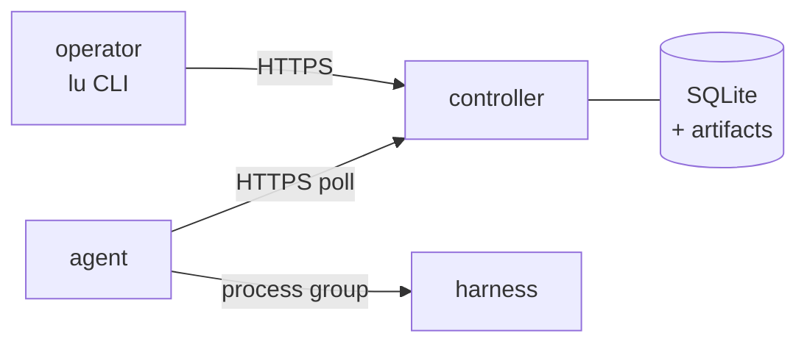

# lu

Lu is a small job queue for coding-agent work: an operator submits a repository, ref and task to a controller, and an agent on a peer checks out the repository, runs a harness under supervision, and uploads a diff, log and report. The controller keeps jobs in SQLite and serves a JSON API over HTTPS; one `lu` binary provides the controller, the operator CLI and, with the `tui` feature, a terminal dashboard. Agents dial out to the controller and poll for work; the controller never connects back to an agent.

## Architecture



The controller owns job state, leases, retry decisions and node cordons. An agent has one job slot in 0.1.0; it stages a fresh checkout, supervises the harness, and reports logs and artifacts back to the controller.

**Status:** controller, agent and operator CLI work end to end. A submitted job is leased to an agent, run by a harness under supervision, and finishes with a diff, a log and a report. See *Known gaps* below.

## Install

```sh
make build
make install
```

`make install` builds `lu` with the `tui` feature and installs it to `$(PREFIX)/bin`. `PREFIX` defaults to `/usr/local` for root and `$HOME/.local` otherwise; `DESTDIR` and `PREFIX` can be overridden. When run as root, `make install` also installs the systemd units from `contrib/` to `$(PREFIX)/lib/systemd/system`; `make uninstall` removes them again.

Configuration and operational details are in [docs/config.md](docs/config.md), [docs/operations.md](docs/operations.md) and [docs/security.md](docs/security.md). The HTTP contract is [docs/api.md](docs/api.md).

## Quick start

These steps run a controller and the operator CLI on one machine. Run them as your own user, not root. Replace `/home/you` with your home directory.

1. Generate one agent token and one operator token. The controller stores only their SHA-256 hashes, so keep the token files:

   ```sh
   umask 077
   mkdir -p "$HOME/lu-demo/artifacts"
   printf '%s' "$(head -c 32 /dev/urandom | base64)" > "$HOME/lu-demo/agent.token"
   printf '%s' "$(head -c 32 /dev/urandom | base64)" > "$HOME/lu-demo/operator.token"
   chmod 600 "$HOME/lu-demo/agent.token" "$HOME/lu-demo/operator.token"
   sha256sum "$HOME/lu-demo/agent.token" "$HOME/lu-demo/operator.token"
   ```

2. Write `$HOME/lu-demo/lu.toml`. Put the two hashes from `sha256sum` in the `token_sha256` fields:

   ```toml
   [controller]
   listen = "127.0.0.1:7600"
   db = "/home/you/lu-demo/lu.db"
   artifacts_dir = "/home/you/lu-demo/artifacts"

   [[controller.agents]]
   name = "node-a"
   token_sha256 = "<sha256 of agent.token>"

   [[controller.operators]]
   name = "ops"
   token_sha256 = "<sha256 of operator.token>"

   [log]
   level = "info"
   format = "text"
   stderr = true

   [service]
   shutdown_timeout_secs = 25
   ```

3. Check the config, then start the controller in the foreground:

   ```sh
   lu check --config "$HOME/lu-demo/lu.toml"
   lu serve --config "$HOME/lu-demo/lu.toml"
   ```

4. In a second shell, point the operator CLI at the controller and submit a job from a local git repository:

   ```sh
   export LU_URL=http://127.0.0.1:7600
   export LU_TOKEN_FILE="$HOME/lu-demo/operator.token"

   lu submit --repo /path/to/repository --ref main --task "run the test suite"
   lu ls
   lu show <job-id>
   lu logs <job-id>
   lu cancel <job-id>
   ```

   `lu submit` prints the new job id. With no agent running the job remains `queued`; `lu logs` is empty and `lu cancel` moves a queued job to `cancelled`.

5. Run an agent on the same machine. Write `$HOME/lu-demo/agent.toml` with an `[agent]` table (`name = "node-a"`, `controller_url = "http://127.0.0.1:7600"`, `token_file` pointing at `agent.token`, a `work_dir` under `lu-demo`, `harness = "opencode"`), then:

   ```sh
   lu agent --config "$HOME/lu-demo/agent.toml"
   ```

   In the other shell, `lu submit ... --wait` returns when the job is done, `lu logs --follow <job-id>` streams its output, and `lu fetch <job-id> --out results` saves the diff, log and report.

For a controller on a non-loopback address, add a `[tls]` table with `cert` and `key`; plain HTTP is accepted only on loopback. See [docs/config.md](docs/config.md).

## Commands

Global flags: `--config <path>` (default `lu.toml`), `--json` (print the raw controller JSON where the command supports it).

| Command | What it does |
| --- | --- |
| `lu check` | Parse and validate the config and TLS files, print a summary, exit. |
| `lu serve` | Run the HTTP(S) controller. This is the default when no subcommand is given. |
| `lu top` | Terminal dashboard demo, only in a build with `--features tui`; ignores `--config`. |
| `lu submit` | Submit a job. `--repo` and `--ref` are required; the task comes from `--task`, `--task-file`, or stdin. `--wait` polls until terminal. |
| `lu ls` | List jobs, newest first. Filters: `--state`, `--limit`. |
| `lu show <id>` | Show one job. |
| `lu logs <id>` | Print a job's stored log. `--follow` keeps reading until the job is terminal. |
| `lu fetch <id>` | Save `diff.patch`, `run.log` and `report.json` into `--out` (default `.`). Missing artifacts are skipped; existing files need `--force`. |
| `lu cancel <id>` | Ask the controller to cancel a job. |
| `lu nodes` | List known nodes. |
| `lu drain <node>` | Stop assigning new jobs to a node. |
| `lu undrain <node>` | Allow a drained node to take jobs again. |

Operator connection settings come from `LU_URL`, `LU_TOKEN_FILE` and optional `LU_CA_FILE`, or from the `[agent]` table in `--config`. The token file must be private (mode `0600` or tighter).

### Exit codes

| Code | Meaning |
| --- | --- |
| `0` | Success, or `submit --wait` / `logs --follow` ended in `done`. |
| `1` | Any error: bad config, connection or HTTP failure, no artifacts available, bad token file. |
| `2` | Command-line usage error (from clap). |
| `3` | `submit --wait` or `logs --follow` ended in `failed` or `cancelled`. |

## What it is not

- No web UI and no interactive attach to a running harness in 0.1.0.
- No push channel: agents poll the controller.
- One job per agent: `slots` is validated as exactly `1`.
- No controller-side provider credentials; provider authentication stays on the leaf in 0.1.0.

## Known gaps

- The agent runs the harness as its own user; see `docs/security.md`.
- The agent sends no provider health, so the controller does not yet steer around a cooling provider.
- `[service].shutdown_timeout_secs` is validated but not applied; the listener drains for a fixed 10 seconds.

## Crates

| Crate | Purpose |
| --- | --- |
| `lu-config` | validated TOML config |
| `lu-auth` | hashed bearer tokens, constant-time match, per-address failure throttle |
| `lu-serve` | HTTP(S) listener with connection caps, request ids and drain on shutdown |
| `lu-tui` | terminal view (feature `tui`, off by default) |
| `lu-proto` | wire types: job spec, states, events, limits, output sanitising |
| `lu-store` | the controller's SQLite store: jobs, leases and fencing epochs, retries, idempotency, cordons |
| `lu-supervise` | harness supervision in a process group, with timeouts and capped output |
| `lu-staging` | per-job checkout, diff export, artifact caps, safe cleanup |
| `app` | the `lu` binary |

MIT. See `LICENSE`.
