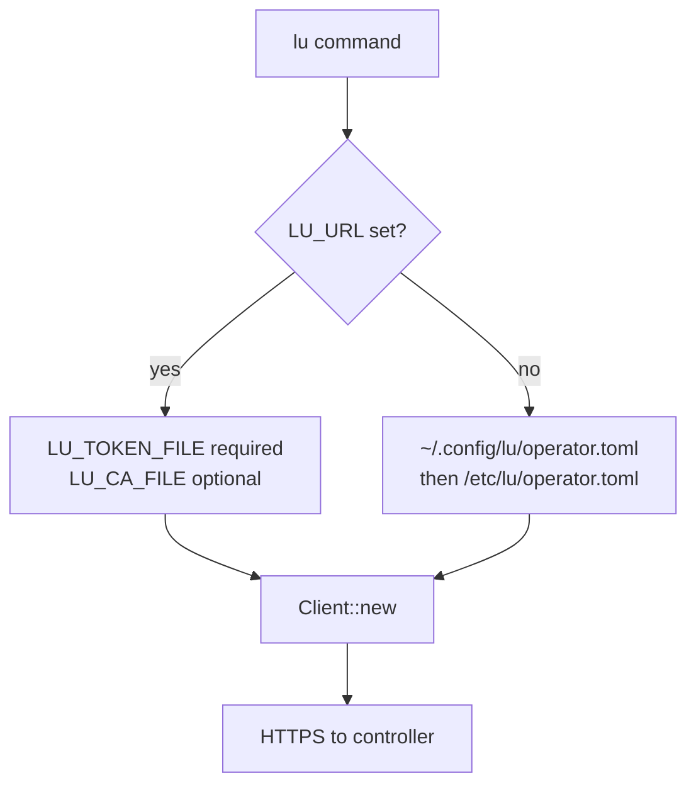

# CLI and MCP clients

`lu` is the controller, the operator CLI and the `lu mcp` server; `ting` is the node agent. Operator
commands and `lu mcp` use the same operator connection settings. Route payloads are in
[HTTP API](api.md) and config keys in [Configuration](config.md).

## Client guide



| Source | Fields | Notes |
| --- | --- | --- |
| Environment | `LU_URL`, `LU_TOKEN_FILE`, optional `LU_CA_FILE` | `LU_TOKEN_FILE` is required when `LU_URL` is non-empty. Highest precedence. |
| Operator file | `url`, `token_file`, optional `ca_file` | `$XDG_CONFIG_HOME/lu/operator.toml` (or `~/.config/lu/operator.toml`), then `/etc/lu/operator.toml`. A leading `~/` expands. |

The token file is read once. It must be a regular file owned by the effective user, with no group
or other bits, no symlink or FIFO, and at most 8 KiB; trailing CR/LF is trimmed. `ca_file` adds up
to 1 MiB of PEM certificates to the system roots. Plain `http` is accepted only on loopback;
redirects are refused.

There is no fallback to `[agent]` in `--config`: an agent token is never attached to an operator
request. With neither source set, the CLI exits non-zero and names `LU_URL`, `LU_TOKEN_FILE`,
optional `LU_CA_FILE`, and the `url` and `token_file` keys of an operator file. An agent token on an
operator route gets the ordinary wrong-scope `401`.

```sh
export LU_URL=https://lu.example.net:7600
export LU_TOKEN_FILE=/etc/lu/operator.token
lu status
lu ls --state queued --limit 20
```

### Command map

Global flags: `--config <path>` (default `lu.toml`) and `--json` (raw controller JSON where
supported). The full command and flag table is in the [README](../README.md#commands).

| Command | Worked example | Result |
| --- | --- | --- |
| `lu check` | `lu check --config /etc/lu/lu.toml` | Same value validation as `lu serve`, then summary and read-only database health; no secret files or TLS material are opened and no port is bound. |
| `lu serve` | `lu serve --config /etc/lu/lu.toml` | Runs the HTTP listener; default with no subcommand. |
| `lu status` | `lu status --json` | Uptime, schema, db size, queue and node counts. |
| `lu submit` | `lu submit --repo /srv/app --ref main --task-file task.txt --wait` | Submits a job and waits for a terminal state. |
| `lu submit --batch` | `lu submit --batch ./tasks --key-prefix release-1 --defaults ./defaults.toml` | Submits one idempotent job per task; see [Submitting work](submitting.md#batch-submissions). |
| `lu retry` | `lu retry 01AR... --provider peer-a --key retry-2` | Requeues a terminal job in place, keeping its id. |
| `lu ls`, `lu show` | `lu show 01AR...` | Job list and one job with its dependencies. |
| `lu graph` | `lu graph 01AR...` | Horizontal dependency graph for one component. |
| `lu logs`, `lu fetch` | `lu fetch 01AR... --out results` | Read the log and save `diff.patch`, `run.log` and `report.json`. |
| `lu cancel` | `lu cancel 01AR... --keep-dependents` | Request cancellation. |
| `lu nodes`, `lu node` | `lu node node-a --workspaces` | Node state, stats, cordons and workspaces. |
| `lu drain`, `lu undrain`, `lu uncordon` | `lu uncordon node-a peer-a` | Change dispatch state; see [Dispatch](dispatch.md#cordons). |
| `lu repos`, `lu sync` | `lu sync app` | List or refresh controller repository mirrors. |
| `lu backup`, `lu restore` | `lu backup --out /var/backups/lu/lu.db` | Database snapshot and install; see [Operations](operations.md#backup-and-restore). |
| `lu mcp` | `lu mcp` | MCP server over stdio; see [MCP server](#mcp-server). |
| `ting` | `ting --config /etc/ting/ting.toml` | Runs the node poll loop and self-service commands; see [ting reference](#ting-reference). |
| `lu top` | `lu top --once` | Terminal dashboard; requires a `tui` build. |

`--repo` and `--ref` are required for single-task `submit`. The task comes from `--task`,
`--task-file` or stdin. Repeat `--after <id>` or `--after-key <key>` for dependencies (16 total),
and `--require <label>` for node labels (8 total). `--collect` selects `none`, `files`, `apply` or
`both` (default `apply`); `--workspace` selects a [workspace policy](workspaces.md). A dependency
chain by key:

```sh
lu submit --key build --repo /srv/app --ref main --task "build"
lu submit --key test --after-key build --repo /srv/app --ref main --task "test"
lu show 01ARZ3NDEKTSV4RRFFQ69G5FAV
```

`lu retry <predecessor>` requeues a failed predecessor and restores waiting dependents;
`--chain` also restores blocked dependents transitively without changing their ids. A plain
`lu cancel` cancels waiting dependents unless `--keep-dependents` is set. See
[Dependencies](dependencies.md#waiting-and-promotion).

### Client behaviour and exit codes

| Area | Behaviour |
| --- | --- |
| Authentication | Every request carries `Authorization: Bearer <token>`. Missing, unknown and wrong-scope tokens return `401`. |
| Idempotency | Submit sends `Idempotency-Key` when the spec has a key. The same key and spec returns the existing job; a different spec is `409 conflict`. |
| Uploads | Agent log and artifact uploads use `Content-Type: application/octet-stream`. Log appends use the current stored offset. |
| Redirects | Never followed; a `3xx` becomes an error so the token cannot leak through `Location`. |
| Retries | Failed GETs and retryable reads get up to 3 attempts for network failures, `429` and `5xx`, with backoff from 100 ms. A `429` reports `Retry-After`. |
| Bodies | JSON responses are capped at 8 MiB (JSON request bodies at 1 MiB); artifacts use per-file caps of 10 MiB diff, 50 MiB log and 1 MiB report. |
| Secrets | The token is redacted from `Debug` output and error text, including text echoed by a hostile controller. |

`lu logs --follow` reads pages with `wait=25` and stops when the controller's `X-Lu-State` is
terminal.

| Code | Meaning |
| --- | --- |
| `0` | Success, or a waited or followed job ending in `done`. |
| `1` | Config, connection, HTTP, token-file or artifact error, including a batch that fails after submission. |
| `2` | Usage error, unknown `--after-key`, batch validation error, or `retry` on a non-terminal job. |
| `3` | A waited or followed job ended `failed` or `cancelled`. |

For symptom-first checks see [Troubleshooting](troubleshooting.md); for install steps see
[Install](install.md).

## ting reference

`ting` runs the node agent. Its self-service commands use the node's own config and token, so an
operator token is not needed to drain a node for maintenance. HTTP views are in
[HTTP API](api.md#agent) and the update sequence is in the
[README](../README.md#updating-a-node).

```text
ting [OPTIONS] [COMMAND]
```

With no subcommand, `ting` runs the agent loop. With `mcp`, it serves the credential-free scoped
server for a job harness; see [Scoped MCP](#scoped-mcp-ting-mcp). Other subcommands talk to the
controller with the node's token. `--config <PATH>` is global and defaults to
`/etc/ting/ting.toml`.

The config needs an `[agent]` table with `name`, `controller_url`, `token_file`, `work_dir` and
`harness`; `ca_file` is optional. The token file follows the private-file rules above and is never
printed. Keys are in [Configuration](config.md#agent).

| Command | Meaning |
| --- | --- |
| `ting drain` | Stop assigning new jobs to this node. Idempotent; a running job finishes and an operator-owned drain is left as it is. |
| `ting undrain` | Clear a drain this node started; an operator-owned drain returns a conflict and stays. |
| `ting status [--json]` | `GET /v1/agent/self`. Plain output is `NAME: version=… draining=… current_job=… last_heartbeat_age_secs=… online=…`. |
| `ting wait-idle --timeout <DURATION>` | Poll once a second until drained and holding no job; a positive number of seconds or an `s`/`m`/`h` suffix. |
| `ting mcp` | Serve the scoped harness server over stdio; no controller config or token is read. |
| `ting --help`, `ting <command> --help` | Print clap help and exit `0`. |

The node name is never accepted as an argument: self-service routes bind it to the token.
Unexpected query strings and body fields are refused with `400 bad_request`. The stable
`status --json` object has exactly these fields in this order, with `null` for unknown values:

```json
{"name":"node-a","version":"0.5.1","draining":true,"current_job":null,"last_heartbeat_age_secs":2,"online":true}
```

No token, path or other node's data appears in that output; the controller calls it
`AgentSelfView` ([API](api.md#agentselfview)).

| Code | Meaning |
| --- | --- |
| `0` | Success, including `wait-idle` reaching a drained and idle node. |
| `1` | Runtime or controller error: bad token contents at request time, connection or HTTP error, request timeout, or encode/decode failure. |
| `2` | Config or usage error: missing config, missing `[agent]`, unreadable token, invalid URL or `--timeout`, or clap usage error. |
| `3` | `wait-idle` timed out before the node was both drained and idle. |

Errors print one line on stderr prefixed `ting: ` and never include a token.

```sh
ting drain --config /etc/ting/ting.toml
ting wait-idle --timeout 10m --config /etc/ting/ting.toml
# stop the old service, replace the binary, start the new service
ting status --json --config /etc/ting/ting.toml
ting undrain --config /etc/ting/ting.toml
```

A failed update leaves the node drained. From the operator host, `lu nodes --json` shows
`drain_origin`, so an operator can see whether a drain belongs to the agent or the operator; only
operator routes can clear an operator-owned drain.

## MCP server

`lu mcp` serves Lu tools over newline-delimited JSON-RPC 2.0 on stdio with the operator connection
above. An unreachable controller still lets the server start: each call then returns an `isError`
result with the connection error.

### Protocol

| Item | Value |
| --- | --- |
| Framing | One JSON object per line on stdin/stdout. |
| Versions | `2024-11-05`, `2025-03-26`, `2025-06-18` (default); an unknown version falls back to the newest. |
| Methods | `initialize`, `ping`, `tools/list`, `tools/call`. Calls before `initialize` get `-32002`. |
| Notifications | Requests without `id` get no reply, including `notifications/initialized`. |
| Argument faults | JSON-RPC `-32602` for unknown, missing or badly typed arguments. |
| Tool failures | A normal result with `isError: true`; text and `structuredContent` carry the reason. |
| Other errors | `-32601` unknown method, `-32600` invalid request, `-32700` parse error. |

```json
{"jsonrpc":"2.0","id":1,"method":"initialize","params":{"protocolVersion":"2025-06-18"}}
{"jsonrpc":"2.0","id":2,"method":"tools/list","params":{}}
```

A successful reply carries text and `structuredContent`:

```json
{"jsonrpc":"2.0","id":1,"result":{"content":[{"type":"text","text":"version 0.4.0 ..."}],"isError":false,"structuredContent":{"version":"0.4.0"}}}
```

### MCP tools

`readOnlyHint: true` is set on the nine read tools; `lu_cancel`, `lu_drain`, `lu_undrain` and
`lu_uncordon` carry `destructiveHint: true`. `?` marks an optional argument.

| Tool | Arguments | Effect |
| --- | --- | --- |
| `lu_status` | none | Version, uptime, schema, db size, job and node counts. |
| `lu_jobs` | `state?`, `limit?` 1–100, default 20 | Compact newest-first job list. |
| `lu_job` | `id` | Full job detail, spec and artifacts. |
| `lu_logs` | `id`, `lines?` 1–400, default 80 | Log tail with escape sequences removed. |
| `lu_nodes` | none | Node states, providers, cordon details, load, labels, version and disk. |
| `lu_node` | `node` | One node's state and stats. |
| `lu_graph` | none | Dependency graph of unfinished jobs. |
| `lu_result` | `id`, `offset?`, `max_bytes?` 1–32768, default 24576 | Summary, report, diff stats and a page of diff text. |
| `lu_drafts` | `limit?` 1–100, default 20 | Operator-only draft inventory; job-scoped agent paths cannot see drafts. |
| `lu_submit` | `repo`, `ref`, `task`; optional `provider`, `model`, `priority`, `group`, `require`, `fallbacks`, `collect`, `include_failed`, `on_conflict`, `on_stuck`, `stuck_after`/`stuck_after_secs`, `after`, `after_keys`, `timeout`/`timeout_secs`, `idle_timeout`/`idle_timeout_secs`, `harness`, expectation fields, `key` | Submit one job. |
| `lu_submit_many` | `jobs[]` 1–12 with `name`, `repo`, `ref`, `task`, optional scheduling and spec fields, and `after_names` | Submit named jobs in order. |
| `lu_submit_batch` | `path`, `key_prefix`; optional `repo`, `ref`, `defaults`, `chain`, `max_parallel`, `dry_run` | Submit one job per task in a directory or checklist on the MCP host; see [Batches](#batches). |
| `lu_cancel` | `id` | Request cancellation. Destructive. |
| `lu_retry` | `id`; optional spec fields as on `lu_submit` | Requeue a terminal job in place, keeping its id. |
| `lu_drain`, `lu_undrain` | `node` | Stop or resume assigning jobs to a node. Destructive. |
| `lu_uncordon` | `node`, `provider?` | Clear one or all cordons on a node. Destructive. |

`require` holds at most 8 labels, `fallbacks` at most 4 choices, and `after`/`after_keys`/
`after_names` at most 16 entries. Timeouts are 1–86400 seconds; `timeout` and `idle_timeout` win
over their `_secs` spellings. `collect` selects `none`, `files`, `apply` or `both`, and `harness`
defaults to `opencode`. Expectation lists hold at most 16 entries; `expect_mode` is `suspect` or
`fail`. `priority` is 0 to 9 (default 5) and `group` is a 1–64 character concurrency group.
`on_stuck` is `none`, `cancel` or `retry`, with `stuck_after` from 60 to 86400 seconds.
On `lu_retry`, absent fields inherit the source spec; present lists replace stored lists and
present bounds or modes are set.

```json
{"jsonrpc":"2.0","id":3,"method":"tools/call","params":{"name":"lu_submit","arguments":{"repo":"/srv/app","ref":"main","task":"run the test suite"}}}
```

Without `key`, the server derives `mcp-` plus 16 hex characters of the spec's SHA-256, so repeated
calls target the same job.

### Batches

`lu_submit_many` validates names before sending: empty names, duplicates, unknown `after_names`,
forward references and cycles are rejected without a partial submission. A controller failure
partway through returns `isError: true` with `submitted` and `not_submitted`.

```json
{"jsonrpc":"2.0","id":4,"method":"tools/call","params":{"name":"lu_submit_many","arguments":{"jobs":[
  {"name":"build","repo":"/srv/app","ref":"main","task":"build"},
  {"name":"test","repo":"/srv/app","ref":"main","task":"test","after_names":["build"]}
]}}}
```

`lu_submit_batch` reads a directory or checklist from the MCP host's filesystem; `path` and
`key_prefix` are required. `chain` depends each job on all earlier ones and `max_parallel` (1–64)
sets a runtime group cap. `dry_run` returns the plan in `structuredContent` without contacting the
controller or reading a token. Input rules, defaults and sidecars are in
[Submitting work](submitting.md#batch-submissions).

```json
{"jsonrpc":"2.0","id":5,"method":"tools/call","params":{"name":"lu_submit_batch","arguments":{
  "path":"/srv/app/tasks/release.md",
  "key_prefix":"release-1",
  "defaults":"/srv/app/tasks/defaults.toml",
  "chain":true
}}}
```

`lu_result` caps the whole result at 32 KiB and shrinks the diff page until text and structured
JSON fit, so `next_offset` never skips unseen bytes. `done` is true when there is no next offset;
an unfinished job returns its state with `done: false`. Other tools cap each part at about 10 KiB
and add `[cut]` when shortened. Tool text is cleaned to printable characters, and log tails also
have ANSI sequences removed.

### Scoped MCP: `ting mcp`

`ting mcp` is a separate stdio server for a harness inside a job. It reads `LU_JOB_SOCKET`, the
agent's per-job Unix socket, and sends no operator or agent token. An opencode configuration uses:

```toml
mcp = { lu = { command = ["ting","mcp"] } }
```

It serves six tools, each mapped to one scope route:

| Tool | Effect |
| --- | --- |
| `job_context` | Own spec, state and dependency status; no other job's task text. |
| `submit_child` | Submit one clamped child job; needs the parent's `allow_spawn`. |
| `list_children` | Direct children's state, failure class and short summary. |
| `get_child` | One direct child's state, failure class and short summary. |
| `get_child_artifact` | A child's `diff.patch` or `report.json`, re-scrubbed on read. |
| `cancel_child` | Cancel one direct child and its descendants. |

No status, node, log, draft, drain, audit or metrics tool is available here, including
`lu_drafts`. The server refuses to start when operator credentials are visible in `LU_URL`,
`LU_TOKEN_FILE` or the standard operator files, and names the source it found. Child output is
marked as untrusted data and every result carries `source: "child_job"`. `lu mcp` is unchanged:
it keeps the operator connection and the full tool list. Checks, limits and the socket are in
[Job-scoped capability](scope.md); the HTTP envelope is in [HTTP API](api.md#job-scoped-routes).

### MCP limits and failures

| Condition | Result |
| --- | --- |
| More than 30 submissions in a rolling minute | `isError: true` with seconds to wait; `lu_submit`, `lu_submit_many`, `lu_submit_batch` and `lu_retry` share the budget. |
| Batch larger than the remaining budget | No request is sent; the error says to wait. |
| Unknown tool or bad arguments | JSON-RPC `-32602`. |
| Job or controller failure | `isError: true`, with the reason in `structuredContent.error`. |
| No controller connection at startup | Every call returns `isError: true` with the stored connection error. |

The operator token is used only for controller requests and never appears in tool results.
Worked diagnostics are in [Troubleshooting](troubleshooting.md#mcp).
