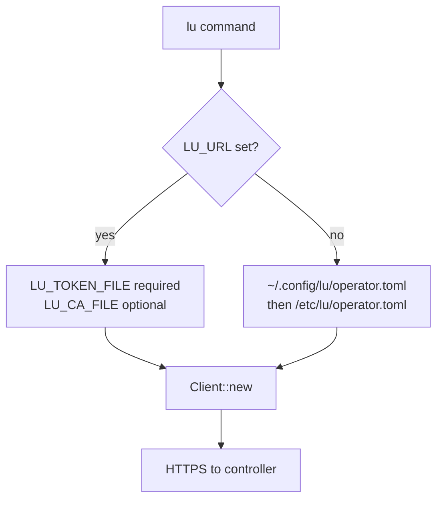

# Client guide

One `lu` binary is the controller, the operator CLI, the node agent and the MCP server. Operator commands and `lu mcp` use `lu-client` to talk to the controller. This page covers connection setup, commands, client behaviour and exit codes. Route payloads are in [api.md](api.md); config keys are in [config.md](config.md).

## Connection settings



| Source | Fields | Notes |
| --- | --- | --- |
| Environment | `LU_URL`, `LU_TOKEN_FILE`, optional `LU_CA_FILE` | `LU_TOKEN_FILE` is required when `LU_URL` is non-empty. Highest precedence. |
| Operator file | `url`, `token_file`, optional `ca_file` | `$XDG_CONFIG_HOME/lu/operator.toml` (or `~/.config/lu/operator.toml`), then `/etc/lu/operator.toml`. A leading `~/` in a path expands. `--config` is not a credential source. |

The token file is read once. It must be a regular file owned by the effective user, with no group or other permission bits, no symlink or FIFO, and at most 8 KiB; trailing CR/LF is trimmed. `ca_file` adds up to 1 MiB of PEM certificates to the system roots. Plain `http` is accepted only on loopback; use `https` for any other host. Redirects are refused.

There is no fallback to `[agent]` in `--config`: an agent token is never attached to an operator
request. With neither source set, the CLI exits non-zero and names `LU_URL`, `LU_TOKEN_FILE`,
optional `LU_CA_FILE`, and the `url` and `token_file` keys of an operator file. An agent token on
an operator route gets the ordinary wrong-scope `401`.

Worked example — environment connection:

```sh
export LU_URL=https://lu.example.net:7600
export LU_TOKEN_FILE=/etc/lu/operator.token
lu status
lu ls --state queued --limit 20
```

## Command map

Global flags: `--config <path>` (default `lu.toml`) and `--json` (raw controller JSON where supported).

| Command | Worked example | Result |
| --- | --- | --- |
| `lu check` | `lu check --config /etc/lu/lu.toml` | Runs the same value validation as `lu serve`, then prints the summary, read-only database health and the checks it ran; no secret files or TLS material are opened, no port is bound and the database is not opened for write. |
| `lu serve` | `lu serve --config /etc/lu/lu.toml` | Runs the HTTP listener; default when no subcommand is given. |
| `lu status` | `lu status --json` | Uptime, schema, db size, queue and node counts. |
| `lu submit` | `lu submit --repo /srv/app --ref main --task-file task.txt --wait` | Submits a job and waits for a terminal state. |
| `lu submit --batch` | `lu submit --batch ./tasks --key-prefix release-1 --defaults ./defaults.toml` | Submits one idempotent job per task in a directory or checklist. |
| `lu retry` | `lu retry 01AR... --provider anthropic --key retry-2` | Requeues a failed, cancelled, expired or deadline-missed job in place and prints `retried <id>; requeued N dependents`; `--chain` restores blocked dependents transitively. |
| `lu ls` | `lu ls --state failed --limit 10` | Newest-first job list. |
| `lu show` | `lu show 01AR...` | One job plus each dependency and its state. |
| `lu graph` | `lu graph 01AR...` | Horizontal dependency graph for one component, with task titles. |
| `lu logs` | `lu logs 01AR... --follow` | Streams until the job reaches a terminal state. |
| `lu fetch` | `lu fetch 01AR... --out results` | Writes `diff.patch`, `run.log` and `report.json`. |
| `lu cancel` | `lu cancel 01AR...` | Requests cancellation; `--keep-children` leaves descendants running, `--keep-dependents` leaves blocked dependents waiting. |
| `lu nodes` | `lu nodes --json` | Full node views, including cordon details and labels. |
| `lu node` | `lu node node-a --workspaces` | Latest host and job stats, workspace counters and cordon details; `--workspaces` lists job state, bytes, age and policy, and `clean --all`/`clean --job <key>` queues workspace deletion. |
| `lu uncordon` | `lu uncordon node-a zen` | Clear one provider cordon, or every cordon when the provider is omitted. |
| `lu drain` / `lu undrain` | `lu undrain node-a` | Stop or resume assigning jobs to a node. |
| `lu repos` / `lu sync` | `lu sync app` | List or refresh controller repository mirrors. |
| `lu backup` / `lu restore` | `lu backup --out /var/backups/lu/lu.db` | Database snapshot and install. See [operations.md](operations.md). |
| `lu mcp` | `lu mcp` | MCP server over stdio. See [mcp.md](mcp.md). |
| `ting` | `ting --config /etc/ting/ting.toml` | Runs the node poll loop; needs an `[agent]` config. |
| `lu top` | `lu top --once` | Terminal dashboard; requires a `tui` build. |

`--repo` and `--ref` are required for single-task `submit`. The task comes from `--task`, `--task-file` or stdin. Repeat `--after <id>` or `--after-key <key>` for dependencies (16 total), and `--require <label>` for node labels (8 total). `--collect` controls dependency inputs (`none`, `files`, `apply`, `both`; default `apply`). `--workspace <policy>` selects `ephemeral`, `keep_on_failure` or `keep`; repeatable `--cache-dir <relative/path>` creates build-cache directories inside the job's workspace. See [workspaces.md](workspaces.md).

With `--batch <path>`, `submit` reads a directory of task files or a Markdown checklist instead of one task. `--key-prefix` is required; each key is `<prefix>-<slug>`. `--defaults <file.toml>` supplies shared fields, `--chain` depends each job on all earlier ones, `--max-parallel N` sets a runtime group cap, and `--dry-run` prints the plan without contacting the controller or reading the token. Validation covers the whole input before any job is sent. See [Batch submissions](batch.md).

Worked example — dependency chain by key:

```sh
lu submit --key build --repo /srv/app --ref main --task "build"
lu submit --key test --after-key build --repo /srv/app --ref main --task "test"
lu show 01ARZ3NDEKTSV4RRFFQ69G5FAV
```

Each `submit` prints its new job id; use that id with `lu show`. For a chain blocked by a failed
predecessor, `lu retry <predecessor>` requeues that job in place and restores its waiting dependents
after it, while `lu retry <predecessor> --chain` restores blocked dependents transitively without
changing their ids.
A plain `lu cancel` cancels
the waiting dependents too; `lu cancel --keep-dependents` leaves them blocked. See
[Dependencies](dependencies.md#waiting-and-promotion).

## Client behaviour

| Area | Behaviour |
| --- | --- |
| Authentication | Every request carries `Authorization: Bearer <token>`. Missing, unknown and wrong-scope tokens return `401`. |
| Idempotency | Submit sends `Idempotency-Key` when the spec has a key. Same key and spec returns the existing job; same key and different spec is `409 conflict`. |
| Uploads | Agent log and artifact uploads use `Content-Type: application/octet-stream`. Log appends must use the current stored offset. |
| Redirects | Never followed; a `3xx` becomes an error so the token cannot leak through `Location`. |
| Retries | Failed GETs and other retryable reads are retried up to 3 attempts for network failures, 429 and 5xx, with exponential backoff from a 100 ms base (first retry waits 200 ms, then 400 ms). A 429 error reports `Retry-After` seconds. |
| Bodies | JSON responses are capped at 8 MiB (the controller caps JSON request bodies at 1 MiB); artifacts use their per-file caps (10 MiB diff, 50 MiB log, 1 MiB report). |
| Secrets | The token is redacted from `Debug` output and error text, including text echoed by a hostile controller. |

`lu logs --follow` reads pages with `wait=25` and stops when the controller's `X-Lu-State` is terminal. Exit `0` means the job ended `done`; exit `3` means `failed` or `cancelled`.

## Exit codes

| Code | Meaning |
| --- | --- |
| `0` | Success, or a followed job ending in `done`. |
| `1` | Config, connection, HTTP, token-file or artifact error. |
| `2` | Usage error, unknown `--after-key`, batch validation error, or `retry` on a non-terminal job. |
| `3` | A waited or followed job ended `failed` or `cancelled`. |

A batch that fails at the controller after validation prints the completed rows and exits `1`. The submitted jobs keep their keys, so a retry finishes the remaining work.

For symptom-first checks, see [troubleshooting.md](troubleshooting.md). For install steps, see [install.md](install.md).
