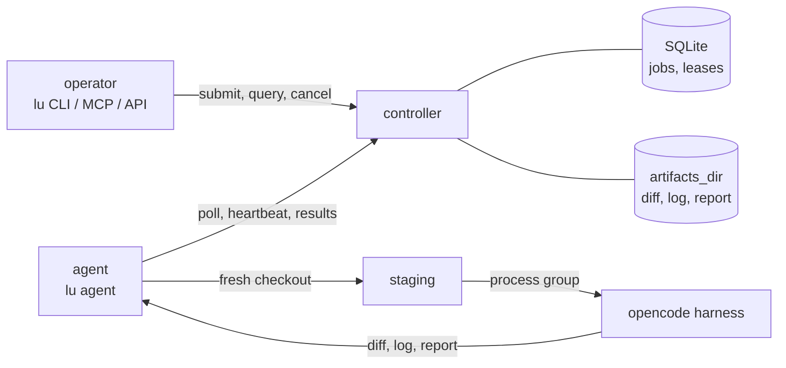

# Concepts

Lu coordinates finite coding-agent jobs around git repositories. The controller is the only
writer of job state; agents poll it for work, run a harness locally and report back. Operators
submit jobs and read results through the same HTTP API the CLI uses.

The controller never connects to an agent. Agents dial out with a token bound to their node name,
and operators dial out with a separate token. Both scopes are checked against SHA-256 hashes held
by the controller; see [Tokens and TLS](tokens-and-tls.md).

## Glossary

| Term | Meaning |
| --- | --- |
| **Job** | A persisted record with a 26-character id, a state, an `attempt` and an `epoch`. It is created from a spec and finishes `done`, `failed` or `cancelled`. |
| **Spec** | The immutable request: repository, git ref, task text, harness, optional provider/model, timeouts, `after` dependencies, required labels, idempotency key and `stack_dependencies`. |
| **Controller** | The HTTP(S) service that owns state, leases, retries, node cordons, mirrors and artifacts. Job records live in SQLite; artifact files live under `artifacts_dir`. |
| **Agent / node** | A named `lu agent` process. It has one job slot in this version, advertises labels, renews leases and stages each job in its own work directory. The agent token is bound to that node name. |
| **Operator** | Any caller using the operator API: `lu` commands, `lu mcp` tools or a direct HTTP client. Operator tokens are a separate scope. |
| **Harness** | The process that does the coding. This tree builds `opencode run [--server URL] --auto [-m MODEL] -f TASKFILE MESSAGE`; an optional `harness_wrapper` can prefix that command. |
| **Artifacts** | Exactly three controller-named files per job: `diff.patch`, `run.log` and `report.json`. Paths are `<job id>/<file name>`, so an agent cannot choose them. |
| **Lease** | A time-limited claim on a job. Assignment sets the node and starts the lease; a missed renewal moves the job to `recovering`. |
| **Epoch** | A fencing counter incremented on each assignment. Agents must present the current epoch when starting, renewing, uploading or completing; stale writes are refused. |
| **Dependency** | An `after` entry naming a job that must be `done` before this job can run. Dependencies can also be stacked as patches; see [Dependencies](dependencies.md). |
| **Label** | An opaque string (at most 64 bytes). Agents advertise labels; jobs require them; dispatch compares them exactly. Lu never interprets their meaning. |
| **Cordon** | A `(node, provider)` suppression after a provider failure. Dispatch skips that pair until the cordon expires or live health clears a Reiki-derived cordon. |
| **Idempotency key** | A stable name for a spec. Re-submitting the same key and spec returns the existing job; the same key with a different spec is a conflict. |
| **Recovery grace** | The window after a lease loss in which the original agent may renew and resume. After it expires, the controller requeues the job or fails it with a node failure. |

## Who decides what

| Concern | Owner | Where to read more |
| --- | --- | --- |
| State and legal transitions | Controller's store | [Job Lifecycle](lifecycle.md) |
| Which queued job goes to which agent | Controller dispatch, using labels, provider cordons, drain state and one-job-per-agent | [Job Lifecycle](lifecycle.md) |
| Retry versus terminal failure | Controller, from the reported failure class and attempt count | [Job Lifecycle](lifecycle.md) |
| Checkout, dependency patch stacking and harness supervision | Agent | [Dependencies](dependencies.md) |
| Authentication, TLS and token storage | Controller config, agent and operator clients | [Tokens and TLS](tokens-and-tls.md) |
| HTTP routes and response shapes | Controller API | [HTTP API](api.md) |

## A job's short life

1. An operator submits a spec. The controller creates a job as `queued`, or `blocked` if any
   dependency is unfinished.
2. An idle, non-draining agent with matching labels and provider availability polls. Dispatch
   moves the job to `leased`, sets the node, increments the epoch and starts the lease.
3. The agent stages a fresh checkout, optionally applies dependency diffs, starts the harness and
   moves the job to `running`. Heartbeats renew the lease.
4. The harness exits, times out or is cancelled. The agent uploads artifacts and reports an
   outcome. The controller either finishes the job, requeues it or cascades a failure to
   dependents.

The job row is the current truth. `lu show` prints that row; `lu logs` reads the stored
`<job id>/run.log` file, whose accepted length is tracked in the job's `log_len`. `lu top` adds a
live view of nodes and recent jobs; with the `tui` feature it can also draw the dependency graph.
