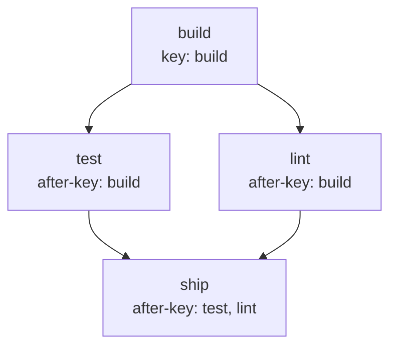

# Dependencies

A job can wait for earlier jobs and, by default, build on their diffs. Dependencies are supplied
at submission and can be changed later with `lu edit`; `lu retry` can also replace the whole list
when it resubmits a finished job.



## Declaring dependencies

```sh
lu submit --key build --repo /home/you/src/demo --ref main --task "build"

lu submit --key test --after-key build \
  --repo /home/you/src/demo --ref main --task "test"

lu submit --key ship --after-key test --after-key lint \
  --repo /home/you/src/demo --ref main --task "ship"
```

- `--after <job-id>` and `--after-key <key>` are repeatable and can be combined. A key resolves
  to the newest job submitted with it. IDs found through keys are appended only if not already
  present.
- A spec may name at most 16 dependencies. Duplicate IDs, unknown IDs and dead dependencies are
  rejected. An unknown `--after-key` is a CLI usage error (exit 2); an unknown ID from the API is
  `422 unknown dependency <id>`.
- A dependency that is already `failed` or `cancelled` is rejected with
  `422 dependency <id> already failed or was cancelled` unless the new spec sets
  `include_failed: true`. With that opt-in the dead dependency is accepted, the dependent starts
  `queued` when the rest of its dependency set is ready, and a later dependency failure releases
  the dependent instead of failing it with `failure_class: "dependency"`.
- `lu retry <id> --after ... --after-key ...` replaces the dependency list on the new job. An old
  job must be terminal first.

## Waiting and promotion

A new job is `queued` when every dependency is `done`, otherwise `blocked`. `lu ls` shows the
number of unfinished dependencies in its `AFTER` column (`-` for none); `lu show` prints one
`after  <id>  <state>` line per dependency, marking those still awaited with `(waiting)`.

When a job completes `done`, the controller moves each blocked direct dependent whose entire
dependency set is now `done` to `queued`. When a job finishes `failed` or `cancelled`, the
controller recursively fails its blocked dependents with `failure_class: "dependency"` and a
summary of the form `dependency <id> <state>`. Those failures cascade in turn; no agent runs and
no dependency patch is applied for such a dependent.

## Stacking dependency diffs

By default the agent stages the dependent's base tree, then fetches each dependency's
`diff.patch` in `after` order and applies it to that tree. Empty or missing diffs are skipped.
The harness then runs on the combined tree, and the dependent's exported diff includes the
applied dependency changes. The list of applied dependency ids is recorded in `report.json` under
`applied_dependencies`.

If a dependency patch cannot be applied, the job finishes `failed` with
`failure_class: "conflict"` and a summary such as:

```text
dependency <id> could not be applied; conflicts: src/main.rs, tests/main.rs
```

An unreadable or otherwise invalid patch is also a conflict; its detail is appended to the
summary instead of a path list. Patches applied before the failing one remain in the exported
diff and are listed in `applied_dependencies`.

Pass `--no-stack` to set `stack_dependencies: false`. The job still waits for its dependencies,
but the harness runs on the dependent's own base tree alone and no dependency diffs are applied.

## Collecting inputs

`--collect <mode>` stages dependency artifacts under `.lu/inputs` before the harness starts. The
modes are `none` (default), `files`, `apply` and `both`; aliases `off`, `false`, `diffs`, `diff`,
`patches` and `patch` are accepted. An explicit `collect` wins over `stack_dependencies`, so
`--no-stack --collect files` collects files without applying diffs. When `collect` is absent,
`stack_dependencies` keeps its old meaning: `true` behaves like `apply`, `false` like `none`.
`apply` and `both` use the existing stacking path; in this part of the design neither applies a
dependency diff that was not already applied by `stack_dependencies`.

Inputs are the job's `after` dependencies. A `done` dependency is always an input. A `failed` or
`cancelled` dependency becomes an input only when `--include-failed` is set and that job stored a
`diff.patch`; without the opt-in, a dead dependency still fails its dependents as described above.
`--include-failed` is also accepted by `lu retry` and `lu edit`. At most 16 inputs and 64 MiB of
stored diffs are allowed; the controller checks the limit at submit time when sizes are known and
the agent re-checks it before staging.

With `files` or `both`, the agent writes `.lu/inputs/INDEX.md` and one directory per input, named
from a safe idempotency key (or a short job id, with `-2`, `-3`, … for duplicates). Each directory
contains `diff.patch`, `report.json`, `run.log` and `meta.json`. `INDEX.md` lists the key, job id,
state, node, failure class, changed-file count and diff bytes; `run.log` keeps only the last
256 KiB and the index notes when a log was capped. Files are `0600`, directories `0700` and
symlinks are refused. Text from another job is untrusted: it is sanitised in the index and never
used as a path or command. `.lu` is added to `.git/info/exclude` and stripped from the exported
`diff.patch`; a tracked `.lu` path is a staging error rather than being silently removed.

## Viewing the graph

`lu graph [job]` draws components that contain at least one unfinished job, newest component
first. Nodes are ordered newest first within a component and placed left to right by dependency
depth; edges point from a prerequisite to the job that names it. A job id selects that job's
component even if every job in it is finished. Display is capped at 6 components and 40 jobs,
with a note when anything is hidden.

A node's title is the first non-empty line of its task, with leading `#` heading marks and a
`Task:` or `task:` prefix removed. Colour is used only when stdout is a terminal and `NO_COLOR`
is unset. `lu graph --json` prints:

```json
{"nodes":[{"id":"...","state":"queued","title":"...","after":["..."]}]}
```

`lu top` and the TUI dashboard also expose the graph panel; press `g` to toggle it there.
