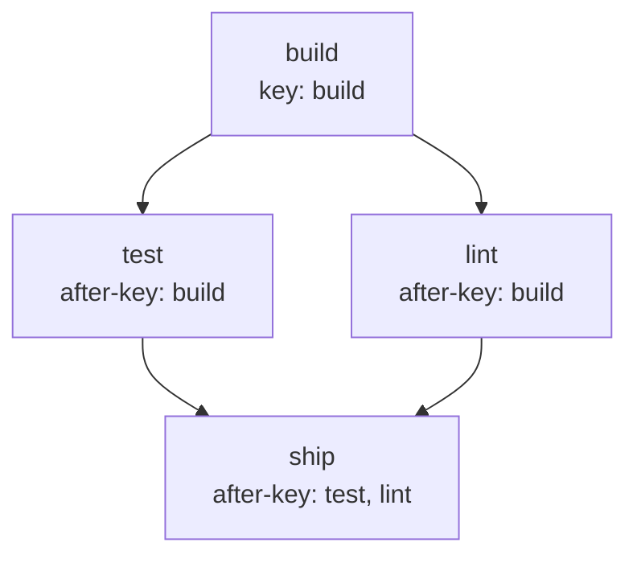

# Dependencies

A job can wait for earlier jobs and, by default, build on their diffs. Dependencies are supplied
at submission and can be changed later with `lu edit`; `lu retry` can also replace the whole list
when it requeues a finished job in place.



## Declaring dependencies

```sh
lu submit --key build --repo /home/you/src/demo --ref main --task "build"

lu submit --key test --after-key build \
  --repo /home/you/src/demo --ref main --task "test"

lu submit --key ship --after-key test --after-key lint \
  --repo /home/you/src/demo --ref main --task "ship"
```

- `--after <job-id>` and `--after-key <key>` are repeatable and can be combined. A key resolves
  to the newest job submitted with it. IDs found through keys are appended only if not already
  present.
- A spec may name at most 16 dependencies. Duplicate IDs, unknown IDs and dead dependencies are
  rejected. An unknown `--after-key` is a CLI usage error (exit 2); an unknown ID from the API is
  `422 unknown dependency <id>`.
- A dependency that is already `failed` or `cancelled` is rejected with
  `422 dependency <id> already failed or was cancelled` unless the new spec sets
  `include_failed: true`. With that opt-in the dead dependency is accepted, the dependent starts
  `queued` when the rest of its dependency set is ready, and a later dependency failure releases
  the dependent instead of failing it with `failure_class: "dependency"`.
- `lu retry <id> --after ... --after-key ...` replaces the dependency list on the requeued job,
  which keeps its id. The job must be failed, cancelled, expired or deadline-missed first.
- `lu submit --batch ... --chain` depends each job on all earlier jobs in the batch. Checklist
  `after:` hints and sidecar `after_keys` add dependencies; hints may name earlier batch slugs or
  existing job keys. See [Batch submissions](submitting.md#dependencies-and-parallelism).

## Waiting and promotion

A new job is `queued` when every dependency is `done`, otherwise `blocked`. `lu ls` shows the
number of unfinished dependencies in its `AFTER` column (`-` for none); for a blocked dependent of
a failed or cancelled predecessor it also shows `predecessor failed`. `lu show` prints one
`after  <id>  <state>` line per dependency, marking those still awaited with `(waiting)`, plus the
job's `blocked_reason` and `blocked_until` deadline when a predecessor failed.

When a job completes `done`, the controller moves each blocked direct dependent whose entire
dependency set is now `done` to `queued`. A failed or cancelled predecessor does **not** fail its
dependents immediately: they stay `blocked` with `blocked_reason: "predecessor failed"` so an
operator can retry the predecessor instead of rebuilding the chain. `lu retry <predecessor>`
requeues the predecessor in place and restores its waiting dependents after it;
`lu retry <predecessor> --chain` also restores blocked dependents transitively, keeping their ids
and `after` references. Cancelled or failed dependents stay untouched. Cancelling a predecessor
cancels its waiting dependents as well unless the operator passes
`lu cancel <predecessor> --keep-dependents`. If no retry happens within
`[controller] blocked_dependent_ttl` (default `24h`), a blocked dependent fails with
`failure_class: "dependency"` and a summary naming the predecessor. `lu top` and the
`lu_blocked_dependents_total` metric show how many dependents are waiting.

`include_failed: true` is a separate opt-in: a dependency already dead at submission is accepted,
and the dependent starts `queued` once its other dependencies are `done`. A job still blocked when
a dependency fails uses the wait-and-retry behaviour above.

```sh
lu show 01ARZ3NDEKTSV4RRFFQ69G5FAV   # blocked_reason: predecessor failed
lu retry 01ARZ3NDEKTSV4RRFFQ69G5FAV   # requeue in place and restore waiting dependents
lu retry 01ARZ3NDEKTSV4RRFFQ69G5FAV --chain  # restore blocked dependents transitively
lu cancel 01ARZ3NDEKTSV4RRFFQ69G5FAV --keep-dependents
```

## One base per chain

Every job records the commit the agent actually staged in `staged_commit`, before dependency
patches are applied. The field appears in the `JobView` returned by `lu show`, `lu ls --json` and
the operator API, and in each entry of `GET /v1/agent/jobs/{id}/deps?epoch=N`. A job with a pinned
`source.base` uses that commit. A dependent with no pinned base inherits the `staged_commit` of
its dependencies, so the whole chain shares one base tree.

- Every dependency of a dependent must agree on the inherited commit. When the recorded commits
  differ, the agent resolves their newest common ancestor and stages that tree as the shared base.
- If any dependency patch does not apply cleanly at that base, the job fails with
  `failure_class: "conflict"` and no harness runs. The summary names every contested commit, for
  example `dependency staged commits disagreed (<commit-a>, <commit-b>); resolved with merge base
  <base>` or `dependencies disagree on the staged commit (<commit-a>, <commit-b>); no common base: ...`.

A dependent's exported `diff.patch` is relative to the inherited base (or the common ancestor used
in the fallback), not to a branch tip that may have moved since. It includes the applied dependency
patches. When the chain finishes, the operator merges the final patch onto the moved branch
afterwards; Lu does not rebase that patch onto a later tip. See
[collecting inputs](#collecting-inputs) for the modes that stage and apply dependency diffs.

## Stacking dependency diffs

By default the agent stages the chain's base tree — a pinned `source.base` or the inherited
`staged_commit` described above — then fetches each dependency's `diff.patch` in `after` order and
applies it to that tree. Empty or missing diffs are skipped. The harness then runs on the combined
tree, and the dependent's exported diff includes the applied dependency changes and is relative to
the base it staged. The list of applied dependency ids is recorded in `report.json` under
`applied_dependencies`. Stacking uses the controller's stored patch, so a dependency's workspace is
not kept just because a dependent is running; the agent waits for controller release before an
ephemeral deletion. See [workspaces.md](workspaces.md).

If a dependency patch cannot be applied, the job finishes `failed` with
`failure_class: "conflict"` and a summary such as:

```text
input build (01ARZ3NDEKTSV4RRFFQ69G5FAV) could not be applied; conflicted files: src/main.rs, tests/main.rs
```

An unreadable or otherwise invalid patch is also a conflict; its detail is appended to the
summary instead of a path list. Patches applied before the failing one remain in the exported
diff and are listed in `applied_dependencies`.

Set `--collect none` to wait for dependencies without applying their diffs or staging files.

### Policy paths for known-safe conflicts

An operator can opt into two conflict policies for named paths in the agent's `[stack]` config
([config.md](config.md#stack)):

- `union_paths`: keep both sides' added lines, in order, and keep base-side deletions.
- `base_paths`: take the base side, typically for generated lock files.

Both lists are empty by default. Per-job `stack_union_paths` and `stack_base_paths` may only
**narrow** the configured lists: a job naming a pattern the agent did not configure, or a pattern
in both lists, is refused instead of widening the policy. Paths use the same bounded,
repo-relative glob grammar as `expect` (`*`, `**` and `?`; no character classes).

Any conflict outside a covered path fails closed with `failure_class: "conflict"`; `--on-conflict`
below does not make an uncovered stack path safe. When a policy resolves a conflict, the summary
names every affected file and hunk, says whether the base moved since the dependency was staged,
and lists the covered policy paths that were used for the decision. That makes the resolution
auditable from `lu show`, `report.json` and the stored artifacts. The policies are opt-in and
fail closed; see [SECURITY.md](../SECURITY.md) for the overall trust model.

## Collecting inputs

`--collect <mode>` controls dependency inputs. The modes are `none`, `files`, `apply` and `both`;
default is `apply`; other spellings are refused with the accepted list. `files` and `both` stage
dependency artifacts under `.lu/inputs` before the harness starts;
`apply` and `both` apply each input's `diff.patch` in `after` order.

Inputs are the job's `after` dependencies. A `done` dependency is always an input. A `failed` or
`cancelled` dependency becomes an input only when `--include-failed` is set and that job stored a
`diff.patch`; without the opt-in, a dead dependency leaves its dependents blocked as described above.
`--include-failed` is also accepted by `lu retry` and `lu edit`. At most 16 inputs and 64 MiB of
stored diffs are allowed; the controller checks the limit at submit time when sizes are known and
the agent re-checks it before staging. Each `GIT binary patch` side is preflighted before libgit2
inflates it: a declared or actual inflated size above 256 MiB is refused, and malformed or
size-mismatched binary data fails staging under every conflict policy.

With `files` or `both`, the agent writes `.lu/inputs/INDEX.md` and one directory per input, named
from a safe idempotency key (or a short job id, with `-2`, `-3`, … for duplicates). Each directory
contains `diff.patch`, `report.json`, `run.log` and `meta.json`. `INDEX.md` lists the key, job id,
state, node, failure class, changed-file count, diff bytes, apply result and conflicted files;
`run.log` keeps only the last 256 KiB and the index notes when a log was capped. Files are `0600`,
directories `0700` and symlinks are refused. Text from another job is untrusted: it is sanitised in
the index and never used as a path or command. `.lu` is added to `.git/info/exclude` and stripped
from the exported `diff.patch`; a tracked `.lu` path at any depth is a staging error.

### Conflict handling

`--on-conflict <policy>` (`on_conflict` in the API, also on `lu retry` and `lu edit`) controls a
patch that does not apply:

- `fail` (default): the job ends `conflict`; the summary names the input, file and hunk. Earlier
  inputs remain in `diff.patch` and `applied_dependencies`.
- `skip`: the patch is left unapplied. Its `INDEX.md` row says `skipped` with the first failing
  file and hunk; later inputs still apply.
- `markers`: a three-way merge leaves standard `<<<<<<<`, `=======` and `>>>>>>>` markers labelled
  with the input name. The row says `markers (N files)` (`markers (1 file)` for one path), later
  inputs still apply, and the markers remain in the exported `diff.patch`.

Each input is tried with libgit2 apply, libgit2 three-way, then `git apply --3way` when `git` is on
the agent's PATH. This last step handles patches libgit2 rejects but git accepts.

`lu collect <key-or-id>... --repo R --ref REF [--template merge|test|review] [--task-file F]`
creates one job with those inputs, `collect = both` and `on_conflict = markers`. Keys resolve like
`--after-key`; `include_failed` is set only when an input is failed with a stored diff. Optional
`--key`, `--provider`, `--model`, `--timeout` and `--wait` behave as on `lu submit`. Templates are
built into the binary and can be overridden by `$XDG_CONFIG_HOME/lu/templates/<name>.md` (or
`$HOME/.config/lu/templates/<name>.md`), read at submit time and capped at 64 KiB. `--task-file`
is appended under `## Extra instructions` and capped at `MAX_TASK_BYTES` (256 KiB).

### Worked three-input merge

```sh
lu submit --key a --repo /srv/demo --ref main --task "add README"
lu submit --key b --after-key a --collect both --on-conflict markers \
  --repo /srv/demo --ref main --task "edit the same README line"
lu submit --key c --after-key b --collect both --on-conflict markers \
  --repo /srv/demo --ref main --task "add docs/notes.md"
lu collect a b c --repo /srv/demo --ref main --template merge
```

The collection job stages all three inputs in `a`, `b`, `c` order. Input `a` applies; `b` leaves
markers in `README.md` and its row reads `markers (1 file)`; `c` still applies. `INDEX.md` records
each result and the conflicted path, and the collection job's `diff.patch` includes the marked
`README.md` and the new `docs/notes.md`. The `merge` prompt tells the harness to read the index,
resolve both sides of every marker and write `MERGE.md`.

## Viewing the graph

`lu graph [job]` draws components that contain at least one unfinished job, newest component
first. Each chain is one horizontal row, prerequisites first: `○ build ──▶ ○ test ──▶ ◔ ship`.
Only a real fan-out (one prerequisite, several dependents) or fan-in (several prerequisites, one
dependent) adds rows, using `├─▶`/`└─▶` branches and `┐`/`┘` joins. A dependency outside the
fetched set is a dim `#id…` stub at the left of its chain, and unrelated single-job components
share a row when they fit. A job id selects that job's component even if every job in it is
finished. Display is capped at 6 components and 40 jobs, with a note when anything is hidden.

A node shows a state glyph and the last five id characters. Its title is the first non-empty line
of its task, with leading `#` heading marks and a `Task:` or `task:` prefix removed; `lu graph`
appends the title clipped to 30 characters, while the `lu top` panel shows only glyphs and ids in
a bordered `Graph` panel. Colour is used only when stdout is a terminal and `NO_COLOR` is unset.
`lu graph --json` prints:

```json
{"nodes":[{"id":"...","state":"queued","title":"...","after":["..."]}]}
```

`lu top` and the TUI dashboard also expose the graph panel; press `g` to toggle it there. The panel
clips tall graphs and reports hidden jobs, components and rows in its title.
