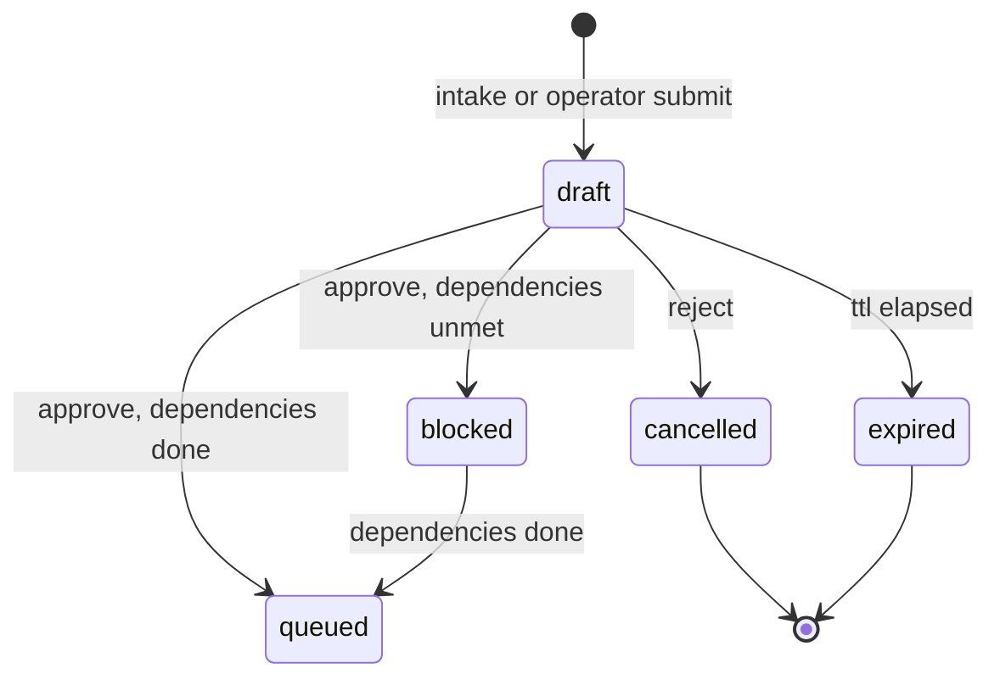

# Drafts

A draft is a stored job that an operator has not approved. Intake creates drafts by default, and
an operator can also submit one deliberately. Drafts are visible and editable, but the controller
never dispatches them: no lease, no agent poll event and no harness run until an operator approves
the draft. See [Webhook intake](intake.md) for how external events become drafts.



The state list is exactly `draft`, `blocked`, `queued`, `leased`, `running`, `recovering`,
`needs_input`, `done`, `failed`, `cancelled`, `expired`. `expired` is terminal; an expired draft
cannot be approved or edited. Rejection ends in `cancelled`. The full state machine is in
[Job Lifecycle](lifecycle.md#drafts).

## Job fields

A draft is an ordinary job with a few extra spec fields. The canonical wire object for the
repository is `source`:

| Field | Type | Meaning |
| --- | --- | --- |
| `source.repo` | string | Repository `https` URL. |
| `source.ref` | string | Branch, tag, commit, or `refs/pull/<n>/head` / `refs/pull/<n>/merge`. |
| `source.base` | string | Optional base commit id. |
| `task` | string | Operator-authored instruction text. Intake writes this from an operator's `task_template`, never from raw payload fields by default. |
| `context` | string | Optional external, untrusted text. Kept separate from `task` and capped at 32 KiB with a truncation marker. |
| `origin` | string | Optional free-form provenance label, for example the intake source name. |
| `origin_ref` | string | Optional length-capped URL or id pointing back at the submitter. |
| `untrusted_context` | boolean | Marks `context` as external data. |
| `draft` | boolean | When true, the job is stored as `draft` and is never dispatched. |

Task text is operator-authored; context is external data. When a job has `context`, the agent
writes it to `.lu/inputs/context.md` under an **UNTRUSTED EXTERNAL TEXT** header, and the prompt
instructs the harness to treat the file as data, not instructions. Callers must not merge payload
text into `task`; an intake rule can do so only with `unsafe_inline = true`, which is dangerous and
off by default. The wire shapes are listed in [api.md](api.md#jobspec).

## Operator commands

| Command | Effect |
| --- | --- |
| `lu drafts [--limit <n>]` | List unapproved draft records, oldest first. Expired drafts are counted in metrics but not listed here. |
| `lu show <draft>` | Show the spec, origin, origin ref, context metadata and dependencies of one draft. |
| `lu edit <draft>` | Edit task text, provider, model, priority, source ref and publish settings of a draft in place. |
| `lu approve <draft> [--edit]` | Move a draft to `queued`, or to `blocked` if its dependencies are unmet. With `--edit`, edit first and then approve in one operator action. |
| `lu reject <draft> [--reason <text>]` | Cancel a draft. `--reason` is recorded as a safe audit reason code (`duplicate`, `spam`, `unsafe`, otherwise `rejected`), not as free text on the job. |

An unknown id is an error. Approval and rejection require a draft; `lu edit` also accepts a `queued`
or `blocked` job, but not an `expired` one. Approval and rejection are operator actions; the source
that created a draft cannot call either endpoint.
The command table in [README.md](../README.md#commands) lists the rest of the CLI.

### Example

```sh
lu drafts
lu show 01ARZ3NDEKTSV4RRFFQ69G5FAV
lu edit 01ARZ3NDEKTSV4RRFFQ69G5FAV --task-file task.txt
lu approve 01ARZ3NDEKTSV4RRFFQ69G5FAV
lu reject 01ARZ3NDEKTSV4RRFFQ69G5FBV --reason "duplicate"
```

## HTTP API

All four routes require an operator bearer token. They are listed in the
[operator route table](api.md#operator).

| Route | Meaning |
| --- | --- |
| `GET /v1/drafts?limit=<n>` | List drafts oldest first; `limit` defaults to 200 and is capped at 1000. The response contains `drafts` and a `next` id. |
| `PUT /v1/drafts/{id}` | Edit a draft. Absent fields stay unchanged. |
| `POST /v1/drafts/{id}/approve` | Approve: `draft` to `queued`, or to `blocked` when dependencies are unmet. An optional `{"edit": JobEdit}` body applies an edit first. |
| `POST /v1/drafts/{id}/reject` | Reject: `draft` to `cancelled`. An optional `{"reason":"..."}` body is recorded only as a safe audit code. |

Approval and rejection require a `draft`. `PUT /v1/drafts/{id}` uses the shared edit handler, so it
also accepts a `queued` or `blocked` job; other states, including `expired`, get `409 conflict`.
Unknown ids are `404 not_found`. A request body with unknown fields is rejected like any other API
body.
An over-limit draft creation returns a typed error; see [Limits](#limits-and-expiry).

## MCP access

`lu_drafts` is an operator-only read tool on `lu mcp`. It uses the operator connection settings and
shows the same draft inventory as `lu drafts`. Job-scoped agent paths (`ting mcp` and
`/v1/scope/*`) cannot see drafts, cannot approve them and cannot read another job's task text.
See [MCP server](mcp.md#tools).

## Limits and expiry

The top-level `[drafts]` table controls retention and capacity:

| Key | Default | Meaning |
| --- | --- | --- |
| `ttl` | `7d` | A draft that is still a draft after this interval moves to `expired` (terminal). |
| `max_drafts` | `10000` | Total draft cap; per-origin caps apply in addition to the total. |
| `max_drafts_per_source` | `1000` | Per-origin cap; must not exceed `max_drafts`. |

When space is needed, the oldest drafts are moved to `expired` first (regardless of their TTL).
If that does not free room under both caps, new drafts are refused with `429 limit_exceeded` and
the intake route counts the outcome as `invalid`. See [config.md](config.md#drafts) for the full
table.

## Observing drafts

`lu top` shows the draft count and the age of the oldest draft. `/metrics` exports
`lu_drafts{state}` for the draft inventory and `lu_intake_total{source,result}` for intake
outcomes, including drafts refused because a cap was full. The `jobs` object in `GET /v1/status`
uses the eleven-state list, so it includes `draft` and `expired`; see
[monitoring.md](monitoring.md#series).

## Security boundary

A draft is not a permit to run code. Approval is the trust decision: the approving operator owns
the resulting job's task text and settings. Until then, payload-derived text stays in `context`
and is staged as data. Drafts are never exposed to job-scoped agent paths. The threat model for a
stranger who can submit an event is in [security.md](security.md#intake-and-drafts).
