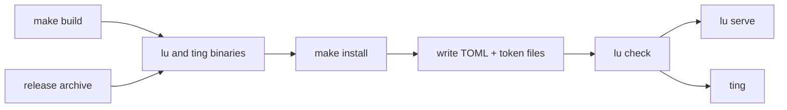

# Install

Release archives contain statically linked `lu` and `ting` binaries, built for musl targets. A
plain `make build` produces release binaries for the host toolchain; they are not necessarily
statically linked. Build from source or use a release archive, then write a controller config,
start the controller and add agent hosts. Config keys are in [config.md](config.md); service
details are in [operations.md](operations.md). Existing agent hosts must follow the
[Ting migration note](migration-ting.md); there is no compatibility shim.



## Release archive

Tagged releases publish `lu-<tag>-<target>.tar.gz` and a `.sha256` file for two musl targets:

| Target | Architecture |
| --- | --- |
| `x86_64-unknown-linux-musl` | x86-64 |
| `aarch64-unknown-linux-musl` | AArch64 |

The archive contains `lu`, `ting`, `LICENSE`, `README.md`, `CHANGELOG.md`, `SECURITY.md`, `docs/`
and `contrib/`. The workflow builds with Rust 1.99, runs `cargo build --release --locked -p lu
--features tui --target <target>` and `cargo build --release --locked -p tuishou-ting --target
<target>`, smoke-runs both binaries, and verifies the tag before publishing.

Worked example:

```sh
sha256sum -c lu-v0.4.0-x86_64-unknown-linux-musl.tar.gz.sha256
tar -xzf lu-v0.4.0-x86_64-unknown-linux-musl.tar.gz
cd lu-v0.4.0-x86_64-unknown-linux-musl
./lu --version
./ting --version
install -m 0755 lu /usr/local/bin/lu
install -m 0755 ting /usr/local/bin/ting
```

## Build from source

`make build` runs `cargo build --release --locked -p lu --features tui` and
`cargo build --release --locked -p tuishou-ting`. `make install` builds, then installs both binaries
into `$(PREFIX)/bin`.

| Variable | Default |
| --- | --- |
| `PREFIX` | `/usr/local` as root, `$HOME/.local` otherwise. |
| `BINDIR` | `$(PREFIX)/bin`. |
| `SYSTEMD_UNIT_DIR` | `$(PREFIX)/lib/systemd/system`. |
| `TARGET_DIR` | `target`, or `$(CARGO_TARGET_DIR)`. |
| `DESTDIR` | Empty; prepended to install paths for packaging. |

Systemd units install only for root, or for a root packaging run with `DESTDIR`. `make uninstall`
removes both binaries and, for root, the units.

Worked example — per-user install:

```sh
make build
make install
"$HOME/.local/bin/lu" --version
"$HOME/.local/bin/ting" --version
```

## Service layout

The contributed units assume this layout. Adjust `ExecStart` when `PREFIX` is not `/usr/local`.

| Path | Owner / mode | Purpose |
| --- | --- | --- |
| `/usr/local/bin/lu` | `root:root`, `0755` | controller and operator CLI installed by `make install` as root |
| `/usr/local/bin/ting` | `root:root`, `0755` | node agent installed by `make install` as root |
| `/etc/lu/lu.toml` | `root:lu`, `0640` | controller config (hashes and paths only) |
| `/etc/lu/operator.token` | operator user, `0600` | operator token |
| `/etc/lu/tls/cert.pem` | `root:lu`, `0644` | TLS certificate |
| `/etc/lu/tls/key.pem` | `lu:lu`, `0600` | TLS private key |
| `/var/lib/lu/lu.db` | `lu:lu`, `0600` | SQLite database, plus WAL files while running |
| `/var/lib/lu/artifacts/` | `lu:lu`, `0700` | per-job logs and artifacts |
| `/etc/ting/ting.toml` | `root:ting`, `0640` | agent config, with the `[agent]` table |
| `/etc/ting/ting.token` | `ting:ting`, `0600` | agent token |
| `/etc/ting/tls/ca.pem` | `root:ting`, `0644` | optional private CA |
| `/var/lib/ting/work/` | `ting:lu-harness`, `0770` | agent staging root |
| `/var/lib/ting/ting.log` | `ting:ting`, `0640` | optional `[log] file` target |
| `/var/lib/lu-harness/` | `lu-harness:lu-harness`, `0700` | harness home |

Worked example — prepare accounts and directories as root:

```sh
make install
install -m 0644 contrib/lu.sysusers /etc/sysusers.d/lu.conf
install -m 0644 contrib/lu.tmpfiles /etc/tmpfiles.d/lu.conf
systemd-sysusers
systemd-tmpfiles --create
install -d -m 0750 -o root -g lu /etc/lu
install -d -m 0750 -o root -g ting /etc/ting
```

## Controller

Generate one token per scope and put only their SHA-256 hashes in the controller config, as described in [Tokens and TLS](tokens-and-tls.md#token-files-and-hashes). Copy `contrib/lu-controller.toml`, replace the placeholder hashes, paths and names, then start it:

```sh
install -m 0644 contrib/lu-controller.toml /etc/lu/lu.toml
chown root:lu /etc/lu/lu.toml
chmod 0640 /etc/lu/lu.toml
lu check --config /etc/lu/lu.toml
systemctl daemon-reload
systemctl enable --now lu-controller.service
curl -fsS https://lu.example.net:7600/v1/health
```

`lu check` validates config values, reports database health and lists the checks it ran. It opens no secret files and binds no port. `lu serve` validates the whole file and its secret files before binding. A non-loopback `listen` requires `[tls]`; there is no config reload, so restart after editing config, TLS files or token hashes.

### Running the controller under systemd

The contributed unit runs as `lu` with `StateDirectory=lu`, so its state directory is `/var/lib/lu`, and it applies `ProtectHome=yes`, which makes the service account's home directory inaccessible. Mirror creation and fetches can read git config files from `$HOME`, so the unit must set `HOME` to a readable directory such as the state directory:

```
Environment=HOME=/var/lib/lu
```

The controller fetches mirrors by running `git` as its own account, so the unit's `PATH` must contain `git`:

```
Environment=PATH=/usr/local/bin:/usr/bin:/bin
```

With `[[controller.repos]]` mirrors configured, `git` must therefore be runnable by the service account and able to reach the remote.

## Agent

Ting is its own binary; there is no `lu agent` subcommand. Write `/etc/ting/ting.toml` from
`contrib/ting.toml`, set `name`, `controller_url`, `token_file`, `work_dir` and `harness`, then
start the unit:

```sh
lu check --config /etc/ting/ting.toml
systemctl enable --now ting.service
lu nodes
```

The contributed unit starts Ting as `ting` with
`ExecStart=/usr/local/bin/ting --config /etc/ting/ting.toml` and the `lu-harness` supplementary
group. `StateDirectory=ting` puts its state under `/var/lib/ting`, and `SyslogIdentifier=ting`
names its journal target. The optional `[log] file` in the sample config is
`/var/lib/ting/ting.log`. The sample config is a deployment template for `/etc/ting/ting.toml`:
set `name`, `controller_url`, `token_file`, `work_dir` and `harness` before enabling the unit. The
agent stores provider credentials on its own host; see [security.md](security.md).

For a foreground check without systemd:

```sh
ting --config /etc/ting/ting.toml
```

The scoped MCP server for a harness inside a job is `ting mcp`; see
[the MCP server](mcp.md#scoped-mcp-ting-mcp).

## After install

Operator commands use `LU_URL` with `LU_TOKEN_FILE` (optional `LU_CA_FILE`) or the first existing operator file at `$XDG_CONFIG_HOME/lu/operator.toml` (or `~/.config/lu/operator.toml`) or `/etc/lu/operator.toml`. Use an operator token: agent tokens get `401` on operator routes, and `--config` never supplies operator credentials. `lu backup`, `lu restore` and `lu check` use only the config's `[controller] db` key for database access and never open TLS keys or tokens, so they run as root or as the service account even when that account owns the secrets.

Use the [client guide](client-guide.md) to submit and follow jobs, [monitoring.md](monitoring.md) to scrape metrics, and [troubleshooting.md](troubleshooting.md) for failures. Upgrade and backup steps are in [operations.md](operations.md); moving an older agent host is in [migration-ting.md](migration-ting.md).
