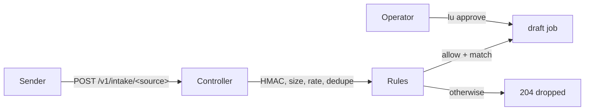

# Webhook intake

Intake turns signed HTTP events into jobs, normally [drafts](submitting.md#drafts), without giving the sender
an operator token. A controller listens on one unauthenticated route per configured source. The
route verifies an HMAC-SHA256 signature, applies operator-authored rules to the JSON body, and
either creates a draft or drops the event. An operator reviews and approves the draft through the
usual CLI or API; the source never dispatches a job itself.



Intake is disabled unless a top-level `[intake]` table is present. Request bodies reject unknown
fields elsewhere in the API, but an intake body is an arbitrary JSON document: rules read it by
JSON pointer. Payload text is never written to logs, error messages or audit entries.

## Configuration

Each source has a name, a signing key and a set of rules. The source name is the path segment of
the intake route.

### `[intake]`

| Key | Default | Meaning |
| --- | --- | --- |
| `sources` | — | Array of `[[intake.sources]]` entries. Without a `[intake]` table no intake route is installed; a present table requires at least one source and at least one rule per source. |

### `[[intake.sources]]`

| Field | Required | Default | Meaning |
| --- | --- | --- | --- |
| `name` | yes | — | Route name, 1 to 64 characters from `A-Z a-z 0-9 . _ -`; unique among sources. |
| `secret_file` | yes | — | Private file holding the HMAC-SHA256 key. Mode `0600` or tighter, no symlink or FIFO, read with `O_NOFOLLOW`. |
| `header` | no | `X-Hub-Signature-256` | Header carrying the signature. |
| `max_body_bytes` | no | `1048576` (1 MiB) | Body size cap, 1 to 16777216 bytes; larger bodies get `400 invalid delivery` and are counted as `invalid`. |
| `rate_per_minute` | no | `60` | Per-source budget, 1 to 100000; excess gets `429 rate_limited` and is counted as `rate_limited`. |
| `dedupe_header` | no | — | Optional header whose value feeds the idempotency key, so a retried delivery is counted as `duplicate`. |
| `dedupe_ttl_secs` | no | `86400` (24h) | How long a delivery id is remembered, 1 to 604800 seconds. |
| `allow_plain_http` | no | `false` | Escape hatch for a listener behind a TLS-terminating proxy or tunnel, or a loopback bind. Not for a directly exposed non-loopback listener. |
| `rules` | yes | — | At least one `[[intake.sources.rules]]` entry. |

A source must have at least one rule. Rules are tried in configuration order; the first rule whose
`match` conditions all hold yields a draft, unless its `allow` conditions fail or a fork is detected
with `allow_forks = false`, in which case the event is dropped and counted. An event that matches no
rule is dropped.

### `[[intake.sources.rules]]`

| Field | Meaning |
| --- | --- |
| `match` | List of conditions on JSON pointers. All must hold for the rule to apply. |
| `allow` | Additional conditions, typically an actor allowlist. When configured and not matched, the event is dropped and counted; it never becomes a draft, even in `auto_approve` mode. |
| `repo` | JSON pointer or literal repository URL for `source.repo`. |
| `ref` | JSON pointer or literal ref for `source.ref`. |
| `base` | Optional JSON pointer or literal base commit for `source.base`. |
| `task_template` | Operator-authored task text. Literal by default; `{{pointer}}` substitutions require `unsafe_inline = true`. |
| `task_vars` | Pointers allowed in `task_template` and `key_template`. Each value is length-capped and has control characters stripped. |
| `context_from` | Pointers copied into the job's external `context`, never into `task` unless `unsafe_inline` is set. |
| `provider`, `model`, `priority`, `group`, `timeout` | Defaults applied to the drafted job's spec. `priority` is `0` to `9`; `timeout` is `1` to `86400` seconds. |
| `publish` | Publish settings applied to the drafted job. |
| `key_template` | Template for the source's idempotency/dedupe key and the job's `origin_ref`. |
| `auto_approve` | Default `false`. When true, an event that passes the rule is created as `queued` (or `blocked` if dependencies are unmet) instead of `draft`. |
| `allow_forks` | Default `false`. Set true only for trusted rules that need refs whose head repository differs from the target. |
| `unsafe_inline` | Default `false`. Dangerous: enables `{{pointer}}` substitution into `task`. `key_template` may always substitute allow-listed pointers. By default payload fields go only into `context`. |

A condition names a JSON pointer and one operator with a comparison value:

| Operator | Meaning |
| --- | --- |
| `equals` | The pointer's value equals the given value. |
| `in` | The value is one of a given list. |
| `prefix` | The value starts with the given string. |
| `regex` | The value matches a bounded, RE2-style regular expression. |
| `exists` | The pointer is present (or, with a false value, absent). |

JSON pointers name positions in the decoded body, for example `/actor/login`,
`/repository/full_name`, `/ref` and `/head/repo`. A missing pointer never satisfies a positive
condition. Templates may reference only pointers listed in `task_vars`; a reference to any other
pointer is a configuration error. `key_template` may substitute those pointers directly;
`task_template` stays literal unless `unsafe_inline = true` is set, which is a dangerous opt-in for
a fully trusted sender.

### Example

This is a generic example of an arbitrary JSON webhook; no particular sender is assumed:

```json
{
  "action": "opened",
  "actor": {"login": "sam"},
  "repository": {"full_name": "team/app"},
  "ref": "refs/heads/main",
  "head": {"repo": {"full_name": "team/app", "private": false}, "sha": "0f1e2d3c4b5a69788796a5b4c3d2e1f0"}
}
```

```toml
[intake]

[[intake.sources]]
name = "events"
secret_file = "/etc/lu/events.key"
header = "X-Hub-Signature-256"
max_body_bytes = 65536
rate_per_minute = 30
dedupe_header = "X-Delivery-Id"

[[intake.sources.rules]]
match = [
  { pointer = "/action", equals = "opened" },
  { pointer = "/head/repo/private", equals = "false" },
]
allow = [
  { pointer = "/actor/login", in = ["sam", "kim"] },
]
repo = { pointer = "/repository/full_name" }
ref = { pointer = "/ref" }
task_template = "Triage the reported issue in the configured repository and update the docs."
task_vars = ["/repository/full_name", "/head/repo/sha"]
context_from = ["/head/repo", "/actor"]
provider = "any"
priority = 5
key_template = "{{/repository/full_name}}:{{/head/repo/sha}}"
auto_approve = false
unsafe_inline = false
```

`repo` and `ref` accept either a pointer object as above or a literal string. `key_template`
makes repeated deliveries of the same event idempotent; the dedupe window is bounded and a repeat
inside it is counted as `duplicate`. The resulting draft's `origin` is the source name and its
`origin_ref` is a length-capped URL or id derived from the event. See
[config.md](config.md#intake) for the complete configuration reference.

## Route

| Item | Value |
| --- | --- |
| Path | `POST /v1/intake/<source>` |
| Authentication | None. No operator or agent bearer token is accepted or required; the source HMAC signature is the only credential. |
| Success | `202` with `{"id":"<job id>","state":"<state>"}` and a `Location: /v1/jobs/<id>` header when a draft or an auto-approved job is created. |
| Dropped | `204` with no body when a signed event matches no rule, fails `allow`, or names a fork while `allow_forks = false`. |
| Duplicate | `204` with no body when a delivery id or key is inside the dedupe window. |
| Rate limited | `429 rate_limited` with `Retry-After` when the per-source budget is exhausted. |
| Invalid | `400 bad_request` with `invalid delivery` for an oversized or malformed body, or a rule that produces an invalid spec. |
| Capacity | `429 limit_exceeded` with `limit: max_drafts` when the draft caps are full. |
| Bad signature | `401` for a missing, malformed or incorrect signature. Missing and bad signatures are indistinguishable. |
| Logs | No payload text in request logs, errors or audit records. Only counts and safe identifiers are recorded. |

The signature is an HMAC-SHA256 of the raw request body using the key in `secret_file`, compared
with the value in the configured header. Signatures are checked before size or parsing. An unknown
`<source>` is `404`. A valid signature alone does not create a job: `match` and `allow` still decide.

## Deduplication and rate limiting

- `key_template` builds the idempotency key from bounded pointers. A delivery whose key is already
  in the dedupe window is dropped as `duplicate`; keys are remembered for `dedupe_ttl_secs`.
  `dedupe_header` provides an additional delivery identifier where the sender supplies one.
- `rate_per_minute` is a per-source budget, checked before rules run. A source that exceeds it gets
  `429 rate_limited` until its budget recovers. One source cannot exhaust another source's budget,
  and no operator token is needed to read the intake route.
- A draft refused because `[drafts]` capacity is exhausted gets `429 limit_exceeded` and is counted
  as `invalid`; it is a different outcome from a rule drop. See
  [Drafts](submitting.md#limits-expiry-and-observability).

## Transport and secrets

Intake follows the same listener rules as the rest of the controller: plain HTTP is confined to a
loopback bind and a non-loopback listener requires `[tls]`. With `[intake]` enabled, startup fails
if neither TLS nor a loopback bind is available unless `allow_plain_http = true` is set. A common
deployment terminates TLS at a reverse proxy or tunnel and binds the controller to loopback; keep
the direct listener unreachable from untrusted networks and pass the raw body through unchanged so
the signature still verifies.

The signing key is a controller-side secret. It is a mode `0600` file named by `secret_file`,
never a bearer token, never included in a job spec, and never passed to an agent. Rotate it at the
sender and controller together. Multiple sources may have different keys. Private repository
credentials used by the mirror are separate, in `[mirror.credentials]`; neither key appears in
logs, artifacts, `lu show` or the audit record. See
[security.md](security.md#intake-and-drafts).

## External text and git sources

Payload values copied through `context_from` are external data. The drafted `context` is capped at
32 KiB with a truncation marker, and the agent writes it to `.lu/inputs/context.md` under an
**UNTRUSTED EXTERNAL TEXT** header; the harness prompt instructs it to treat that file as data.
Templates may interpolate only pointers listed in `task_vars`, with a length cap and stripped
control characters. `task_template` stays literal unless `unsafe_inline = true` is set; that opt-in
allows payload fields into `task` and is dangerous, so enable it only for a sender you fully trust.

The drafted job's `source.ref` may name a branch, tag, commit, or a pull-request ref such as
`refs/pull/<n>/head` or `refs/pull/<n>/merge`. The controller mirror fetches named refs with
restricted exact refspecs, never `+refs/*`, and pins the resolved commit in the job record. A fork
head is refused unless the rule sets `allow_forks = true`. See
[config.md](config.md#intake) and [lifecycle.md](lifecycle.md#drafts).

## Outcomes and metrics

`lu_intake_total{source,result}` counts intake outcomes with exactly these `result` labels:
`accepted`, `dropped`, `bad_signature`, `duplicate`, `rate_limited`, `invalid`. A draft refused by
a capacity cap is counted as `invalid`. `lu_drafts{state}` reports the draft inventory, and `lu top`
shows the draft count and oldest draft age. Scrape and alert examples are in
[monitoring.md](monitoring.md#series).
