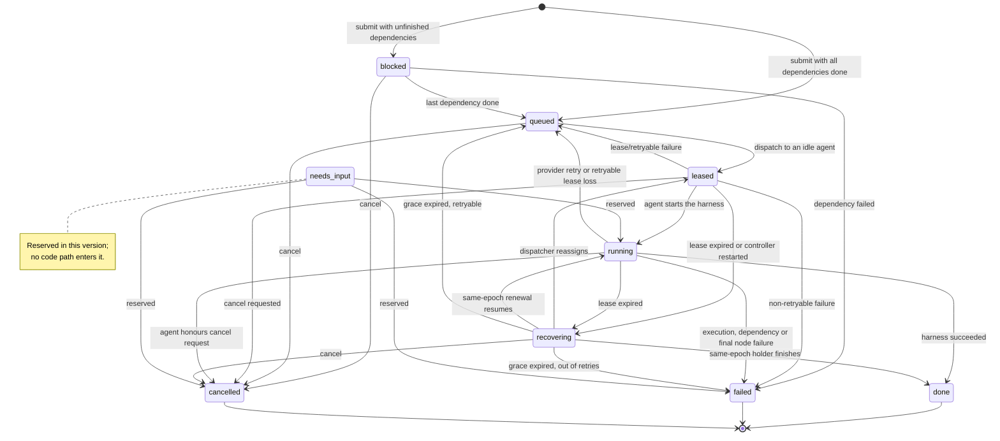

# Job Lifecycle

A job moves through a small, explicit state machine. The controller owns every transition; agents
only propose starts, renewals, uploads and completions, all fenced by the job's epoch.

`needs_input` is part of the wire enum and the transition table, but it is reserved and
unreachable in this version. The terminal states are `done`, `failed` and `cancelled`; they have no
outgoing edges.

## Transition reference

| From | Allowed targets | What causes it |
| --- | --- | --- |
| `blocked` | `queued`, `cancelled`, `failed` | All dependencies become `done`; operator cancel; a dependency fails or is cancelled, which cascades. |
| `queued` | `leased`, `cancelled` | Dispatch to an idle, non-draining agent; operator cancel. |
| `leased` | `running`, `queued`, `recovering`, `cancelled`, `failed` | Agent starts; retryable failure or lost lease; lease expiry or controller restart; cancel; non-retryable failure. |
| `running` | `done`, `failed`, `cancelled`, `queued`, `recovering` | Harness success; terminal failure; honoured cancel; provider retry; lease expiry. |
| `recovering` | `running`, `done`, `leased`, `queued`, `failed`, `cancelled` | Same-epoch renewal; same-epoch completion; reassignment; grace expiry with or without retry budget; operator cancel. |
| `needs_input` | `running`, `failed`, `cancelled` | Reserved edges only; not reachable in this version. |
| `done`, `failed`, `cancelled` | none | Terminal. |

## Leases and epochs

- Creation sets `attempt = 1`, `epoch = 0` and no node.
- Assignment moves `queued` to `leased`, records the node, increments `epoch` and sets a lease
  expiring after `lease_secs` (default 60, allowed 5–3600).
- `start_job`, log uploads and `complete` all require the epoch the controller issued. A stale
  epoch is refused, so a recovered or replaced agent cannot overwrite the current holder.
- Agents heartbeat every `heartbeat_secs` (default 15). Config validation requires
  `heartbeat_secs * 2 < lease_secs`.
- Controller maintenance runs every `max(1, lease_secs / 3)` seconds. It expires stale leases into
  `recovering` and ages recovery grace timers.
- A lease expiry moves `leased` or `running` to `recovering`. If the original agent renews with
  the same epoch while the job is still `recovering`, the lease is refreshed and the job returns
  to `running`.
- At controller startup, every `leased` or `running` job becomes `recovering`; jobs already
  `recovering` get a fresh grace timer because monotonic clocks restart with the process.
- After `recovery_grace_secs` (default 30, allowed 0–600), the controller requeues the job or
  fails it with class `node`, incrementing the attempt and clearing the node.

Dispatch considers only `queued` jobs, oldest id first. The node must have a current heartbeat,
must be idle and not draining, and must not already hold a `leased`, `running` or `recovering`
job. The job's required labels must be a subset of the node's labels; if it names a provider, the
node must offer it and no `(node, provider)` cordon may be active.

## Failure classes and retries

| Class | Meaning | Requeue rule |
| --- | --- | --- |
| `node` | Agent lost, lease expired, harness spawn failed, workspace prepare failed, or an ordinary staging error. | Requeue while `attempt <= max_retries` (default 1, allowed 0–3); otherwise fail with `node`. |
| `provider` | All keys unavailable, a model limit, a 429, or a provider-failure marker followed by harness silence. | Requeue while `attempt <= 100`; `max_retries` is not consulted. At `attempt > 100` the job fails with `provider`. |
| `execution` | Harness exited non-zero, timed out, produced no output, or the task itself was invalid. Staging errors naming a missing ref, authentication failure or unknown repository are also `execution`. | Never requeue. |
| `dependency` | A dependency finished `failed` or `cancelled`. | Never requeue. |
| `conflict` | A dependency diff could not be applied to the dependent's base tree. | Never requeue. |

A requeue increments `attempt`, clears the node and cancel request, and moves the job back to
`queued`. A provider requeue also inserts or refreshes a cordon for the `(node, provider)` pair:
normally for `provider_cooldown_secs` (default 1800), or for the agent's `retry_after_secs` clamped
to 5 seconds–24 hours. Execution, dependency and conflict failures are terminal on the first
occurrence and fail any blocked dependents.

Because node and provider requeues increment `attempt`, the effective budgets are: node failures
at attempts 1 through `max_retries` are retried, and provider failures at attempts 1 through 100
are retried. The next failure past the limit ends the job.

A failure before the harness produced a verdict is classified by the agent, one row per case:

| Cause | Class | Retried |
| --- | --- | --- |
| The harness process could not be started (command not found, exec refused, no pid) | `node` | within `max_retries` |
| Staging or preparing the tree failed in a way the node controls (disk, filesystem, clone transport, permissions, leftover directory) | `node` | within `max_retries` |
| A staging error that names a missing ref, an authentication failure or an unknown repository | `execution` | never |
| A dependency diff could not be applied and the three-way merge left conflicts (or the patch was unreadable) | `conflict` | never |

Provider-failure detection and cordon behaviour during an outage are in
[operations.md](operations.md#provider-cordons-and-node-drains).

## Cancellation

| State | Effect |
| --- | --- |
| `blocked`, `queued`, `recovering` | Immediate `cancelled` with a finished time; blocked dependents fail with class `dependency`. |
| `leased`, `running`, `needs_input` | `cancel_requested` is set. The job stays in its state until the agent stops the harness and reports `Cancelled`; then it becomes `cancelled` and dependents fail. |
| `done`, `failed`, `cancelled` | Refused with `409 conflict`. |

## Observing progress

`lu show` prints the current row, including `attempt`, `epoch`, `failure`, `waiting` and `summary`.
`lu logs --follow` streams log chunks and stops when the controller reports a terminal state in
the log response; it exits `0` for `done` and `3` for `failed` or `cancelled`. `lu submit --wait`
uses the same exit convention.
