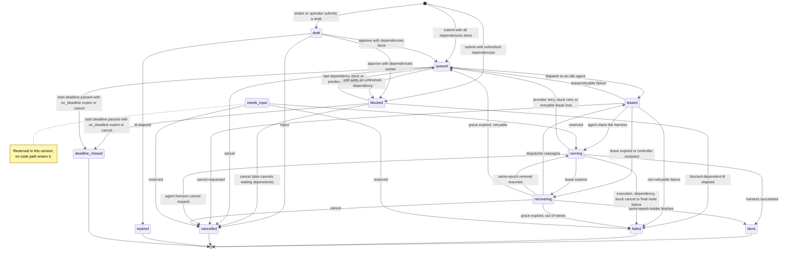

# Job Lifecycle

A job moves through a small, explicit state machine. The controller owns every transition; agents
only propose starts, renewals, uploads and completions, all fenced by the job's epoch.

## Model and ownership

Lu coordinates finite coding-agent jobs around git repositories. The controller is the only writer
of job state; agents poll it, run a harness locally and report back. Operators submit jobs and read
results through the HTTP API used by the CLI. The controller never connects to an agent: agents
dial out with a token bound to their node, and operators use a separate token ([Tokens and TLS](tokens-and-tls.md)).

| Term | Meaning |
| --- | --- |
| **Job** | A persisted record with a 26-character id, a state, an `attempt` and an `epoch`, created from a spec. |
| **Spec** | The stored request: repo, ref, task, harness, optional provider/model, timeouts, `after` dependencies, labels, key and `collect`. `lu edit` can change part of a queued or blocked job in place. |
| **Controller** | The HTTP(S) service owning state, leases, retries, cordons, mirrors and artifacts; job records live in SQLite and files under `artifacts_dir`. |
| **Agent / node** | A named `ting` process with one job slot, advertising labels and staging each job in its work directory. |
| **Operator** | Any caller using `lu`, `lu mcp` or a direct HTTP client with an operator token. |
| **Harness** | The process doing the coding. A job names a validated profile; the built-in `opencode` profile runs `opencode run`, and a profile's `wrapper` may prefix the command. |
| **Artifacts** | Exactly three controller-named files per job: `diff.patch`, `run.log` and `report.json`. |
| **Lease** | A time-limited claim; a missed renewal moves the job to `recovering`. |
| **Epoch** | A fencing counter incremented on each assignment; stale writes are refused. |
| **Dependency** | An `after` entry that must be `done` first; see [Dependencies](dependencies.md). |
| **Label** | An opaque string of at most 64 bytes advertised by an agent and required by a job. |
| **Cordon** | A `(node, provider)` suppression; see [Dispatch](dispatch.md#cordons). |
| **Idempotency key** | A stable spec name; resubmitting the same key and spec returns the existing job. |
| **Recovery grace** | The window after a lease loss in which the original agent may resume. |

| Concern | Owner | Read it on |
| --- | --- | --- |
| State and legal transitions | Controller store | [Transition reference](#transition-reference) |
| Batch input to specs | CLI or MCP planner, before any request | [Submitting work](submitting.md#batch-submissions) |
| Which queued job goes where | Controller dispatch | [Dispatch](dispatch.md) |
| Retry versus terminal failure | Controller, from failure class and attempt count | [Failure classes](#failure-classes-and-retries) |
| Checkout, patch stacking, harness supervision | Agent | [Dependencies](dependencies.md) |
| Authentication, TLS, token storage | Controller config and clients | [Tokens and TLS](tokens-and-tls.md) |
| Routes and response shapes | Controller API | [HTTP API](api.md) |

The state list is exactly `draft`, `blocked`, `queued`, `leased`, `running`, `recovering`,
`needs_input`, `done`, `failed`, `cancelled`, `expired`, `deadline_missed`. Waiting for a failed
predecessor adds no state: the dependent remains `blocked` with a `blocked_reason` and a deadline.
`needs_input` is part of the wire enum and the transition table, but it is reserved and unreachable
in this version. The terminal states are `done`, `failed`, `cancelled`, `expired` and
`deadline_missed`; they have no outgoing edges. `deadline_missed` is reached only from `queued` or
`blocked` when a job's start deadline passes with `on_deadline = "expire"` or `"cancel"`. Both
actions end the same way: `finished_at` is set and the summary is `deadline missed`. See
[scheduling.md](scheduling.md#admission-deadlines-and-queue-order).

## Transition reference

| From | Allowed targets | What causes it |
| --- | --- | --- |
| `draft` | `queued`, `blocked`, `cancelled`, `expired` | Operator approval with all dependencies done or with unmet dependencies; rejection; `ttl` elapsed. Never dispatched in this state. |
| `blocked` | `queued`, `cancelled`, `failed`, `deadline_missed` | All dependencies become `done` or a failed predecessor is retried; operator cancel (also cancels waiting dependents); `[controller] blocked_dependent_ttl` expires after a predecessor failed; start deadline passes with `on_deadline = "expire"` or `"cancel"`. |
| `queued` | `leased`, `blocked`, `cancelled`, `deadline_missed` | Dispatch to an idle, non-draining agent; edit adds an unfinished dependency; operator cancel; start deadline passes with `on_deadline = "expire"` or `"cancel"`. |
| `leased` | `running`, `queued`, `recovering`, `cancelled`, `failed` | Agent starts; retryable failure or lost lease; lease expiry or controller restart; cancel; non-retryable failure. |
| `running` | `done`, `failed`, `cancelled`, `queued`, `recovering` | Harness success; terminal failure (including stuck cancel); honoured cancel; provider or stuck retry; lease expiry. |
| `recovering` | `running`, `done`, `leased`, `queued`, `failed`, `cancelled` | Same-epoch renewal; same-epoch completion; reassignment; grace expiry with or without retry budget; operator cancel. |
| `needs_input` | `running`, `failed`, `cancelled` | Reserved edges only; not reachable in this version. |
| `done`, `failed`, `cancelled`, `expired`, `deadline_missed` | none | Terminal. |

## Leases and epochs

- Creation sets `attempt = 1`, `epoch = 0` and no node.
- Assignment moves `queued` to `leased`, records the node, increments `epoch` and sets a lease
  expiring after `lease_secs` (default 60, allowed 5–3600).
- `start_job`, log uploads and `complete` all require the epoch the controller issued. A stale
  epoch is refused, so a recovered or replaced agent cannot overwrite the current holder.
- Agents heartbeat every `heartbeat_secs` (default 15). Config validation requires
  `heartbeat_secs * 2 < lease_secs`.
- Controller maintenance runs every `max(1, lease_secs / 3)` seconds. It expires stale leases into
  `recovering` and ages recovery grace timers.
- A lease expiry moves `leased` or `running` to `recovering`. If the original agent renews with
  the same epoch while the job is still `recovering`, the lease is refreshed and the job returns
  to `running`.
- At controller startup, every `leased` or `running` job becomes `recovering`; jobs already
  `recovering` get a fresh grace timer because monotonic clocks restart with the process.
- After `recovery_grace_secs` (default 30, allowed 0–600), the controller requeues the job or
  fails it with class `node`, incrementing the attempt and clearing the node.

Dispatch considers only `queued` jobs. The store orders them by starvation class descending,
effective priority descending, then `dispatch_seq` ascending and `eligible_since` ascending;
effective priority starts at `spec.priority` and gains up to two points as the job waits, and a job
older than `[schedule] starvation_secs` outranks every static priority. `draft` and terminal jobs
are never assigned.
The node must have a current heartbeat, must be idle and not draining, and must not already hold a
`leased`, `running` or `recovering` job. The job's required labels must be a subset of the node's
labels; if it names a provider, the
node must offer it and no `(node, provider)` cordon may be active. A job with `provider = "any"`
takes the first healthy, uncordoned pair from the node's published `provider_models`, and records
it as the assigned provider and model. With no eligible pair the job stays `queued` with a
waiting reason.

## Blocked dependents and chain bases

When a dependency finishes `failed` or `cancelled`, its blocked dependents do not fail immediately.
They stay `blocked` with `blocked_reason: "predecessor failed"` and a `blocked_until` deadline from
`[controller] blocked_dependent_ttl` (default 24h); `lu ls` prints the same reason. Retrying the
predecessor requeues it in place and restores waiting dependents after it, while `lu retry --chain`
also restores blocked dependents transitively without changing their ids or `after` references.
`lu cancel --keep-dependents` leaves waiting
dependents in place; a plain cancel takes them with the predecessor. At the deadline a still-blocked
dependent fails with `failure_class: "dependency"` and never retries. `lu top` and the
`lu_blocked_dependents_total` metric expose the waiting count. See
[Waiting and promotion](dependencies.md#waiting-and-promotion).

A dependent with no pinned `source.base` inherits its dependencies' `staged_commit`, which the agent
records before applying dependency patches. Multiple dependencies must agree; when they disagree, the agent stages their newest common
ancestor. If any patch then fails to apply, the job fails with class `conflict` and the summary names
every contested commit. The dependent's `diff.patch` is
relative to the inherited base, so the operator merges the final patch onto the moved branch after
the chain finishes. Opt-in `[stack]` policies resolve conflicts only on covered paths and fail
closed elsewhere; see [One base per chain](dependencies.md#one-base-per-chain) and
[config.md](config.md#stack).

## Editing a queued or blocked job

`lu edit` changes provider, model, fallbacks, requirements, tolerations and dependencies of a
`queued` or `blocked` job through `POST /v1/jobs/{id}/edit`. The job keeps its id, so dependents
stay attached, and its assignment is cleared for fresh dispatch. Edited dependencies are checked
like submission dependencies: at most 16, no cycle and no finished job. The job becomes `blocked`
when any new dependency is unfinished and `queued` when all are `done`. Other states get `409
conflict`; a cycle gets `400 bad_request`.

## Drafts

A `draft` is created by intake or by an operator who submits a job in draft mode. It is stored and
visible, and an operator can edit it, but it is never dispatched: no lease, agent event or harness
run happens until approval. Approval moves `draft` to `queued` when all dependencies are `done`,
or to `blocked` when they are not; rejection moves it to `cancelled`. A draft that is still a draft
after the `[drafts] ttl` (default 7 days) moves to `expired`, which is terminal. When a draft cap is
full, the oldest drafts are moved to `expired` first regardless of TTL; an over-limit draft creation
is refused with a typed error when that does not free room.

Draft text has two provenance classes. `task` is operator-authored (an intake rule builds it from
an operator-written `task_template`); `context` is external data copied from the event. The agent
stages `context` as `.lu/inputs/context.md` under an **UNTRUSTED EXTERNAL TEXT** header and the
prompt tells the harness to treat it as data. `context` is capped at 32 KiB with a truncation
marker. The operator commands, API routes and MCP access are in
[Submitting work](submitting.md#drafts); the event rules that create drafts are in
[intake.md](intake.md).

## Failure classes and retries

| Class | Meaning | Requeue rule |
| --- | --- | --- |
| `node` | Agent lost, lease expired, harness spawn failed, harness crashed at launch (a crash banner within 3 seconds and before any harness output), workspace prepare failed, an ordinary staging error, recognized harness or host infrastructure trouble, or a stuck job with the retry policy. | Requeue on a different node while `attempt < min(max_retries + 1, node_attempts)` (defaults 1 and 2; allowed 0–3 and 1–4); otherwise fail with `node`. |
| `provider` | All keys unavailable, a model limit, a 429, or a provider-failure marker followed by harness silence. | Requeue while `attempt <= 100`; `max_retries` is not consulted. At `attempt > 100` the job fails with `provider`. |
| `execution` | Harness exited non-zero, timed out, produced no output, was stopped by the stuck cancel policy, or the task itself was invalid. Staging errors naming a missing ref, authentication failure or unknown repository are also `execution`. | Never requeue. |
| `dependency` | A dependency finished `failed` or `cancelled` and the dependent's blocked-dependent TTL expired before a retry reattached it. | Never requeue. |
| `conflict` | A dependency diff could not be applied to the dependent's base tree. | Never requeue. |

A requeue increments `attempt`, clears the node and cancel request, and moves the job back to
`queued`. A provider requeue also inserts or refreshes a cordon for the `(node, provider)` pair:
normally for `provider_cooldown_secs` (default 1800), or for the agent's `retry_after_secs` clamped
to 5 seconds–24 hours. Execution and conflict failures are terminal on the first occurrence. A
`dependency` failure is terminal for that job after its blocked-dependent TTL, when dependents that
are still waiting also fail; see [Blocked dependents and chain bases](#blocked-dependents-and-chain-bases).

Because node and provider requeues increment `attempt`, the effective budgets are: node failures
at attempts below `min(max_retries + 1, node_attempts)` are retried, and provider failures at
attempts 1 through 100 are retried. The next failure past the limit ends the job. No automatic
retry happens once a `diff.patch` has been stored or cancellation has been requested, so partial
work is never silently rerun.

### Node infrastructure failures

When the agent recognizes harness or host trouble, it sends a `node` completion with a fixed
`failure_reason`. The codes are `harness_unreachable`, `container_start`,
`container_wait_timeout`, `gateway_unavailable` and `workspace_enospc`. The controller stores the
code on the job and excludes the failed node from that job's future dispatch. A requeued job
therefore goes to a different node; when every eligible node has been excluded, it stays `queued`
with `waiting_reason: "all eligible nodes are excluded for this job"`. An operator `lu retry`
clears the reason and exclusions; automatic requeues do not.

The agent uses high-confidence signatures so task output is not mistaken for a host fault. It
recognizes an explicit harness-server connection failure, Podman start/create failures, the full
overlay-storage wait timeout, a gateway health `503` whose body contains an operator-configured
marker, and a disk-full error while preparing a workspace or staging tree. A bare
`connection refused`, `ENOSPC`, ordinary `no space left on device` or unmarked `503` in harness
output is not enough. An ordinary provider outage remains `provider`, not `gateway_unavailable`.
Markers are set with `[agent] gateway_fault_markers`; an empty list classifies no `503`.

Every new exclusion writes a `node_excluded` audit record with the node and, when known, the
reason. A completion records the reporting node as actor; a recovery timeout uses actor
`maintenance`. See the [Audit record](security.md#audit-record) and
[dispatch.md](dispatch.md#node-exclusions). The failure summary also names the reason code.

A failure before the harness produced a verdict is classified by the agent, one row per case:

| Cause | Class | Retried |
| --- | --- | --- |
| The harness process could not be started (command not found, exec refused, no pid) | `node` | within the node budget, no reason code |
| The harness exited or was signalled within 3 seconds with a crash banner (`panic(`, `abort() called`, `Segmentation fault`, `Illegal instruction`, `SIGILL`, `core dumped`) in its output | `node` | within the node budget, no reason code |
| Staging or preparing the tree failed in a way the node controls (disk, filesystem, clone transport, permissions, leftover directory) | `node` | within the node budget; `workspace_enospc` only for an explicit disk-full preparation error |
| Podman could not create or start the harness container, the harness server could not be reached, or the overlay-storage wait timed out | `node` | within the node budget, with `container_start`, `harness_unreachable` or `container_wait_timeout` |
| A staging error that names a missing ref, an authentication failure or an unknown repository | `execution` | never |
| A dependency diff could not be applied: the three-way merge left conflicts, or plain apply and `git apply --3way` all failed (the summary names the file and hunk) | `conflict` | never |

A harness crash also marks the node with the label and taint `harness_ok=false` in later
heartbeats. The taint dispatches no further harness jobs to that node unless a job explicitly
tolerates `harness_ok=false`; a later successful harness run clears both. This uses the ordinary
[node labels and taints](dispatch.md#taints-and-tolerations) mechanism and needs no extra schema.

Provider-failure detection during an outage is in
[operations.md](operations.md#provider-failure-detection); cordon behaviour is in
[dispatch.md](dispatch.md#cordons).

## Stuck jobs

Stuck detection adds no state. It uses the same output/CPU observation as `lu node`: both idle
counters must exceed 300 seconds, and the observation must stay continuous for
`stuck_after_secs` before the agent acts. With `on_stuck = "cancel"`, it stops the harness and
completes the running job as `execution`, which is terminal. With `on_stuck = "retry"`, it
completes as `node` with no reason code and follows the node requeue rule above. `on_stuck = "none"` (the
default) leaves the job running. Both active policies upload the usual artifacts, use the summary
`stuck for <n>s, stopped`, and send `stuck_mode` in the completion so the controller can export
`lu_jobs_stuck_stopped_total{mode}`. Absent job fields use the agent defaults. See
[operations.md](operations.md#stuck-jobs).

## Cancellation

| State | Effect |
| --- | --- |
| `draft`, `blocked`, `queued`, `recovering` | Immediate `cancelled` with a finished time. Waiting dependents are cancelled too unless `--keep-dependents` is set; a draft is normally cancelled by `lu reject`. |
| `leased`, `running`, `needs_input` | `cancel_requested` is set. The job stays in its state until the agent stops the harness and reports `Cancelled`; then it becomes `cancelled` and its waiting dependents stay `blocked` until retried or the TTL expires. |
| `done`, `failed`, `cancelled`, `expired` | Refused with `409 conflict`. |

## Empty diffs

A `done` job whose stored diff is empty gets `outcome_note: "no_changes"` in its `JobView`. It
prints as `no changes` in `lu ls` and `lu show` and is marked in the TUI job list. Set
`allow_empty: true` (`lu submit --allow-empty`) to suppress the note. The controller counts noted
jobs in `lu_jobs_no_changes_total`, reset on restart.

## Expectations

A job's `expect` block declares what a successful run must leave behind: files in the working tree,
changed paths matching globs, paths that must not change, and bounds on the exported diff size. The
agent checks it after the harness exits successfully, against the same diff it uploads as
`diff.patch`; `.lu/` paths at any depth are excluded. Each unmet expectation is recorded as a short string in
`report.json` under `expect_failures`.

In `suspect` mode (the default) the job stays `done` and gets `outcome_note: "expect_failed"`, which
prints as `expect failed` in `lu ls`, `lu show` and the TUI job list. The controller counts these
jobs in `lu_jobs_expect_failed_total`, reset on restart. In `fail` mode the job ends `failed` with
failure class `execution` and a summary naming the first unmet expectation; it gets no note. A
harness failure keeps its own class, and expectations are not evaluated. An empty diff gets
`no_changes`, which takes precedence over `expect_failed` when both apply.

## Partial diffs on terminal jobs

The `done`, `failed` and `cancelled` `JobView`s carry `diff_bytes`: the size of the
stored `diff.patch`, or `0` when none is stored. A job that wrote files before failing still keeps
that diff, and `lu fetch` downloads it alongside the log and report; the job's `state` and
`failure_class` still mark it unsuccessful. `lu show` prints `diff_bytes` as a row.

## Workspace cleanup

Terminal jobs do not immediately lose their working tree. The agent's workspace policy decides whether to delete it at once, keep failures for a TTL, or keep it for a longer TTL, with disk-pressure eviction for kept trees. An ephemeral tree waits until the controller has stored the final artifacts and no active dependant needs the workspace; dependants use the stored `diff.patch`, so stacking and collection never require keeping it. See [workspaces.md](workspaces.md) for policies, configuration and operator commands.

## Observing progress

`lu show` prints the current row, including `attempt`, `epoch`, `failure`, `waiting`, `summary`, `diff_bytes` and `outcome_note`.
`lu logs --follow` streams log chunks and stops when the controller reports a terminal state in
the log response; it exits `0` for `done` and `3` for `failed` or `cancelled`. `lu submit --wait`
uses the same exit convention.
