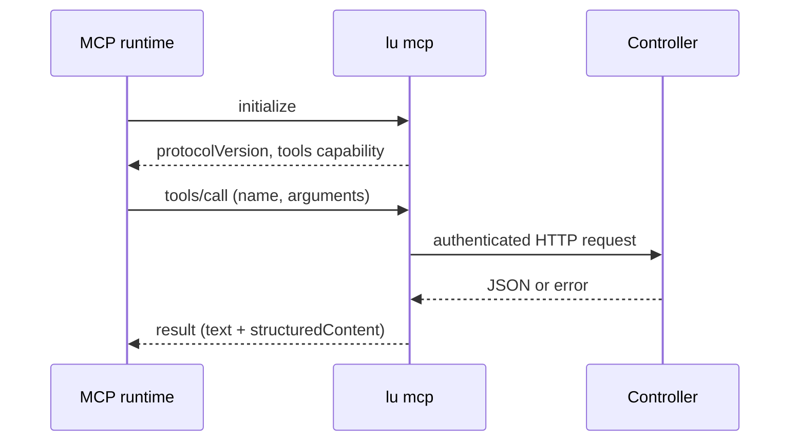

# MCP server

`lu mcp` serves Lu tools over newline-delimited JSON-RPC 2.0 on stdio. It uses the same operator connection settings as the CLI; see [client guide](client-guide.md). A controller that is unreachable at startup still starts the server: each call then returns an `isError` result with the connection error.



## Protocol

| Item | Value |
| --- | --- |
| Framing | One JSON object per line on stdin/stdout. |
| Versions | `2024-11-05`, `2025-03-26`, `2025-06-18` (default). An unknown requested version falls back to the newest. |
| Methods | `initialize`, `ping`, `tools/list`, `tools/call`. Calls before `initialize` get `-32002`. |
| Notifications | Requests without `id` get no reply, including `notifications/initialized`. |
| Argument faults | JSON-RPC `-32602` (unknown argument, missing argument, bad type or shape). |
| Tool failures | A normal result with `isError: true`; the text and `structuredContent` carry the reason. Spec bounds use the CLI's validation text. |
| Other errors | `-32601` unknown method, `-32600` invalid request, `-32700` parse error. |

A successful reply has this shape:

```json
{"jsonrpc":"2.0","id":1,"result":{"content":[{"type":"text","text":"version 0.4.0 ..."}],"isError":false,"structuredContent":{"version":"0.4.0"}}}
```

Worked example — initialize and list tools:

```json
{"jsonrpc":"2.0","id":1,"method":"initialize","params":{"protocolVersion":"2025-06-18"}}
{"jsonrpc":"2.0","id":2,"method":"tools/list","params":{}}
```

## Tools

`readOnlyHint: true` is set on the nine read tools. Only `lu_cancel`, `lu_drain`, `lu_undrain` and `lu_uncordon` carry `destructiveHint: true`.

Every argument is listed below; `?` marks an optional argument.

| Tool | Arguments | Effect |
| --- | --- | --- |
| `lu_status` | none | Controller version, uptime, schema, db size, job counts, node counts. |
| `lu_jobs` | `state?`, `limit?` 1–100, default 20 | Compact newest-first job list. |
| `lu_job` | `id` | Full job detail, spec and artifacts. |
| `lu_logs` | `id`, `lines?` 1–400, default 80 | Log tail with escape sequences removed. |
| `lu_nodes` | none | Node states, providers, cordon details, load, labels, version and disk-free stats. |
| `lu_node` | `node` | One node's state, labels, version, providers, cordon details, load, uptime and disk-free stats. |
| `lu_graph` | none | Horizontal dependency graph of unfinished jobs, with task titles. |
| `lu_result` | `id`, `offset?`, `max_bytes?` 1–32768, default 24576 | Summary, report, diff stats and a page of diff text. |
| `lu_drafts` | `limit?` 1–100, default 20 | Operator-only read of the draft inventory; job-scoped agent paths cannot see drafts. See [drafts.md](drafts.md#mcp-access). |
| `lu_submit` | `repo`, `ref`, `task`; `provider?`, `model?`, `priority?`, `group?`, `require?`, `fallbacks?`, `collect?`, `include_failed?`, `on_conflict?`, `on_stuck?`, `stuck_after?`/`stuck_after_secs?`, `after?`, `after_keys?`, `timeout?`, `timeout_secs?`, `idle_timeout?`, `idle_timeout_secs?`, `harness?`, `expect_files?`, `expect_changed?`, `forbid_changed?`, `min_diff_bytes?`, `max_diff_bytes?`, `expect_mode?`, `key?` | Submit one job. |
| `lu_submit_many` | `jobs[]` 1–12; each with `name`, `repo`, `ref`, `task`, `provider?`, `model?`, `priority?`, `group?`, `require?`, `fallbacks?`, `collect?`, `include_failed?`, `on_conflict?`, `on_stuck?`, `stuck_after?`/`stuck_after_secs?`, `after_names?`, `after_keys?`, `timeout?`, `timeout_secs?`, `idle_timeout?`, `idle_timeout_secs?`, `harness?`, `expect_files?`, `expect_changed?`, `forbid_changed?`, `min_diff_bytes?`, `max_diff_bytes?`, `expect_mode?`, `key?` | Submit named jobs in order. |
| `lu_submit_batch` | `path`, `key_prefix`; `repo?`, `ref?`, `defaults?`, `chain?`, `max_parallel?`, `dry_run?` | Submit one idempotent job per task in a directory or checklist on the MCP host. |
| `lu_cancel` | `id` | Ask the controller to cancel a job. Destructive. |
| `lu_retry` | `id`; `provider?`, `model?`, `priority?`, `group?`, `require?`, `fallbacks?`, `collect?`, `include_failed?`, `on_conflict?`, `on_stuck?`, `stuck_after?`/`stuck_after_secs?`, `after?`, `after_keys?`, `timeout?`, `timeout_secs?`, `idle_timeout?`, `idle_timeout_secs?`, `harness?`, `expect_files?`, `expect_changed?`, `forbid_changed?`, `min_diff_bytes?`, `max_diff_bytes?`, `expect_mode?`, `key?` | Requeue a terminal job in place, keeping its id. |
| `lu_drain` | `node` | Stop assigning new jobs to a node. Destructive. |
| `lu_undrain` | `node` | Allow a drained node to take jobs again. Destructive. |
| `lu_uncordon` | `node`, `provider?` | Clear one provider cordon, or every cordon when the provider is omitted. Destructive. |

`require` holds at most 8 node labels. `fallbacks` holds at most 4 objects with a `provider` and optional `model`. `after`, `after_keys` and `after_names` hold at most 16 entries; `after_keys` resolves existing jobs by their idempotency key. Timeouts are 1–86400 seconds: `timeout_secs` defaults to 3600, and `timeout` wins when both spellings are present. `idle_timeout` wins over `idle_timeout_secs` likewise. `collect` selects `none`, `files`, `apply` or `both` (default `apply`), and `harness` defaults to `opencode`. `task` is inline text, never a path. Expectation lists hold at most 16 entries each: `expect_files` names relative paths, `expect_changed` and `forbid_changed` take globs, and `min_diff_bytes`/`max_diff_bytes` bound the diff size. `expect_mode` is `suspect` (default) or `fail`. `priority` is 0 to 9 (default 5) and dispatches higher values first. `group` is a 1–64 character concurrency group name; groups without a configured or runtime cap are unlimited. `on_stuck` is `none`, `cancel` or `retry`, and `stuck_after`/`stuck_after_secs` is 60 to 86400 seconds; absent values use the agent defaults.

On `lu_retry`, absent fields inherit the source spec. Empty `require` or `fallbacks` clear those lists, and any `after` or `after_keys` argument replaces the dependencies. Expectation fields are likewise overrides: a present list replaces the stored one, and a present bound or mode is set; absent ones stay as they are.

Worked example — submit one job:

```json
{"jsonrpc":"2.0","id":3,"method":"tools/call","params":{"name":"lu_submit","arguments":{"repo":"/srv/app","ref":"main","task":"run the test suite"}}}
```

With no `key`, the server derives `mcp-` plus 16 hex characters of the SHA-256 over the canonical spec with its key removed. Repeating the same arguments targets the same job.

## Batches

`lu_submit_many` validates every name before sending: empty names, duplicates, unknown `after_names`, forward references and cycles are rejected without a partial submission. A controller failure partway through returns `isError: true` with `submitted`, `not_submitted` and their counts.

Worked example — build then test:

```json
{"jsonrpc":"2.0","id":4,"method":"tools/call","params":{"name":"lu_submit_many","arguments":{"jobs":[
  {"name":"build","repo":"/srv/app","ref":"main","task":"build"},
  {"name":"test","repo":"/srv/app","ref":"main","task":"test","after_names":["build"]}
]}}}
```

`lu_submit_batch` reads a directory of task files or a Markdown checklist from the MCP host's filesystem. `path` and `key_prefix` are required. `repo` and `ref` may come from those arguments or from `defaults`. Each job gets the key `<key_prefix>-<slug>`, so a repeated call targets the same jobs. `chain` depends each job on all earlier ones, and `max_parallel` (1–64) sets a runtime group cap before submission. `dry_run` returns the plan in `structuredContent` without contacting the controller or reading an operator token. Paths are not fetched from the caller's machine.

Validation collects duplicate keys, empty or oversized tasks, bad TOML, unknown keys, invalid `after` hints and group conflicts before any request. A controller failure partway through returns `isError: true` with `submitted` and `not_submitted`. Input rules and sidecar fields are in [Batch submissions](batch.md).

Worked example — checklist with shared defaults:

```json
{"jsonrpc":"2.0","id":5,"method":"tools/call","params":{"name":"lu_submit_batch","arguments":{
  "path":"/srv/app/tasks/release.md",
  "key_prefix":"release-1",
  "defaults":"/srv/app/tasks/defaults.toml",
  "chain":true
}}}
```

## Results and paging

`lu_result` caps the whole result at 32 KiB. It shrinks the diff page until the text and structured JSON both fit, so `next_offset` never skips unseen bytes. Stats cover the whole diff; `done` is true when there is no next offset. An unfinished job returns its state with `done: false`.

Worked example — page through a diff:

```json
{"jsonrpc":"2.0","id":5,"method":"tools/call","params":{"name":"lu_result","arguments":{"id":"01ARZ3NDEKTSV4RRFFQ69G5FAV"}}}
{"jsonrpc":"2.0","id":6,"method":"tools/call","params":{"name":"lu_result","arguments":{"id":"01ARZ3NDEKTSV4RRFFQ69G5FAV","offset":24576}}}
```

Other tools cap each text and structured part at about 10 KiB and add a `[cut]` marker when shortened. Tool text is passed through printable-character cleaning; log tails also have ANSI sequences removed.

## Scoped MCP: `ting mcp`

`ting mcp` is a separate stdio server for a harness
running inside a job. It reads `LU_JOB_SOCKET`, the path to the agent's per-job Unix socket, and
connects there; it never reads or sends an operator or agent token. An opencode configuration uses:

```toml
mcp = { lu = { command = ["ting","mcp"] } }
```

It serves only six tools, and each maps to one scope route:

| Tool | Scope route | Effect |
| --- | --- | --- |
| `job_context` | `job_context` | Own spec, state and dependency status; no other job's task text. |
| `submit_child` | `submit_child` | Submit one clamped child job; needs the parent's operator-set `allow_spawn`. |
| `list_children` | `list_children` | Direct children's state, failure class and short summary. |
| `get_child` | `get_child` | One direct child's state, failure class and short summary. |
| `get_child_artifact` | `get_child_artifact` | A direct child's `diff.patch` or `report.json`, re-scrubbed on read while `[artifacts] scrub = true` (the default). |
| `cancel_child` | `cancel_child` | Cancel one direct child and its descendants. |

No status, node, log, draft, drain, audit, metrics or other operator tool is available here,
including the operator-only `lu_drafts` read tool. The server
refuses to start if it can see operator credentials in `LU_URL`, `LU_TOKEN_FILE` or at the standard
operator config paths (`$XDG_CONFIG_HOME/lu/operator.toml`, `~/.config/lu/operator.toml`,
`/etc/lu/operator.toml`), and names the source it found. Tool descriptions mark child output as
untrusted data; every result carries `source: "child_job"` so a harness can keep it separate from
instructions.

`lu mcp` is unchanged: it still uses the operator connection and keeps the full tool list for
humans. The server-side checks, limits and agent socket are described in
[Job-scoped capability](scope.md); the HTTP envelope is in [api.md](api.md#job-scoped-routes).

## Limits and failures

| Condition | Result |
| --- | --- |
| More than 30 submissions in a rolling minute | `isError: true` with the seconds to wait. `lu_submit`, `lu_submit_many`, `lu_submit_batch` and `lu_retry` share the budget. |
| Batch larger than the remaining budget | No request is sent; the error says to wait. |
| Unknown tool or bad arguments | JSON-RPC `-32602`. |
| Job or controller failure | `isError: true`, e.g. `{"structuredContent":{"error":"..."}}`. |
| No controller connection at startup | Every call returns `isError: true` with the stored connection error. |

The operator token is used only for controller requests and never appears in tool results. Job and route details are in [api.md](api.md); connection settings are in [client guide](client-guide.md); operational use is in [operations.md](operations.md).
