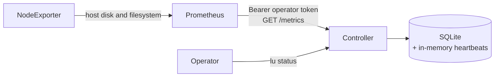

# Monitoring

The controller exposes Prometheus text at `GET /metrics` and a one-shot JSON summary at `GET /v1/status`. Both need an operator token. This page lists the emitted series, a scrape setup and alert examples.



## Scrape configuration

`Content-Type` is `text/plain; version=0.0.4; charset=utf-8`. The operator token grants full operator scope, so protect the scrape config like `lu.toml`.

```yaml
scrape_configs:
  - job_name: lu
    scheme: https
    metrics_path: /metrics
    authorization:
      credentials_file: /etc/lu/operator.token
    tls_config:
      ca_file: /etc/lu/ca.pem
    static_configs:
      - targets: ["controller.internal:7600"]
```

If Prometheus supports only inline `credentials`, protect that file with the same permissions. Lu exports `lu_node_disk_free_percent{node}` for each node's work filesystem when its heartbeat reports disk totals; use node-exporter for host-wide disk and filesystem alerts.

## Series

| Series | Type | Meaning |
| --- | --- | --- |
| `lu_build_info{version}` | gauge | Always `1`; controller build version. |
| `lu_uptime_seconds` | gauge | Seconds since the controller process started. |
| `lu_db_bytes` | gauge | SQLite file size, excluding `-wal` and `-shm`. |
| `lu_schema_version` | gauge | Schema version the binary expects; currently `5`. |
| `lu_recovered_on_boot` | gauge | Jobs moved to `recovering` by this process's boot recovery. |
| `lu_queue_oldest_seconds` | gauge | Age of the oldest `queued` or `blocked` job, or `0` when none. |
| `lu_jobs{state}` | gauge | Jobs in each of nine zero-filled states: `blocked`, `queued`, `leased`, `running`, `recovering`, `needs_input`, `done`, `failed`, `cancelled`. |
| `lu_nodes` | gauge | Nodes that have sent at least one heartbeat. |
| `lu_nodes_online` | gauge | Nodes seen within two lease periods. |
| `lu_nodes_drained` | gauge | Nodes with the drain flag set. |
| `lu_controller_up` | gauge | Always `1` when the route answers. |
| `lu_repo_last_sync_seconds{repo}` | gauge | Seconds since that configured mirror synced; `0` before its first sync. |
| `lu_jobs_completed_total{outcome}` | counter | Terminal jobs by `outcome`: `done`, `failed`, `cancelled`; derived from stored jobs and kept across restarts. |
| `lu_node_last_seen_seconds{node}` | gauge | Seconds since that node's last heartbeat. |
| `lu_node_labels_info{node,label}` | gauge | `1` per label in the node's latest heartbeat. |
| `lu_node_disk_free_percent{node}` | gauge | Free space percentage on the node's work filesystem, when its latest heartbeat reported disk totals. |
| `lu_node_providers{node,provider,state}` | gauge | `1` per reported provider; `state` is `ok`, `cooling`, `disabled` or `unknown`. |

Node series describe the latest heartbeat held in memory. They disappear after a controller restart until agents report again. Provider and label series appear only for nodes that report them.

## `lu status`

`GET /v1/status` and `lu status` return the same fields: `version`, `uptime_secs`, `schema_version`, `db_bytes`, `recovered_on_boot`, `jobs` (nine zero-filled counts), `oldest_queued_secs`, `nodes`, `nodes_online` and `lease_secs`.

Worked example:

```sh
lu status --json
```

```json
{
  "version": "0.1.10",
  "uptime_secs": 3600,
  "schema_version": 5,
  "db_bytes": 81920,
  "recovered_on_boot": 2,
  "jobs": {"blocked": 0, "queued": 1, "leased": 1, "running": 2, "recovering": 0, "needs_input": 0, "done": 12, "failed": 1, "cancelled": 0},
  "oldest_queued_secs": 45,
  "nodes": 3,
  "nodes_online": 2,
  "lease_secs": 60
}
```

`lu check` reports database-level health without Prometheus: `quick_check`, schema version, size, `leased`/`running` jobs without a lease, and orphan dependency rows.

## Alerts

Worked example — a small rule group using only emitted series:

```yaml
groups:
  - name: lu
    rules:
      - alert: LuControllerDown
        expr: up{job="lu"} == 0
        for: 2m
      - alert: LuQueueIsStale
        expr: lu_queue_oldest_seconds > 900
        for: 10m
      - alert: LuNoOnlineNodes
        expr: lu_nodes_online == 0 and lu_jobs{state="queued"} > 0
        for: 5m
      - alert: LuNodeMissingHeartbeat
        expr: lu_node_last_seen_seconds > 180
        for: 2m
      - alert: LuRepoMirrorStale
        expr: lu_repo_last_sync_seconds > 86400
        for: 15m
```

Tune heartbeat and queue thresholds against the configured `lease_secs` and expected backlog. A `recovered_on_boot` increase marks a controller restart that interrupted jobs; check `lu ls --state recovering` to see whether they resume or retry. Failure classes and retry rules are in [lifecycle.md](lifecycle.md); scrape route details are in [api.md](api.md).
