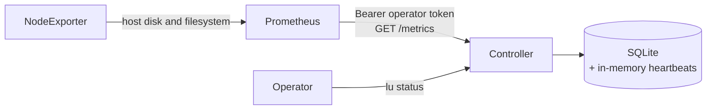

# Monitoring

The controller exposes Prometheus text at `GET /metrics` and a one-shot JSON summary at `GET /v1/status`. Both need an operator token. This page lists the emitted series, a scrape setup and alert examples.



## Scrape configuration

`Content-Type` is `text/plain; version=0.0.4; charset=utf-8`. The operator token grants full operator scope, so protect the scrape config like `lu.toml`.

```yaml
scrape_configs:
  - job_name: lu
    scheme: https
    metrics_path: /metrics
    authorization:
      credentials_file: /etc/lu/operator.token
    tls_config:
      ca_file: /etc/lu/ca.pem
    static_configs:
      - targets: ["controller.internal:7600"]
```

If Prometheus supports only inline `credentials`, protect that file with the same permissions. Lu exports `lu_node_disk_free_percent{node}` for each node's work filesystem when its heartbeat reports disk totals; use node-exporter for host-wide disk and filesystem alerts.

## Series

| Series | Type | Meaning |
| --- | --- | --- |
| `lu_build_info{version}` | gauge | Always `1`; controller build version. |
| `lu_uptime_seconds` | gauge | Seconds since the controller process started. |
| `lu_db_bytes` | gauge | SQLite file size, excluding `-wal` and `-shm`. |
| `lu_schema_version` | gauge | Schema version the binary expects; currently `4`. |
| `lu_recovered_on_boot` | gauge | Jobs moved to `recovering` by this process's boot recovery. |
| `lu_queue_oldest_seconds` | gauge | Age of the oldest `queued` or `blocked` job, or `0` when none. |
| `lu_jobs{state}` | gauge | Jobs in each of eleven zero-filled states: `draft`, `blocked`, `queued`, `leased`, `running`, `recovering`, `needs_input`, `done`, `failed`, `cancelled`, `expired`. |
| `lu_blocked_dependents_total` | gauge | Blocked dependents whose predecessor failed or was cancelled (`blocked_reason: "predecessor failed"`), waiting for a retry or for `[controller] blocked_dependent_ttl` to expire. `0` when none. |
| `lu_drafts{state}` | gauge | Draft inventory by state; `draft` counts waiting drafts and `expired` counts drafts expired by TTL or capacity pressure. |
| `lu_intake_total{source,result}` | counter | Intake events by source and `result`: `accepted`, `dropped`, `bad_signature`, `duplicate`, `rate_limited`, `invalid`. |
| `lu_group_running{group}` | gauge | Jobs in that configured or runtime-capped group currently `leased`, `running`, `recovering` or `needs_input`. |
| `lu_group_limit{group}` | gauge | Active `max_running` cap for that group, from config or a runtime update. |
| `lu_nodes` | gauge | Nodes that have sent at least one heartbeat. |
| `lu_nodes_online` | gauge | Nodes seen by this controller process within two lease periods; a restart clears prior liveness. |
| `lu_nodes_drained` | gauge | Nodes with the drain flag set. |
| `lu_controller_up` | gauge | Always `1` when the route answers. |
| `lu_repo_last_sync_seconds{repo}` | gauge | Seconds since that configured mirror synced; `0` before its first sync. |
| `lu_jobs_stuck_stopped_total{mode}` | counter | Jobs stopped by the agent's stuck policy, by `mode` (`cancel` or `retry`), since this controller process started. |
| `lu_jobs_completed_total{outcome}` | counter | Terminal jobs by `outcome`: `done`, `failed`, `cancelled`; derived from stored jobs and kept across restarts. |
| `lu_jobs_no_changes_total` | counter | `done` jobs whose stored diff was empty and `allow_empty` was false, summed since this controller process started. |
| `lu_jobs_expect_failed_total` | counter | `done` jobs whose suspect expectations failed, summed since this controller process started. |
| `lu_publish_total{target,result}` | counter | Publish attempts by `target` (`snapshot` or `source_branch`) and fixed `result` code, since this controller process started. Results include `published`, `published_snapshot_fallback`, `gates_failed`, `hold`, `no_snapshot_prefix`, `failed`, `denied`, `invalid`, `state`, `git` and `rate_limited`. |
| `lu_node_last_seen_seconds{node}` | gauge | Seconds since that node's last heartbeat. |
| `lu_node_labels_info{node,label}` | gauge | `1` per label in the node's latest heartbeat. |
| `lu_node_disk_free_percent{node}` | gauge | Free space percentage on the node's work filesystem, when its latest heartbeat reported disk totals. |
| `lu_node_providers{node,provider,state}` | gauge | `1` per reported provider; `state` is `ok`, `cooling`, `disabled` or `unknown`. |
| `lu_audit_write_errors_total` | counter | Audit record enqueue or write failures since this controller process started. Always present, `0` when auditing is off. A non-zero value means one or more events were not recorded; the job still completed. |
| `lu_node_cordon_seconds_remaining{node,provider,source}` | gauge | Seconds left on a failure cordon; `0` for Reiki cordons that lift on healthy heartbeats. |
| `lu_node_workspace_bytes{node}` | gauge | Bytes in job workspaces from the node's latest heartbeat. |
| `lu_node_workspace_count{node}` | gauge | Number of job workspaces from the node's latest heartbeat. |
| `lu_node_workspace_reclaimed_bytes_total{node}` | counter | Bytes reclaimed by workspace deletion since the agent started. |
| `lu_node_workspace_evictions_total{node}` | counter | Workspaces removed by eviction since the agent started. |
| `lu_node_workspace_delete_errors_total{node}` | counter | Failed workspace deletions since the agent started; failures are retried with backoff. |
| `lu_scope_requests_total{route,result}` | counter | Scoped job requests by route and `result` (`ok` or a failure code such as `bad_request`, `limit_exceeded` or `internal`), since controller start. |
| `lu_scope_limit_exceeded_total{limit}` | counter | Scoped requests refused by a named cap, since controller start; the same names appear in `429 limit_exceeded` errors. |

`lu_drafts{state}` follows the draft inventory; an `expired` count that keeps growing means approved
review is not keeping up with the `[drafts] ttl` or that draft caps are forcing older drafts out.
`lu_intake_total` counts intake outcomes, never
payload text: a rise in `bad_signature` points at a sender or signing-key mismatch, while
`rate_limited` or `duplicate` can be normal retry traffic. Drop reasons are not attributed to a
particular rule, so correlate with the operator's intake logs and [intake.md](intake.md#outcomes-and-metrics).

`lu_blocked_dependents_total` counts jobs blocked by a failed or cancelled predecessor. A sustained
non-zero value means someone should retry the predecessor (`lu retry <id>`, or `--chain` to retry
the dependents as well); otherwise those jobs fail with class `dependency` when the TTL expires.
`lu top` shows the same waiting-dependent count; see
[dependencies.md](dependencies.md#waiting-and-promotion).

Node label, provider, disk and last-seen series come from the controller store's persisted latest heartbeat and survive a restart; `lu_node_last_seen_seconds` keeps growing until a new heartbeat arrives. Workspace series come from the same heartbeat but are kept only in controller memory, so they return to zero on a controller restart and their cumulative agent counters restart with the agent. `lu_nodes_online` uses a monotonic timestamp reset at boot, so it becomes `0` on restart until agents report again. Provider and label series appear only for nodes that report them. Cordon series come from the store; boot clears cordons, so they reappear only when a new failure or Reiki reading sets one. Group series appear for named `[[controller.groups]]` entries and for groups given a runtime cap through `PUT /v1/groups/{name}/limit`. A job in an uncapped group has no group series. Runtime caps return to configured values on restart.

## `lu status`

`GET /v1/status` and `lu status` return the same fields: `version`, `uptime_secs`, `schema_version`, `db_bytes`, `recovered_on_boot`, `jobs` (eleven zero-filled counts, including `draft` and `expired`), `waiting_dependents`, `oldest_queued_secs`, `drafts`, `oldest_draft_secs`, `nodes`, `nodes_online`, `lease_secs`, `audit_write_errors`, `scope_enabled`, `scope_max_depth`, `scope_max_children_per_job` and `scope_max_descendants_per_root`. `audit_write_errors` is the same counter as `lu_audit_write_errors_total`; `lu show <id>` also prints it in the job view. Draft counts and the oldest draft age are visible in `lu top`; see [drafts.md](drafts.md#observing-drafts).

Worked example:

```sh
lu status --json
```

```json
{
  "version": "0.5.1",
  "uptime_secs": 3600,
  "schema_version": 4,
  "db_bytes": 81920,
  "recovered_on_boot": 2,
  "jobs": {"draft": 3, "blocked": 0, "queued": 1, "leased": 1, "running": 2, "recovering": 0, "needs_input": 0, "done": 12, "failed": 1, "cancelled": 0, "expired": 1},
  "oldest_queued_secs": 45,
  "drafts": 3,
  "oldest_draft_secs": 620,
  "nodes": 3,
  "nodes_online": 2,
  "lease_secs": 60,
  "audit_write_errors": 0,
  "scope_enabled": false,
  "scope_max_depth": 2,
  "scope_max_children_per_job": 8,
  "scope_max_descendants_per_root": 32
}
```

`lu check` validates config values and reports database-level health without Prometheus: `quick_check`, schema version, size, `leased`/`running` jobs without a lease, and orphan dependency rows. Its `checks:` line names what ran; no port is bound.

## Alerts

Worked example — a small rule group using only emitted series:

```yaml
groups:
  - name: lu
    rules:
      - alert: LuControllerDown
        expr: up{job="lu"} == 0
        for: 2m
      - alert: LuQueueIsStale
        expr: lu_queue_oldest_seconds > 900
        for: 10m
      - alert: LuNoOnlineNodes
        expr: lu_nodes_online == 0 and lu_jobs{state="queued"} > 0
        for: 5m
      - alert: LuNodeMissingHeartbeat
        expr: lu_node_last_seen_seconds > 180
        for: 2m
      - alert: LuRepoMirrorStale
        expr: lu_repo_last_sync_seconds > 86400
        for: 15m
      - alert: LuWorkspaceDeleteErrors
        expr: increase(lu_node_workspace_delete_errors_total[15m]) > 0
        for: 5m
      - alert: LuWaitingDependents
        expr: lu_blocked_dependents_total > 0
        for: 15m
      - alert: LuDraftsBacklog
        expr: lu_drafts{state="draft"} > 50
        for: 30m
      - alert: LuIntakeBadSignatures
        expr: increase(lu_intake_total{result="bad_signature"}[15m]) > 0
        for: 5m
```

Tune heartbeat, queue and draft thresholds against the configured `lease_secs`, `[drafts] ttl` and
expected backlog. A `recovered_on_boot` increase marks a controller restart that interrupted jobs;
check `lu ls --state recovering` to see whether they resume or retry. Failure classes and retry
rules are in [lifecycle.md](lifecycle.md); scrape route details are in [api.md](api.md).
