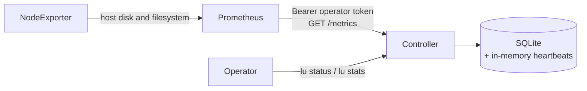

# Monitoring

The controller exposes Prometheus text at `GET /metrics`, a one-shot JSON summary at `GET /v1/status` and a node-contribution report at `GET /v1/stats`. All three need an operator token. This page lists the emitted series, a scrape setup and alert examples.



## Scrape configuration

`Content-Type` is `text/plain; version=0.0.4; charset=utf-8`. The operator token grants full operator scope, so protect the scrape config like `lu.toml`.

```yaml
scrape_configs:
  - job_name: lu
    scheme: https
    metrics_path: /metrics
    authorization:
      credentials_file: /etc/lu/operator.token
    tls_config:
      ca_file: /etc/lu/ca.pem
    static_configs:
      - targets: ["controller.internal:7600"]
```

If Prometheus supports only inline `credentials`, protect that file with the same permissions. Lu exports `lu_node_disk_free_percent{node}` for each node's work filesystem when its heartbeat reports disk totals; use node-exporter for host-wide disk and filesystem alerts.

## Series

| Series | Type | Meaning |
| --- | --- | --- |
| `lu_build_info{version}` | gauge | Always `1`; controller build version. |
| `lu_uptime_seconds` | gauge | Seconds since the controller process started. |
| `lu_db_bytes` | gauge | SQLite file size, excluding `-wal` and `-shm`. |
| `lu_schema_version` | gauge | Schema version the binary expects; currently `7`. |
| `lu_recovered_on_boot` | gauge | Jobs moved to `recovering` by this process's boot recovery. |
| `lu_queue_oldest_seconds` | gauge | Age of the oldest `queued` or `blocked` job, or `0` when none. |
| `lu_jobs{state}` | gauge | Jobs in each of twelve zero-filled states: `draft`, `blocked`, `queued`, `leased`, `running`, `recovering`, `needs_input`, `done`, `failed`, `cancelled`, `expired`, `deadline_missed`. There are no separate schedule-wait or reload counters. |
| `lu_blocked_dependents_total` | gauge | Blocked dependents whose predecessor failed or was cancelled (`blocked_reason: "predecessor failed"`), waiting for a retry or for `[controller] blocked_dependent_ttl` to expire. `0` when none. |
| `lu_drafts{state}` | gauge | Draft inventory by state; `draft` counts waiting drafts and `expired` counts drafts expired by TTL or capacity pressure. |
| `lu_intake_total{source,result}` | counter | Intake events by source and `result`: `accepted`, `dropped`, `bad_signature`, `duplicate`, `rate_limited`, `invalid`. |
| `lu_group_running{group}` | gauge | Jobs in that configured or runtime-capped group currently `leased`, `running`, `recovering` or `needs_input`. |
| `lu_group_limit{group}` | gauge | Active `max_running` cap for that group, from config or a runtime update. |
| `lu_nodes` | gauge | Nodes that have sent at least one heartbeat. |
| `lu_nodes_online` | gauge | Nodes seen by this controller process within two lease periods; a restart clears prior liveness. |
| `lu_nodes_drained` | gauge | Nodes with the drain flag set. |
| `lu_controller_up` | gauge | Always `1` when the route answers. |
| `lu_repo_last_sync_seconds{repo}` | gauge | Seconds since that configured mirror synced; `0` before its first sync. |
| `lu_jobs_stuck_stopped_total{mode}` | counter | Jobs stopped by the agent's stuck policy, by `mode` (`cancel` or `retry`), since this controller process started. |
| `lu_jobs_completed_total{outcome}` | counter | Terminal jobs by `outcome`: `done`, `failed`, `cancelled`; derived from stored jobs and kept across restarts. |
| `lu_node_jobs_total{node,state}` | counter | Terminal jobs for a configured node and fixed `state`: `done`, `failed`, `cancelled`, `expired`; derived from all retained jobs. |
| `lu_node_failures_total{node,class}` | counter | Failed jobs for a configured node and one of five fixed `class` values: `node`, `provider`, `execution`, `dependency`, `conflict`. |
| `lu_node_busy_seconds_total{node}` | counter | Sum of wall-clock job durations on a configured node; not CPU time. |
| `lu_node_job_runtime_seconds_{bucket,count,sum}{node[,le]}` | histogram | Wall-clock `finished_at - started_at` (or creation time when start is missing), with fixed `le` bounds. |
| `lu_node_queue_wait_seconds_{bucket,count,sum}{node[,le]}` | histogram | Wall-clock `started_at - created_at`, with the same fixed `le` bounds. |
| `lu_node_job_runtime_seconds_{median,p90}_seconds{node}`, `lu_node_queue_wait_seconds_{median,p90}_seconds{node}` | gauge | Nearest-rank percentiles in whole seconds; `0` when there are no samples. |
| `lu_node_last_job_finished_timestamp_seconds{node}` | gauge | Newest terminal `finished_at` on a configured node; `0` when that node has no finished job. |
| `lu_jobs_no_changes_total` | counter | `done` jobs whose stored diff was empty and `allow_empty` was false, summed since this controller process started. |
| `lu_jobs_expect_failed_total` | counter | `done` jobs whose suspect expectations failed, summed since this controller process started. |
| `lu_publish_total{target,result}` | counter | Publish attempts by `target` (`snapshot` or `source_branch`) and fixed `result` code, since this controller process started. Results include `published`, `published_snapshot_fallback`, `gates_failed`, `hold`, `no_snapshot_prefix`, `failed`, `denied`, `invalid`, `state`, `git` and `rate_limited`. |
| `lu_node_last_seen_seconds{node}` | gauge | Seconds since that node's last heartbeat. |
| `lu_node_labels_info{node,label}` | gauge | `1` per label in the node's latest heartbeat. |
| `lu_node_disk_free_percent{node}` | gauge | Free space percentage on the node's work filesystem, when its latest heartbeat reported disk totals. |
| `lu_node_harness_ok{node}` | gauge | `1` when the latest heartbeat reports a healthy harness or omits `harness_ok` (older agents); `0` when it reports `harness_ok: false`. |
| `lu_node_disk_free_pct{node}` | gauge | Free work-filesystem percentage from the heartbeat's `disk_free_pct`. Older agents without the field report `100`. |
| `lu_node_providers{node,provider,state}` | gauge | `1` per reported provider; `state` is `ok`, `cooling`, `disabled` or `unknown`. |
| `lu_audit_write_errors_total` | counter | Audit record enqueue or write failures since this controller process started. Always present, `0` when auditing is off. A non-zero value means one or more events were not recorded; the job still completed. |
| `lu_node_cordon_seconds_remaining{node,provider,source}` | gauge | Seconds left on a failure cordon; `0` for Reiki cordons that lift on healthy heartbeats. |
| `lu_node_workspace_bytes{node}` | gauge | Bytes in job workspaces from the node's latest heartbeat. |
| `lu_node_workspace_count{node}` | gauge | Number of job workspaces from the node's latest heartbeat. |
| `lu_node_workspace_reclaimed_bytes_total{node}` | counter | Bytes reclaimed by workspace deletion since the agent started. |
| `lu_node_workspace_evictions_total{node}` | counter | Workspaces removed by eviction since the agent started. |
| `lu_node_workspace_delete_errors_total{node}` | counter | Failed workspace deletions since the agent started; failures are retried with backoff. |
| `lu_scope_requests_total{route,result}` | counter | Scoped job requests by route and `result` (`ok` or a failure code such as `bad_request`, `limit_exceeded` or `internal`), since controller start. |
| `lu_scope_limit_exceeded_total{limit}` | counter | Scoped requests refused by a named cap, since controller start; the same names appear in `429 limit_exceeded` errors. |
| `lu_node_jobs_total{node,state}` | counter | Terminal jobs on a configured node; `state` is `done`, `failed` or `cancelled`. |
| `lu_node_failures_total{node,class}` | counter | Failed jobs on a configured node by fixed `class`: `node`, `provider`, `execution`, `dependency`, `conflict`. |
| `lu_node_busy_seconds_total{node}` | counter | Wall-clock job duration on a configured node, in seconds; not CPU time. |
| `lu_node_job_runtime_seconds_bucket{node,le}`, `lu_node_job_runtime_seconds_count{node}`, `lu_node_job_runtime_seconds_sum{node}` | histogram | Terminal job runtime. Fixed `le` values are `1`, `5`, `15`, `60`, `300`, `900`, `3600`, `21600` and `+Inf` seconds. |
| `lu_node_job_runtime_seconds_median_seconds{node}`, `lu_node_job_runtime_seconds_p90_seconds{node}` | gauge | All-time median and p90 runtime in seconds, from the same stored terminal jobs. |
| `lu_node_queue_wait_seconds_bucket{node,le}`, `lu_node_queue_wait_seconds_count{node}`, `lu_node_queue_wait_seconds_sum{node}` | histogram | Time from job creation to start. Fixed `le` values match runtime. |
| `lu_node_queue_wait_seconds_median_seconds{node}`, `lu_node_queue_wait_seconds_p90_seconds{node}` | gauge | All-time median and p90 queue wait in seconds. |
| `lu_node_last_job_finished_timestamp_seconds{node}` | gauge | Unix timestamp of the newest terminal finish on that node; `0` means no stored finish. |

`lu_drafts{state}` follows the draft inventory; an `expired` count that keeps growing means approved
review is not keeping up with the `[drafts] ttl` or that draft caps are forcing older drafts out.
`lu_intake_total` counts intake outcomes, never
payload text: a rise in `bad_signature` points at a sender or signing-key mismatch, while
`rate_limited` or `duplicate` can be normal retry traffic. Drop reasons are not attributed to a
particular rule, so correlate with the operator's intake logs and [intake.md](intake.md#outcomes-and-metrics).

`lu_blocked_dependents_total` counts jobs blocked by a failed or cancelled predecessor. A sustained
non-zero value means someone should retry the predecessor in place (`lu retry <id>`, or `--chain`
to restore blocked dependents transitively); otherwise those jobs fail with class `dependency` when
the TTL expires.
`lu top` shows the same waiting-dependent count; see
[dependencies.md](dependencies.md#waiting-and-promotion).

Node label, provider, disk and last-seen series come from the controller store's persisted latest heartbeat and survive a restart; `lu_node_last_seen_seconds` keeps growing until a new heartbeat arrives. Workspace series come from the same heartbeat but are kept only in controller memory, so they return to zero on a controller restart and their cumulative agent counters restart with the agent. `lu_nodes_online` uses a monotonic timestamp reset at boot, so it becomes `0` on restart until agents report again. Provider and label series appear only for nodes that report them. Cordon series come from the store; boot clears cordons, so they reappear only when a new failure or Reiki reading sets one. Group series appear for named `[[controller.groups]]` entries and for groups given a runtime cap through `PUT /v1/groups/{name}/limit`. A job in an uncapped group has no group series. Runtime caps return to configured values on restart.

The metrics expose raw heartbeat signals; there is no threshold series. `lu nodes` and `lu top` read the controller's `[schedule] min_disk_free_pct` from the additive `min_disk_free_pct` field of each `NodeView`. They show `harness down` when `harness_ok` is false, `disk free N%` only when it is below the threshold, and a warning tone in `lu top` when it is below twice the threshold. An older controller that omits the threshold leaves disk out of `HEALTH`; the raw percentage stays in `disk_free_pct` and the `DISK_FREE` column.

## Node contribution statistics

`GET /v1/stats`, `lu stats` and the node series in `/metrics` all read one report computed by the
controller store from stored jobs. Only terminal jobs (`done`, `failed`, `cancelled`, `expired`) with
a `finished_at` within the requested window contribute. `since` is inclusive on `finished_at`;
without it the report covers all retained history. The CLI accepts `--since <unix-seconds|UTC-date|duration>`
(`30m`, `1h30m`, `7d`), and the API accepts the same syntax in `?since=`. See
[api.md](api.md#statsreport) for the JSON shape.

- **Retention.** Lu does not prune jobs: there is no job-delete path, so the persistent `jobs` table
  is the source of truth. Counters derived from it do not fall when old jobs age out and survive a
  controller restart. `/metrics` queries the report without `since` for this reason; a `since`
  window changes the report's counts by design and must not be used as a monotonic counter series.
- **Busy time.** `busy_seconds` and the runtime histogram use wall-clock job duration
  (`finished_at - started_at`, falling back to `finished_at - created_at` for older rows), not CPU
  time. Queue wait uses `started_at - created_at`. Jobs with no `finished_at` still count in states,
  retries and repositories, but contribute no duration sample. Negative gaps are clamped to zero.
- **Bounded labels.** `node` label values come only from configured `[[controller.agents]]` names,
  with zero-valued rows for nodes that have not finished a job. `state` and `class` are fixed names.
  Repository text is never a metric label: the report exposes at most ten `host/owner/name` values
  in `top_repositories` for the JSON and CLI views only.
- **Buckets and retries.** Duration buckets are cumulative with fixed `le` bounds of `1`, `5`,
  `15`, `60`, `300`, `900`, `3600`, `21600` seconds plus `+Inf`. `retries` sums `attempt - 1` over
  counted terminal jobs. A failed job with no stored class is counted as `node`.

PromQL examples using only emitted series:

```promql
# Failed jobs in the last hour per node (counters are all-time, so use a range).
sum by (node) (increase(lu_node_jobs_total{state="failed"}[1h]))

# Wall-clock busy fraction per node over five minutes.
sum by (node) (rate(lu_node_busy_seconds_total[5m]))

# Slowest decile of job runtime over the last hour.
histogram_quantile(0.9, sum by (le) (rate(lu_node_job_runtime_seconds_bucket[1h])))

# Nodes with no terminal job in the last day.
time() - lu_node_last_job_finished_timestamp_seconds > 86400
```

For a sortable table of the same report, use `lu stats --by node`, `--by repo` or `--by state`;
all three tables are drawn from the same fields that back the metrics above.
The per-node contribution series come from one all-time store report. They are monotonic counters derived from stored jobs, so they survive a restart (jobs are not pruned); `node` is only ever a configured node name and `state`/`class` are fixed values. Repository names, job content and operator names are never labels. Busy seconds are wall-clock job duration, not CPU time; queue wait is `started_at - created_at`. The `_median_seconds` and `_p90_seconds` gauges are all-time summaries, while `_bucket` series support rate-based percentiles over a scrape window.

## `lu status`

`GET /v1/status` and `lu status` return the same fields: `version`, `uptime_secs`, `schema_version`, `db_bytes`, `recovered_on_boot`, `jobs` (twelve zero-filled counts, including `draft`, `expired` and `deadline_missed`), `waiting_dependents`, `oldest_queued_secs`, `drafts`, `oldest_draft_secs`, `nodes`, `nodes_online`, `lease_secs`, `audit_write_errors`, `scope_enabled`, `scope_max_depth`, `scope_max_children_per_job` and `scope_max_descendants_per_root`. `audit_write_errors` is the same counter as `lu_audit_write_errors_total`; `lu show <id>` also prints it in the job view. Draft counts and the oldest draft age are visible in `lu top`; see [drafts.md](drafts.md#observing-drafts).

Worked example:

```sh
lu status --json
```

```json
{
  "version": "0.5.1",
  "uptime_secs": 3600,
  "schema_version": 7,
  "db_bytes": 81920,
  "recovered_on_boot": 2,
  "jobs": {"draft": 3, "blocked": 0, "queued": 1, "leased": 1, "running": 2, "recovering": 0, "needs_input": 0, "done": 12, "failed": 1, "cancelled": 0, "expired": 1, "deadline_missed": 0},
  "oldest_queued_secs": 45,
  "drafts": 3,
  "oldest_draft_secs": 620,
  "nodes": 3,
  "nodes_online": 2,
  "lease_secs": 60,
  "audit_write_errors": 0,
  "scope_enabled": false,
  "scope_max_depth": 2,
  "scope_max_children_per_job": 8,
  "scope_max_descendants_per_root": 32
}
```

`lu check` validates config values and reports database-level health without Prometheus: `quick_check`, schema version, size, `leased`/`running` jobs without a lease, and orphan dependency rows. Its `checks:` line names what ran; no port is bound.

## Per-node monitoring assets

Two ready-to-use assets live in `contrib/monitoring/`:

- `grafana-lu-nodes.json` — a Grafana dashboard with a `node` variable sourced from `lu_node_jobs_total`. It has panels for utilisation per node (`rate(lu_node_busy_seconds_total[5m])`), failure rate by node and class, busy share of the fleet, p50/p90 runtime and queue wait (`histogram_quantile` over the fixed buckets), and time since the last finished job. Nodes whose finish timestamp is `0` are omitted from the last panel because they have never finished a job.
- `lu-alerts.yml` — a Prometheus rule file with `LuNodeIdleWhileJobsQueued`, `LuNodeFailureRateHigh` and `LuControllerMetricsMissing`. Load it with `rule_files:` in `prometheus.yml`. The idle rule treats `0` as never finished, the failure rule groups by `node` and `class`, and the controller rule fires when `up{job="lu"}` is down or controller metrics are absent.

Both files use only the series in the table above and only configured node names as label values. They contain no credentials, repository text, job names or operator names. The alert thresholds are starting points: tune the idle window, failure rate and `for` durations against the fleet's `lease_secs`, normal failure rate and expected backlog.

`scripts/check-monitoring.sh` parses both files (JSON and YAML) and checks that the dashboard has panels and the rule file has the three alerts. CI runs it alongside the other repository checks.

## Alerts

Worked example — a small rule group using only emitted series:

```yaml
groups:
  - name: lu
    rules:
      - alert: LuControllerDown
        expr: up{job="lu"} == 0
        for: 2m
      - alert: LuQueueIsStale
        expr: lu_queue_oldest_seconds > 900
        for: 10m
      - alert: LuNoOnlineNodes
        expr: lu_nodes_online == 0 and lu_jobs{state="queued"} > 0
        for: 5m
      - alert: LuNodeMissingHeartbeat
        expr: lu_node_last_seen_seconds > 180
        for: 2m
      - alert: LuRepoMirrorStale
        expr: lu_repo_last_sync_seconds > 86400
        for: 15m
      - alert: LuWorkspaceDeleteErrors
        expr: increase(lu_node_workspace_delete_errors_total[15m]) > 0
        for: 5m
      - alert: LuWaitingDependents
        expr: lu_blocked_dependents_total > 0
        for: 15m
      - alert: LuDraftsBacklog
        expr: lu_drafts{state="draft"} > 50
        for: 30m
      - alert: LuIntakeBadSignatures
        expr: increase(lu_intake_total{result="bad_signature"}[15m]) > 0
        for: 5m
      - alert: LuNodeFailuresSpike
        expr: increase(lu_node_jobs_total{state="failed"}[15m]) > 5
        for: 5m
```

Tune heartbeat, queue and draft thresholds against the configured `lease_secs`, `[drafts] ttl` and
expected backlog. A `recovered_on_boot` increase marks a controller restart that interrupted jobs;
check `lu ls --state recovering` to see whether they resume or retry. Failure classes and retry
rules are in [lifecycle.md](lifecycle.md); scrape route details are in [api.md](api.md).
