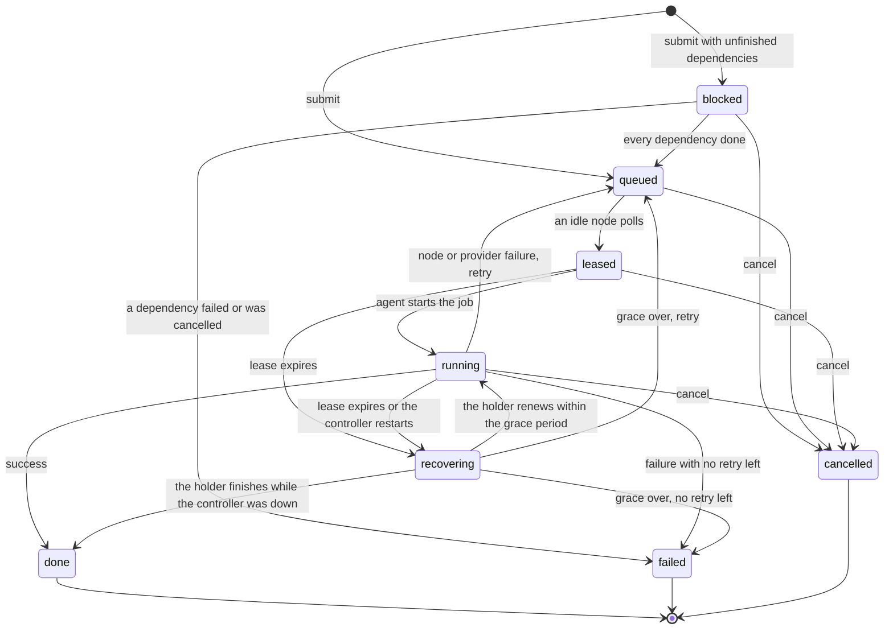

# Operations

This page covers a packaged controller deployment, upgrades, backup, restart behaviour, leases and retries, provider cordons, and how to read `lu nodes`.

**0.1.0 status:** controller, agent (`lu agent`) and operator CLI work end to end. Read the agent limitation in `docs/security.md` before running an agent next to anything sensitive.

## Layout

The contributed units assume this layout:

| Path | Owner / mode | Purpose |
| --- | --- | --- |
| `/usr/local/bin/lu` | `root:root`, `0755` | binary installed by `make install` as root |
| `/etc/lu/lu.toml` | `root:lu`, `0640` | controller config (hashes and paths only) |
| `/etc/lu/agent.toml` | `root:lu`, `0640` | agent config |
| `/etc/lu/agent.token` | `lu:lu`, `0600` | agent token, readable only by the agent user |
| `/etc/lu/operator.token` | operator user, `0600` | operator token, not installed by the unit |
| `/etc/lu/tls/cert.pem` | `root:lu`, `0644` | TLS certificate |
| `/etc/lu/tls/key.pem` | `lu:lu`, `0600` | TLS private key |
| `/var/lib/lu/lu.db` | `lu:lu`, `0600` | SQLite database (plus `-wal` and `-shm` while running) |
| `/var/lib/lu/artifacts/` | `lu:lu`, `0700` | per-job logs and artifacts |
| `/var/lib/lu/work/` | `lu:lu-harness`, `0770` | agent staging root |
| `/var/lib/lu-harness/` | `lu-harness:lu-harness`, `0700` | harness home |

If `PREFIX` is not `/usr/local`, change `ExecStart` in the units to match.

## Install the service

As root:

```sh
make install
install -m 0644 contrib/lu.sysusers /etc/sysusers.d/lu.conf
install -m 0644 contrib/lu.tmpfiles /etc/tmpfiles.d/lu.conf
systemd-sysusers
systemd-tmpfiles --create
install -d -m 0750 -o root -g lu /etc/lu
```

Create the config and tokens. Never put a plaintext token in the config:

```sh
umask 077
printf '%s' "$(head -c 32 /dev/urandom | base64)" > /etc/lu/agent.token
printf '%s' "$(head -c 32 /dev/urandom | base64)" > /etc/lu/operator.token
chown lu:lu /etc/lu/agent.token
chmod 600 /etc/lu/agent.token /etc/lu/operator.token
sha256sum /etc/lu/agent.token /etc/lu/operator.token
```

Put the two hashes in `lu.toml`. A trailing newline in a token file is trimmed by the CLI but is *not* trimmed when you compute `sha256sum`; use `printf '%s'` as above so the hash and the token agree.

Copy `contrib/lu-controller.toml` to `/etc/lu/lu.toml`, replace the hashes, paths and names, then:

```sh
lu check --config /etc/lu/lu.toml
systemctl daemon-reload
systemctl enable --now lu-controller.service
systemctl status lu-controller.service
```

`lu-controller.service` is `Type=simple`; `lu` does not implement `sd_notify`, so `Type=notify` is not available. It runs as `lu`, uses `StateDirectory=lu`, and applies `NoNewPrivileges`, `ProtectSystem=strict`, `ProtectHome`, `PrivateTmp`, `PrivateDevices`, restricted address families, an empty capability set and `LimitNOFILE=65536`. `ReadWritePaths=/var/lib/lu` is the only writable system path. `TimeoutStopSec=40` is above the default `[service].shutdown_timeout_secs=25`, although the binary's actual in-flight drain is currently fixed at 10 seconds.

`lu-agent.service` is present for the intended agent layout, but it runs `lu agent`, which this tree does not implement. Do not enable it in 0.1.0; it will fail with a command-line usage error.

The HTTP health route needs no token:

```sh
curl -fsS http://127.0.0.1:7600/v1/health
```

It returns `{"ok":true,"version":"…","db":"ok"}`. A non-loopback listener requires TLS; use `https://` and the configured certificate.

## Upgrade

1. Read `CHANGELOG.md` and run the new binary's `lu check --config /etc/lu/lu.toml` before replacing anything.
2. Back up the database and artifacts (below).
3. Stop the controller: `systemctl stop lu-controller.service`.
4. Replace `/usr/local/bin/lu` and any changed unit files, then `systemctl daemon-reload`.
5. Start the controller and check `/v1/health`, `journalctl -u lu-controller`, `lu ls` and `lu nodes`.

The store has schema version 1. It creates or verifies the schema at startup and refuses a database whose schema version is newer than the binary supports. Downgrades are not supported; roll back by restoring the matching database backup as well as the older binary.

There is no online config reload. `SIGHUP` is not handled; restart the controller after changing config, TLS files or token hashes.

## Backup and restore

The database uses SQLite WAL mode. A plain copy of `lu.db` while the controller is running can miss committed transactions held in `lu.db-wal`.

Online database backup, without stopping the controller:

```sh
install -d -m 0700 /var/backups/lu
sqlite3 /var/lib/lu/lu.db ".backup '/var/backups/lu/lu-$(date +%F).db'"
```

If `sqlite3` is not available, stop the controller and copy `lu.db`, `lu.db-wal` and `lu.db-shm` together. Do not copy only `lu.db` from a live controller.

Artifacts are ordinary files under `/var/lib/lu/artifacts/<job id>/`. Back them up with modes preserved:

```sh
tar -C /var/lib/lu -czf "/var/backups/lu/artifacts-$(date +%F).tar.gz" artifacts
```

The database and artifacts are not updated in one transaction. For a consistent pair, stop the controller before taking both; otherwise accept that a job may reference an artifact that is missing from, or newer than, the snapshot. Backups contain job tasks, diffs, reports and logs, which may include source code and secrets that were present in a checked-out repository: store them with the same care as the live artifact directory.

Restore:

```sh
systemctl stop lu-controller.service
install -d -m 0750 -o lu -g lu /var/lib/lu
install -m 0600 -o lu -g lu /var/backups/lu/lu-YYYY-MM-DD.db /var/lib/lu/lu.db
rm -f /var/lib/lu/lu.db-wal /var/lib/lu/lu.db-shm
rm -rf /var/lib/lu/artifacts
tar -C /var/lib/lu -xzf /var/backups/lu/artifacts-YYYY-MM-DD.tar.gz
chown -R lu:lu /var/lib/lu/artifacts
chmod 0700 /var/lib/lu/artifacts
systemctl start lu-controller.service
```

## What a controller restart does

On startup the controller runs boot recovery before serving traffic:

- Every job in `leased` or `running` becomes `recovering`. Its node and epoch are kept.
- Jobs already in `recovering` stay there, but their grace timer is restarted. Lease and recovery timestamps are based on a monotonic clock that begins again with the process, so the old values are not meaningful after a restart.
- An agent that still holds the lease and renews the same epoch within `recovery_grace_secs` moves the job back to `running` and continues.
- If the grace period expires first, a node-class failure is applied. If `attempt <= max_retries`, the job returns to `queued`, the attempt is incremented, the node is cleared, and `failure_class`, `cancel_requested` and `finished_at` are cleared. Otherwise it becomes `failed` with `failure_class: "node"`.
- `queued`, `blocked`, `done`, `failed` and `cancelled` jobs are not changed by boot recovery.

The listener stops accepting new connections on `SIGTERM` or Ctrl-C and drains in-flight connections for up to 10 seconds. The contributed unit allows 40 seconds before systemd sends `SIGKILL`.

If the controller is down for longer than a lease, agents cannot renew. When it returns, the same recovery path applies; a job can therefore consume a retry even though the harness itself did nothing wrong.

## Leases and retries



A `needs_input` state is reserved for interactive harnesses and unreachable in 0.1.0.

A job submitted with `after` dependencies starts as `blocked` when at least one dependency is not `done`; if all are already `done`, it starts as `queued`. When a dependency finishes `done`, all blocked dependents whose remaining dependencies are `done` move to `queued` and waiter polls wake. When a dependency finishes `failed` or `cancelled`, blocked dependents fail with `failure_class: "dependency"`, a summary naming the dependency and its state, and the failure cascades through their own dependents. Dependency failures never retry, and dependencies do not transfer results or artifacts to the dependent job.

A job starts as `queued` with `attempt = 1` and `epoch = 0`. When an idle, non-draining node with no held job asks for work, the controller assigns the oldest queued job whose provider is available and not cordoned:

- state becomes `leased`, `node` is set, `epoch` is incremented, and the lease runs for `lease_secs`.
- the agent calls `start` to move the job to `running`, then renews the lease. In 0.1.0 the controller also best-effort renews on `poll`, `start` and log append.
- every agent write names the epoch. A write with an older epoch is `409 stale_epoch` and changes nothing.

Maintenance runs every `max(1, lease_secs / 3)` seconds. An expired lease moves the job to `recovering`; after `recovery_grace_secs` it is requeued or failed as described above.

On completion:

- `Done` moves the job to `done` and records `finished_at`; newly unblocked dependents move to `queued`.
- `Failed(Execution)` moves it to `failed` immediately. Execution failures never retry.
- `Failed(Node)` and `Failed(Provider)` retry while `attempt <= max_retries`: the job returns to `queued`, the attempt is incremented, and the node is cleared. Beyond the cap it becomes `failed` with that failure class. A terminal `failed` or `cancelled` job fails its blocked dependents.

`max_retries` is the number of retries, not the total number of attempts. With the default `1`, an initial attempt plus one retry is allowed. A provider failure that is retried also cordons the `(node, provider)` pair for `provider_cooldown_secs`.

The agent also watches a running harness's output. If a line matches a provider-unavailable marker (the opencode message about every key in the stream's chain, a quota message, a 429, or a rate limit) and the harness then produces no output for 120 seconds, the agent stops it like a cancel and completes the job as `Failed(Provider)`, with a summary naming the marker. Any output after the marker restarts the 120-second watch.

Cancellation is different:

- a `queued` or `blocked` job becomes `cancelled` immediately, and its blocked dependents fail with `failure_class: "dependency"`;
- a `leased`, `running`, `recovering` or `needs_input` job gets `cancel_requested = true` and the agent is told on its next poll;
- a terminal job returns `409 conflict`.

## Provider cordons and node drains

These are separate mechanisms:

- **Drain** stops a node taking any new job. It is set by `POST /v1/nodes/{name}/drain` and cleared by `/undrain`, and is stored in the `nodes` table. It survives a controller restart. A node must have sent a heartbeat at least once to exist; draining an unknown node returns success but does not create it.
- **Cordon** stops a node taking jobs that name a particular provider. It is created when a retryable provider failure completes and the job names a provider, and it expires after `provider_cooldown_secs`. A job with no provider is not blocked by a cordon.

Cordon deadlines are stored as monotonic milliseconds. The controller does not rebase them on restart, so a surviving cordon's remaining time is approximate and may last longer than the configured cooldown if the previous process ran for a long time. `lu nodes --json` shows the currently unexpired cordons; there is no CLI command to clear one. Waiting out the cooldown or editing the database while the controller is stopped are the available options.

## Reading `lu nodes`

Human output has four columns:

```text
NAME    HARNESS  LAST_SEEN            DRAINED
node-a  idle     2026-11-16 09:12:00Z no
```

- `NAME` is the node name bound to the agent token.
- `HARNESS` is the last reported harness state (`idle`, `busy`, or `-` if unknown).
- `LAST_SEEN` is the last heartbeat time in UTC.
- `DRAINED` is intended to show the drain flag.

There is no `ONLINE` column in the table. Use `lu nodes --json` to see the full controller view: `online` (seen within two lease periods), `draining`, `providers`, `current_job`, `cordons` and the opaque `reiki` document.

Two client/controller mismatches affect this view in 0.1.0:

- The controller sends `draining`, but the client looks for `drained`, so the human `DRAINED` column prints `no` even for a drained node.
- `drain` and `undrain` return `{}`; non-JSON mode tries to decode that as a node and fails. `lu drain --json node-a` and `lu undrain --json node-a` send the request successfully and print `{}`. Use those forms until the client is fixed.

A node with no current job and `harness: idle` can take work. A node that is `busy`, draining, has a held job, is missing from the list, or has a matching provider cordon will not be assigned one.

## Logs and artifacts

Logs are stored at `<artifacts_dir>/<job id>/run.log`; artifacts are `diff.patch`, `run.log` and `report.json` in the same directory. The controller chooses the paths and names. Files are `0600`; directories are `0700`.

- `GET /v1/jobs/{id}/logs?offset=N` returns raw bytes from the offset, with `X-Lu-Log-Length` and `X-Lu-State`. `?wait=25` waits up to 25 seconds for new bytes or a state change.
- Total log storage is capped at 50 MiB. Bytes beyond the cap are dropped with a marker line and the upload still succeeds.
- `diff.patch` is capped at 10 MiB, `report.json` at 1 MiB, and one log chunk at 64 KiB plus framing.
- `lu logs <id>` prints the stored text. `lu logs --follow` is intended to stop at a terminal state, but the client currently ignores the controller's `X-Lu-State` header, so it may keep waiting. Use `lu show <id>` to check the state if follow does not stop.
- `lu fetch <id> --out DIR` writes the fixed names into `DIR`, mode `0600`, and refuses to overwrite existing files unless `--force` is given. Missing artifacts are skipped; if none are available the command exits `1`.

## Common failures

| Symptom | Check |
| --- | --- |
| `lu serve` exits with a config error | `lu check --config …`; the error names the table. |
| `cannot open …/lu.db: … database directory does not exist` | Create the parent directory and ensure `lu` can write it. |
| `cannot listen …` | Port already in use or not permitted; `listen` must be a socket address. |
| TLS key refused | Mode must be `0600` or tighter and the file must be owned by `lu`; symlinks are refused. |
| `401 unauthorized` | Wrong token, wrong scope, a hash mismatch, or a token file with the wrong contents. Operator commands need an operator token; agent routes need an agent token. |
| `403 forbidden` | The token is valid but the job or heartbeat belongs to a different node. |
| Job stays `queued` | No agent is polling, the node is busy or draining, provider missing, or provider cordon. Inspect `lu nodes --json`. |
| `lu nodes` shows `DRAINED no` after a drain | Known client mismatch; use `lu nodes --json`. |
| `lu drain <node>` fails to decode | Use `lu drain --json <node>`; the request itself succeeds. |
| `logs --follow` never stops | Known client mismatch; `Ctrl-C` and use `lu show`/`lu logs`. |
| `lu fetch` exits `1` | No artifacts yet, or the job has not uploaded any; check the job state. |

Limits and route details are in [api.md](api.md). Config keys and validation rules are in [config.md](config.md). The threat model is in [security.md](security.md).
