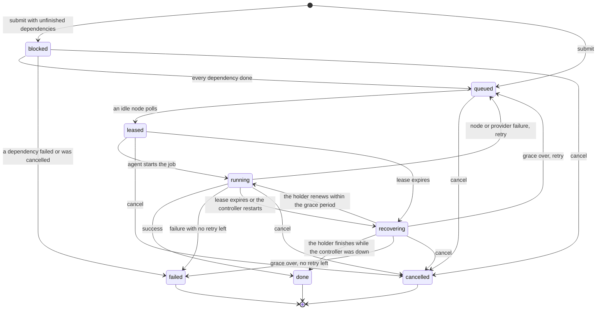

# Operations

This page covers a packaged controller deployment, upgrades, backup and restore, restart behaviour, leases and retries, provider cordons, how to read `lu status` and `lu nodes`, monitoring, and the dependency-graph display.

**0.1.0 status:** controller, agent (`lu agent`) and operator CLI work end to end. Read the agent limitation in `docs/security.md` before running an agent next to anything sensitive.

## Layout

The contributed units assume this layout:

| Path | Owner / mode | Purpose |
| --- | --- | --- |
| `/usr/local/bin/lu` | `root:root`, `0755` | binary installed by `make install` as root |
| `/etc/lu/lu.toml` | `root:lu`, `0640` | controller config (hashes and paths only) |
| `/etc/lu/agent.toml` | `root:lu`, `0640` | agent config |
| `/etc/lu/agent.token` | `lu:lu`, `0600` | agent token, readable only by the agent user |
| `/etc/lu/operator.token` | operator user, `0600` | operator token, not installed by the unit |
| `/etc/lu/tls/cert.pem` | `root:lu`, `0644` | TLS certificate |
| `/etc/lu/tls/key.pem` | `lu:lu`, `0600` | TLS private key |
| `/var/lib/lu/lu.db` | `lu:lu`, `0600` | SQLite database (plus `-wal` and `-shm` while running) |
| `/var/lib/lu/artifacts/` | `lu:lu`, `0700` | per-job logs and artifacts |
| `/var/lib/lu/work/` | `lu:lu-harness`, `0770` | agent staging root |
| `/var/lib/lu-harness/` | `lu-harness:lu-harness`, `0700` | harness home |

If `PREFIX` is not `/usr/local`, change `ExecStart` in the units to match.

## Install the service

As root:

```sh
make install
install -m 0644 contrib/lu.sysusers /etc/sysusers.d/lu.conf
install -m 0644 contrib/lu.tmpfiles /etc/tmpfiles.d/lu.conf
systemd-sysusers
systemd-tmpfiles --create
install -d -m 0750 -o root -g lu /etc/lu
```

Create the config and tokens. Never put a plaintext token in the config:

```sh
umask 077
printf '%s' "$(head -c 32 /dev/urandom | base64)" > /etc/lu/agent.token
printf '%s' "$(head -c 32 /dev/urandom | base64)" > /etc/lu/operator.token
chown lu:lu /etc/lu/agent.token
chmod 600 /etc/lu/agent.token /etc/lu/operator.token
sha256sum /etc/lu/agent.token /etc/lu/operator.token
```

Put the two hashes in `lu.toml`. A trailing newline in a token file is trimmed by the CLI but is *not* trimmed when you compute `sha256sum`; use `printf '%s'` as above so the hash and the token agree.

Copy `contrib/lu-controller.toml` to `/etc/lu/lu.toml`, replace the hashes, paths and names, then:

```sh
lu check --config /etc/lu/lu.toml
systemctl daemon-reload
systemctl enable --now lu-controller.service
systemctl status lu-controller.service
```

`lu-controller.service` is `Type=simple`; `lu` does not implement `sd_notify`, so `Type=notify` is not available. It runs as `lu`, uses `StateDirectory=lu`, and applies `NoNewPrivileges`, `ProtectSystem=strict`, `ProtectHome`, `PrivateTmp`, `PrivateDevices`, restricted address families, an empty capability set and `LimitNOFILE=65536`. `ReadWritePaths=/var/lib/lu` is the only writable system path. `TimeoutStopSec=40` is above the fixed 10-second in-flight drain the binary performs on shutdown.

`lu-agent.service` is present for the intended agent layout, but it runs `lu agent`, which this tree does not implement. Do not enable it in 0.1.0; it will fail with a command-line usage error.

The HTTP health route needs no token:

```sh
curl -fsS http://127.0.0.1:7600/v1/health
```

It returns `{"ok":true,"version":"…","db":"ok"}`. A non-loopback listener requires TLS; use `https://` and the configured certificate.

## Upgrade

1. Read `CHANGELOG.md` and run the new binary's `lu check --config /etc/lu/lu.toml` before replacing anything.
2. Back up the database and artifacts (below).
3. Stop the controller: `systemctl stop lu-controller.service`.
4. Replace `/usr/local/bin/lu` and any changed unit files, then `systemctl daemon-reload`.
5. Start the controller and check `/v1/health`, `journalctl -u lu-controller`, `lu ls` and `lu nodes`.

The store has schema version 2. It creates or verifies the schema at startup and refuses a database whose schema version is newer than the binary supports. Downgrades are not supported; roll back by restoring the matching database backup as well as the older binary.

There is no online config reload. `SIGHUP` is not handled; restart the controller after changing config, TLS files or token hashes.

## Backup and restore

The database uses SQLite WAL mode. A plain copy of `lu.db` while the controller is running can miss committed transactions held in `lu.db-wal`.

Take an online snapshot without stopping the controller:

```sh
install -d -m 0700 /var/backups/lu
lu backup --config /etc/lu/lu.toml --out "/var/backups/lu/lu-$(date +%F).db"
```

`lu backup` uses SQLite's `VACUUM INTO`, writes the copy with mode `0600`, runs
`PRAGMA integrity_check`, and prints the size, schema version and job count. It refuses to
replace an existing file unless `--force` is given.

For a daily snapshot, install a small wrapper, a service and a timer as root:

```sh
# /usr/local/bin/lu-backup
#!/bin/sh
set -eu
/usr/local/bin/lu backup --config /etc/lu/lu.toml \
    --out "/var/backups/lu/lu-$(date +%F).db" --force
find /var/backups/lu -name 'lu-*.db' -mtime +30 -delete
```

```sh
chmod 0755 /usr/local/bin/lu-backup
```

```ini
# /etc/systemd/system/lu-backup.service
[Unit]
Description=Lu database backup
After=lu-controller.service

[Service]
Type=oneshot
User=lu
Group=lu
ExecStart=/usr/local/bin/lu-backup
ReadWritePaths=/var/backups/lu
```

```ini
# /etc/systemd/system/lu-backup.timer
[Unit]
Description=Daily Lu database backup

[Timer]
OnCalendar=daily
Persistent=true

[Install]
WantedBy=timers.target
```

```sh
install -d -m 0700 -o lu -g lu /var/backups/lu
systemctl daemon-reload
systemctl enable --now lu-backup.timer
```

Keep the backup directory private because the database holds job tasks and summaries.

Artifacts are ordinary files under `/var/lib/lu/artifacts/<job id>/`. Back them up with modes preserved:

```sh
tar -C /var/lib/lu -czf "/var/backups/lu/artifacts-$(date +%F).tar.gz" artifacts
```

The database and artifacts are not updated in one transaction. For a consistent pair, stop the controller before taking both; otherwise accept that a job may reference an artifact that is missing from, or newer than, the snapshot. Backups contain job tasks, diffs, reports and logs, which may include source code and secrets that were present in a checked-out repository: store them with the same care as the live artifact directory.

Restore the database:

```sh
systemctl stop lu-controller.service
lu restore --config /etc/lu/lu.toml /var/backups/lu/lu-YYYY-MM-DD.db
systemctl start lu-controller.service
```

`lu restore` verifies the snapshot, refuses a file that is not a Lu database (an empty or
foreign SQLite file would replace your data with nothing), rejects a schema newer than the
binary supports, and refuses when the database is still in use, so stop the controller first.
Only one restore runs at a time. It stages the copy beside the database with the old file's
owner and mode `0600`, moves the current database and every `-wal`, `-shm` and `-journal` file
to `<db>.pre-restore-<unix seconds>` names, then renames the staged copy into place. Run it as
root or as the controller's own account; either way the installed file keeps the old owner.
Boot recovery then applies to jobs that were leased or running in the snapshot.

If a restore is interrupted, the previous database is still under its `pre-restore` name:
`mv <db>.pre-restore-<seconds> <db>`, and the same for each `-wal` or `-shm` file, puts it back.
A failed install does this itself and says so. `lu backup` refuses an output path that is the
database or one of its files, or a symlink, and removes a partial file if it fails.

Artifacts are not part of the database snapshot. Restore them separately:

```sh
rm -rf /var/lib/lu/artifacts
tar -C /var/lib/lu -xzf /var/backups/lu/artifacts-YYYY-MM-DD.tar.gz
chown -R lu:lu /var/lib/lu/artifacts
chmod 0700 /var/lib/lu/artifacts
```

## What a controller restart does

On startup the controller runs boot recovery before serving traffic:

- Every job in `leased` or `running` becomes `recovering`. Its node and epoch are kept.
- Jobs already in `recovering` stay there, but their grace timer is restarted. Lease and recovery timestamps are based on a monotonic clock that begins again with the process, so the old values are not meaningful after a restart.
- An agent that still holds the lease and renews the same epoch within `recovery_grace_secs` moves the job back to `running` and continues.
- If the grace period expires first, a node-class failure is applied. If `attempt <= max_retries`, the job returns to `queued`, the attempt is incremented, the node is cleared, and `failure_class`, `cancel_requested` and `finished_at` are cleared. Otherwise it becomes `failed` with `failure_class: "node"`.
- `queued`, `blocked`, `done`, `failed` and `cancelled` jobs are not changed by boot recovery.

The listener stops accepting new connections on `SIGTERM` or Ctrl-C and drains in-flight connections for up to 10 seconds. The contributed unit allows 40 seconds before systemd sends `SIGKILL`.

If the controller is down for longer than a lease, agents cannot renew. When it returns, the same recovery path applies; a job can therefore consume a retry even though the harness itself did nothing wrong.

## Leases and retries



A `needs_input` state is reserved for interactive harnesses and unreachable in 0.1.0.

A job submitted with `after` dependencies starts as `blocked` when at least one dependency is not `done`; if all are already `done`, it starts as `queued`. When a dependency finishes `done`, all blocked dependents whose remaining dependencies are `done` move to `queued` and waiter polls wake. When a dependency finishes `failed` or `cancelled`, blocked dependents fail with `failure_class: "dependency"`, a summary naming the dependency and its state, and the failure cascades through their own dependents. Dependency failures never retry, and dependencies do not transfer results or artifacts to the dependent job.

A job starts as `queued` with `attempt = 1` and `epoch = 0`. When an idle, non-draining node with no held job asks for work, the controller assigns the oldest queued job whose provider is available and not cordoned:

- state becomes `leased`, `node` is set, `epoch` is incremented, and the lease runs for `lease_secs`.
- the agent calls `start` to move the job to `running`, then renews the lease. In 0.1.0 the controller also best-effort renews on `poll`, `start` and log append.
- every agent write names the epoch. A write with an older epoch is `409 stale_epoch` and changes nothing.

Maintenance runs every `max(1, lease_secs / 3)` seconds. An expired lease moves the job to `recovering`; after `recovery_grace_secs` it is requeued or failed as described above.

On completion:

- `Done` moves the job to `done` and records `finished_at`; newly unblocked dependents move to `queued`.
- `Failed(Execution)` moves it to `failed` immediately. Execution failures never retry. `lu retry <id>` resubmits a finished job's spec as a new job (`--provider`, `--model` and `--after` replace those fields); the new job is independent of the old one.
- `Failed(Node)` retries while `attempt <= max_retries`: the job returns to `queued`, the attempt is incremented, and the node is cleared. Beyond the cap it becomes `failed` with that failure class. `Failed(Provider)` does not use that budget: a provider outage is not the job's fault, so the job returns to `queued` and waits until a node can serve the provider again (the node must report it healthy and have no cordon). Only 100 provider failures in a row fail the job. A terminal `failed` or `cancelled` job fails its blocked dependents.

A failure before the harness produced a verdict is classified by the agent, one row per case:

| Cause | Class | Retried |
| --- | --- | --- |
| The harness process could not be started (command not found, exec refused, no pid) | `node` | within `max_retries` |
| Staging or preparing the tree failed in a way the node controls (disk, filesystem, clone transport, permissions, leftover directory) | `node` | within `max_retries` |
| A staging error that names a missing ref, an authentication failure or an unknown repository | `execution` | never |

`max_retries` is the number of node-failure retries, not the total number of attempts. With the default `1`, an initial attempt plus one retry is allowed. A provider failure also cordons the `(node, provider)` pair for `provider_cooldown_secs`.

When a job names a `provider`, the agent also checks it against its node's Reiki reading every five seconds. Reiki is the authority on keys, so this works for any harness: when two fresh readings in a row show the provider cooling or disabled (no usable key), the agent stops the job like a cancel and completes it as `Failed(Provider)`, with a summary that names the provider and the soonest return time Reiki reported. The completion carries that time plus a 60-second buffer as `retry_after_secs`, and the controller cordons the provider on the node for that long instead of the configured cordon length. The controller then cordons that provider on the node and requeues the job on another node.

As a fallback for a job that names no provider, or a node without a Reiki feed, the agent watches a running harness's output. If the newest line matches a provider-unavailable marker (the opencode message about every key in the stream's chain, a quota message, a 429, or a rate limit) and the harness then produces no output for 120 seconds, the agent stops it the same way and completes the job as `Failed(Provider)`, with a summary naming the marker. Any other output after the marker disarms the watch.

Cancellation is different:

- a `queued`, `blocked` or `recovering` job becomes `cancelled` immediately, and its blocked dependents fail with `failure_class: "dependency"`;
- a `leased`, `running` or `needs_input` job gets `cancel_requested = true` and the agent is told on its next poll;
- a terminal job returns `409 conflict`.

## Provider cordons and node drains

These are separate mechanisms:

- **Drain** stops a node taking any new job. It is set by `POST /v1/nodes/{name}/drain` and cleared by `/undrain`, and is stored in the `nodes` table. It survives a controller restart. A node must have sent a heartbeat at least once to exist; draining an unknown node returns `404 not_found`.
- **Cordon** stops a node taking jobs that name a particular provider. It is created when a retryable provider failure completes and the job names a provider, and it expires after `provider_cooldown_secs`. A job with no provider is not blocked by a cordon.

Cordon deadlines are stored as monotonic milliseconds. The controller does not rebase them on restart, so a surviving cordon's remaining time is approximate and may last longer than the configured cooldown if the previous process ran for a long time. `lu nodes --json` shows the currently unexpired cordons; there is no CLI command to clear one. Waiting out the cooldown or editing the database while the controller is stopped are the available options.

## Reading `lu status`

`lu status` is a one-shot operator summary of the controller:

```text
version             0.1.10
uptime_secs         3600
schema_version      2
db_bytes            81920
recovered_on_boot   2
oldest_queued_secs  0
nodes               3
nodes_online        2
lease_secs          60

STATE     COUNT
blocked   0
queued    0
leased    1
running   2
...
```

`recovered_on_boot` is the number of jobs moved to `recovering` by the current process's boot
recovery. `oldest_queued_secs` is `0` when no job is queued or blocked. `lu status --json`
prints the raw `GET /v1/status` response.

## Reading `lu nodes`

Human output has five columns:

```text
NAME    VERSION  HARNESS  LAST_SEEN            DRAINED
node-a  0.1.10   idle     2026-11-16 09:12:00Z no
```

- `NAME` is the node name bound to the agent token.
- `VERSION` is the agent version from its latest heartbeat, or `-` for an older agent.
- `HARNESS` is the last reported harness state (`idle`, `busy`, or `-` if unknown).
- `LAST_SEEN` is the last heartbeat time in UTC.
- `DRAINED` is intended to show the drain flag.

There is no `ONLINE` column in the table. Use `lu nodes --json` to see the full controller view: `online` (seen within two lease periods), `draining`, `providers`, `current_job`, `cordons`, `version` and the opaque `reiki` document.

A node with no current job and `harness: idle` can take work. A node that is `busy`, draining, has a held job, is missing from the list, or has a matching provider cordon will not be assigned one.

## Reading `lu node`

`lu node <name>` prints the latest host and job stats the node reported. The controller keeps only the most recent heartbeat's stats in memory, so they survive neither a controller restart nor an agent restart until the next heartbeat.

```text
node  node-a
load1             0.50
load5             0.25
load15            0.12
mem_total_kb      8192
mem_available_kb  4096
swap_used_kb      12
disk_free_bytes   -
uptime_secs       600

job 01J...  pgid 4242  output_idle 400s  cpu_idle 350s  stuck yes
  PID   PPID  STATE  CPU_S  RSS_KB  AGE_S  FILES  COMMAND
  4242  1     S      7      1024    90     3      opencode run
```

- Host numbers come from the agent's `/proc` sample. `disk_free_bytes` is currently always `-`; the documented optional field is reserved for a later filesystem stat primitive.
- Each job is a running job owned by that node. `pgid` is the harness process group, and the process table is capped at the 64 busiest members. `COMMAND` is the first 80 characters of the command line with control characters replaced.
- `output_idle` is seconds since the harness last wrote output; `cpu_idle` is seconds since any process in the job tree last used CPU. `stuck yes` means both are above 300 seconds while the job is still running.
- A node that has not sent stats prints `host  -` and `jobs  -`. An unknown node is a 404 and exits `1`.
- `lu node <name> --json` prints the exact `GET /v1/nodes/{name}/stats` body, including an empty `{}` for a known node with no stats.

Stats are sampled on the agent at heartbeat time, which may be slower than `lu top`'s two-second refresh. They describe the agent's view, not live controller state.
## Display

`lu top` draws the dependency graph below the job list when the terminal is at least 24 rows tall and a component has an unfinished job. Press `g` to hide or show it. A component is a set of jobs linked by `after`, including finished jobs that connect unfinished ones; a component whose jobs are all terminal is left out.

Each row is one job, placed left to right by depth: `0` with no dependency in the fetched set, otherwise one past its deepest dependency. Box-drawing connectors join a job to its dependencies, and an edge takes the dependency's colour. An `after` id that is not in the fetched jobs is a dim stub `#id…`. Job titles are clipped to the panel width.

| State | Glyph | Colour |
| --- | --- | --- |
| `done` | `✓` | dim green |
| `running`, `leased` | `▶` | bright green |
| `blocked` | `◌` | orange |
| `queued`, `recovering`, `needs_input` | `○` | yellow |
| `failed` | `✗` | red |
| `cancelled` | `–` | grey |

The job list uses the same colours. The graph shows at most 6 components and 40 jobs, and a dim line reports how many jobs and components were left out.

`lu graph [JOB]` prints the same graph without the dashboard, using up to 200 jobs from the controller. `JOB` selects the component containing that job, even if every job in it is finished. Output is coloured only when stdout is a terminal and `NO_COLOR` is unset. `lu graph --json` prints `{"nodes":[{"id","state","title","after"}]}` for the shown jobs, without stubs or the summary line.

## Logs and artifacts

Logs are stored at `<artifacts_dir>/<job id>/run.log`; artifacts are `diff.patch`, `run.log` and `report.json` in the same directory. The controller chooses the paths and names. Files are `0600`; directories are `0700`.

- `GET /v1/jobs/{id}/logs?offset=N` returns raw bytes from the offset, with `X-Lu-Log-Length` and `X-Lu-State`. `?wait=25` waits up to 25 seconds for new bytes or a state change.
- Total log storage is capped at 50 MiB. Bytes beyond the cap are dropped with a marker line and the upload still succeeds.
- `diff.patch` is capped at 10 MiB, `report.json` at 1 MiB, and one log chunk at 64 KiB plus framing.
- `lu logs <id>` prints the stored text. `lu logs --follow` is intended to stop at a terminal state, but the client currently ignores the controller's `X-Lu-State` header, so it may keep waiting. Use `lu show <id>` to check the state if follow does not stop.
- `lu fetch <id> --out DIR` writes the fixed names into `DIR`, mode `0600`, and refuses to overwrite existing files unless `--force` is given. Missing artifacts are skipped; if none are available the command exits `1`.

## Repository mirrors

When `[[controller.repos]]` lists a repository, the controller keeps a bare mirror at `<artifacts_dir>/../mirrors/<name>.git` and pins each job for that URL to the commit its ref names. A submit syncs first when the mirror has never synced, is older than 60 seconds, or does not know the ref. An unknown ref is `422` naming the ref; a fetch failure is `500` with any credential scrubbed from the message. Syncs run on a blocking thread with a 5-minute timeout and a 10 GiB mirror cap.

- `lu repos` lists each configured mirror, its URL, last sync time and number of branch heads. `--json` prints the raw `GET /v1/repos` body.
- `lu sync <name>` fetches one mirror and prints its last sync time and branch heads. `--json` prints the raw response.
- Both commands use the operator token, like the rest of the CLI. `GET /v1/repos` and `POST /v1/repos/{name}/sync` are the corresponding routes.

## Metrics

`GET /metrics` serves Prometheus text (exposition `0.0.4`, `Content-Type: text/plain; version=0.0.4; charset=utf-8`). It needs an operator token, like every other operator route. It is safe to scrape from any host that holds the operator token; keep that host tight.

Series:

| Series | Type | Meaning |
| --- | --- | --- |
| `lu_jobs{state="…"}` | gauge | Jobs in each of the eight states (`queued`, `leased`, `running`, `recovering`, `needs_input`, `done`, `failed`, `cancelled`); all eight are zero-filled. |
| `lu_nodes` | gauge | Registered nodes that have sent at least one heartbeat. |
| `lu_nodes_online` | gauge | … and seen within two lease periods. |
| `lu_nodes_drained` | gauge | … with the drain flag set. |
| `lu_node_providers{node,provider,state}` | gauge | 1 per provider as reported by that node's latest heartbeat, `state` is `ok`, `cooling`, `disabled` or `unknown`. |
| `lu_controller_up` | gauge | Always 1. |
| `lu_jobs_completed_total{outcome="done\|failed\|cancelled"}` | counter | Jobs in a terminal state, by outcome, derived from the stored jobs table; survives a restart. |
| `lu_build_info{version="…"}` | gauge | Always 1; the controller build version. |
| `lu_uptime_seconds` | gauge | Seconds since the controller process started. |
| `lu_db_bytes` | gauge | Size of the SQLite database file, excluding `-wal` and `-shm`. |
| `lu_schema_version` | gauge | Schema version the binary expects, currently `2`. |
| `lu_recovered_on_boot` | gauge | Jobs moved to `recovering` by this process's boot recovery. |
| `lu_queue_oldest_seconds` | gauge | Age of the oldest `queued` or `blocked` job, or `0` when there is none. |
| `lu_node_last_seen_seconds{node}` | gauge | Seconds since that node's last heartbeat. |
| `lu_repo_last_sync_seconds{repo}` | gauge | Seconds since that configured repository was last mirrored, or `0` before the first sync. |

Example scrape config (operator token read from the file, never from the config itself):

```yaml
scrape_configs:
  - job_name: lu
    scheme: https
    metrics_path: /metrics
    authorization:
      credentials_file: /etc/lu/operator.token
    tls_config:
      ca_file: /etc/lu/ca.pem                    # if the controller cert is internal
    static_configs:
      - targets: ["controller.internal:8443"]
```

If your Prometheus only supports inline `credentials`, put the token inline there and protect the config the same way you protect `lu.toml`. The operator token grants full operator scope, so treat the scrape config as a secret.

Example alert rules:

```yaml
groups:
  - name: lu
    rules:
      - alert: LuControllerDown
        expr: up{job="lu"} == 0
        for: 2m
      - alert: LuQueueIsStale
        expr: lu_queue_oldest_seconds > 900
        for: 10m
      - alert: LuNoOnlineNodes
        expr: lu_nodes_online == 0 and lu_jobs{state="queued"} > 0
        for: 5m
      - alert: LuNodeMissingHeartbeat
        expr: lu_node_last_seen_seconds > 180
        for: 2m
      - alert: LuDatabaseGrowing
        expr: lu_db_bytes > 2e9
        for: 1h
      - alert: LuRecoveredAfterRestart
        expr: lu_recovered_on_boot > 0
        for: 5m
```

Adjust the heartbeat and queue thresholds to the configured `lease_secs` and expected backlog.
`LuRecoveredAfterRestart` fires after a controller restart that interrupted jobs; check
`lu status` and `lu ls --state recovering` to see whether they resume or retry.

`lu check` reports the same database-level health without Prometheus: `quick_check`, schema
version, size, `leased`/`running` jobs without a lease, and orphan `job_deps` rows.

## Common failures

| Symptom | Check |
| --- | --- |
| `lu serve` exits with a config error | `lu check --config …`; the error names the table. |
| `cannot open …/lu.db: … database directory does not exist` | Create the parent directory and ensure `lu` can write it. |
| `cannot listen …` | Port already in use or not permitted; `listen` must be a socket address. |
| TLS key refused | Mode must be `0600` or tighter and the file must be owned by `lu`; symlinks are refused. |
| `401 unauthorized` | Wrong token, wrong scope, a hash mismatch, or a token file with the wrong contents. Operator commands need an operator token; agent routes need an agent token. |
| `403 forbidden` | The token is valid but the job or heartbeat belongs to a different node. |
| Job stays `queued` | No agent is polling, the node is busy or draining, provider missing, or provider cordon. Inspect `lu nodes --json`. |
| `logs --follow` never stops | Known client mismatch; `Ctrl-C` and use `lu show`/`lu logs`. |
| `lu fetch` exits `1` | No artifacts yet, or the job has not uploaded any; check the job state. |

Limits and route details are in [api.md](api.md). Config keys and validation rules are in [config.md](config.md). The threat model is in [security.md](security.md).
