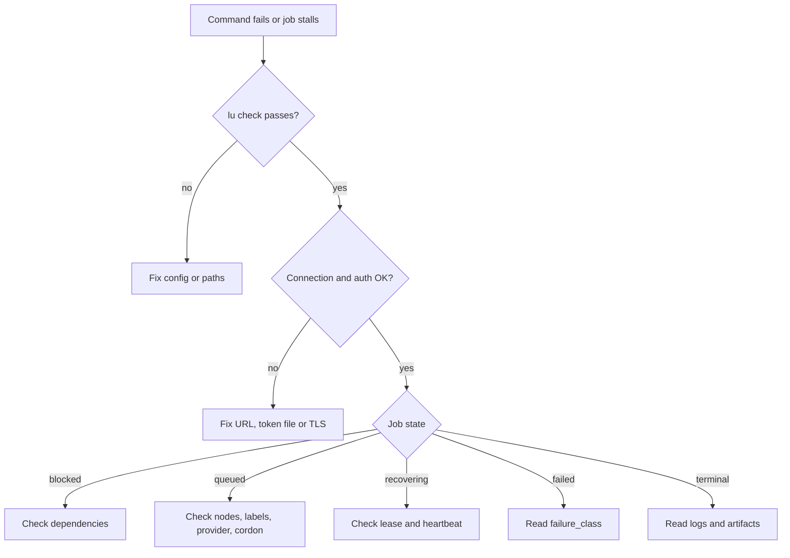

# Troubleshooting

Start with the failing layer: command setup, controller connection, then job state. Each table gives the check and the action.



## Quick answers

| Question | What it means | Check / action |
| --- | --- | --- |
| Why `401` with the right token? | Missing, malformed, unknown or wrong-scope tokens all return the same `401` with `WWW-Authenticate: Bearer`. Compare file bytes with `token_sha256` and restart the controller after changing its hash. | Use an operator token for `lu` and `lu mcp`; see [Tokens and TLS](tokens-and-tls.md#token-files-and-hashes). |
| Why is a job blocked forever? | An `after` dependency is unfinished; a failed predecessor adds `blocked_reason: "predecessor failed"` and a `blocked_until` deadline, after which the dependent fails with class `dependency`. | Follow the chain with `lu show <id>` and `lu graph <id>`; retry the predecessor with `lu retry <dep-id>` or `--chain`; see [Dependencies](dependencies.md#waiting-and-promotion). |
| Why did a dependency conflict fail the job? | The default `on_conflict = "fail"` stops before the harness and never retries; disagreeing chain bases can name two commits. | Read `lu show` and `lu logs`, fix the base or ref, or resubmit with `--collect files`, `--on-conflict markers` or `--on-conflict skip`; see [Dependencies](dependencies.md#one-base-per-chain). |
| Why does submit return `429`? | Ten failed token checks in 60 seconds block an address for the window; mirror syncs and base packs have their own budgets. The MCP submission cap is a tool error, not HTTP `429`. | Fix the token and wait `Retry-After`; see [Security](security.md#throttling). |
| Why does a node never take work? | The job cannot be placed: the node may be offline, busy, draining, holding a `recovering` job, missing a label, tainted, without a healthy provider or cordoned for that provider. | Read `waiting` in `lu show <id>` and `lu nodes --json`; see [Dispatch](dispatch.md). |
| Why will a cordon not lift? | A cordon blocks one `(node, provider)` pair until its deadline, two healthy provider heartbeats, a controller restart or `lu uncordon`. | Check `cordon_details` and provider health; see [Dispatch](dispatch.md#cordons). |

Read and clear cordons with `lu nodes --json` and `lu uncordon`; drains use `lu drain` and
`lu undrain`.

## Command and connection

| Symptom | Check | Action |
| --- | --- | --- |
| `lu serve` exits with a config error | `lu check --config …` | The error names the table. Fix that table before starting. |
| `no controller URL: set LU_URL …` | Environment, then operator files | Set `LU_URL` and `LU_TOKEN_FILE` (optional `LU_CA_FILE`), or write `url` and `token_file` (optional `ca_file`) in `~/.config/lu/operator.toml` or `/etc/lu/operator.toml`. `--config` never supplies operator credentials and has no `[agent]` fallback. See [CLI and MCP clients](cli.md). |
| Token file refused | Owner, mode, type | Regular file, owned by the effective user, mode `0600` or tighter, no symlink or FIFO; at most 64 KiB for an agent token, 8 KiB for an operator token. |
| `401 unauthorized` | Token value, scope, hash | Missing, unknown and wrong-scope tokens all return `401`. Use an operator token for CLI/MCP and an agent token for agent routes. |
| `403 forbidden` | Node binding | A valid agent token is bound to one node; another node's job or heartbeat is refused. |
| `429 rate_limited` | `Retry-After`, source address and route | Ten failed token checks in 60 seconds block an address for the rest of the window. Separately, one mirror sync at a time and six per operator per minute, or four base packs at a time and thirty per agent per minute, return `429` when the slot or budget is exhausted. |
| TLS key refused | `[tls] key` | Regular file, owned by the controller user, mode `0600` or tighter, no symlink. |
| `cannot listen …` | `[controller] listen` | Use a socket address such as `127.0.0.1:7600`; a non-loopback address needs `[tls]`. |
| Database directory error | `[controller] db` parent | Create the parent directory and give the controller write access. |

Worked example — isolate a startup failure:

```sh
lu check --config /etc/lu/lu.toml
curl -fsS http://127.0.0.1:7600/v1/health
export LU_URL=http://127.0.0.1:7600 LU_TOKEN_FILE=/etc/lu/operator.token
lu status
```

`/v1/health` needs no token. A non-loopback listener uses `https://`. Operator commands take
credentials from `LU_URL`/`LU_TOKEN_FILE` (or an operator file), not from `--config`.

## Batch submission

| Symptom | Check | Action |
| --- | --- | --- |
| `lu: batch validation failed:` | The listed errors cover duplicate keys, empty or oversized tasks, bad TOML, unknown keys, missing `repo`/`ref` and invalid `after` hints. | Fix every listed issue and retry. Nothing was submitted. See [Batch submissions](submitting.md#dry-run-and-failures). |
| `duplicate key` | Two task files or checklist items share a slug. | Rename one source, or use another `--key-prefix`. A repeated slug is an error even with different task text. |
| `unknown key` in `after` | The key is not an earlier job in this batch and was not found on the controller. | Put the prerequisite earlier in the input, or submit it first with that key. |
| `group cap conflict` | `--max-parallel` was used with jobs in different groups. | Give all jobs the same `group`, or omit `--max-parallel`. |
| Rerun reports the same ids | The same `--key-prefix` and task slugs produced the same idempotency keys. | Expected. The controller returns the existing jobs instead of creating duplicates. |
| Partial run exits `1` | Some jobs were submitted before the controller failed. | Read the printed rows, note the remaining keys, then rerun the batch. Submitted jobs keep their keys. |

A dry run performs the same local validation but sends no request and reads no operator token.

## Job state

State definitions, legal transitions and the full state table are in
[Job Lifecycle](lifecycle.md). For each state, check:

| State | Next check |
| --- | --- |
| `blocked` | `lu show <id>` lists each dependency, its state and, when a predecessor failed, `blocked_reason` and `blocked_until`. |
| `queued` | `lu nodes --json`: an online, idle, non-draining node with every required label and provider. |
| `leased` / `running` | `lu node <node>` for the latest heartbeat and process tree. |
| `recovering` | Agent heartbeat and `recovery_grace_secs`; a late write with an old epoch is discarded. |
| `done`, `failed`, `cancelled` | `lu logs <id>` and `lu fetch <id>`; `lu retry <id>` requeues the same job. (not for `done`) |

A queued job that cannot be placed shows the first blocking reason in `lu show` and `lu top`: a full group cap, then a missing label, an untolerated taint or no healthy provider pair. For what a drain or provider cordon does, see [Cordons](dispatch.md#cordons).

Worked example — diagnose a queued job:

```sh
lu show 01ARZ3NDEKTSV4RRFFQ69G5FAV
lu nodes --json
lu undrain node-a
```

## Dependency chains

| Symptom | Check | Action |
| --- | --- | --- |
| Dependent stays `blocked` with `predecessor failed` | `lu show <dependent>` lists the predecessor and the `blocked_until` deadline; `lu ls --state blocked` shows the backlog. | Retry the predecessor with `lu retry <predecessor>` to requeue it in place and restore waiting dependents, or `lu retry <predecessor> --chain` to restore blocked dependents transitively. Cancelled or failed dependents stay untouched. Otherwise they fail with class `dependency` at `[controller] blocked_dependent_ttl` (default 24h). `lu top` and `lu_blocked_dependents_total` show the count. |
| Waiting dependents were cancelled | A plain `lu cancel <predecessor>` cancels them. | Leave them blocked next time with `lu cancel <predecessor> --keep-dependents`. |
| Conflict summary names two commits | The dependencies recorded different `staged_commit` values. The agent staged their newest common ancestor, but a dependency patch did not apply there (or no common ancestor exists). | Inspect the named commits and the dependencies' `diff.patch` files. When a common ancestor exists and every patch applies, it is used automatically; otherwise resolve the patches and resubmit the chain. |
| Conflict on a `union_paths` or `base_paths` path | The summary lists every file and hunk, whether the base moved, and the covered policy paths. | Check the agent's `[stack]` lists and the job's narrower `stack_union_paths`/`stack_base_paths`; uncovered paths always fail closed. See [Policy paths](dependencies.md#policy-paths-for-known-safe-conflicts). |
| Final patch does not apply to the current branch | The chain's `diff.patch` is relative to the inherited base, which may predate the branch tip. | Merge the final patch onto the moved branch yourself; Lu does not rebase it. |

Worked example — recover a chain after a failed predecessor:

```sh
lu ls --state blocked
lu show 01ARZ3NDEKTSV4RRFFQ69G5FAV   # blocked_reason: predecessor failed
lu retry 01ARZ3NDEKTSV4RRFFQ69G5FAV --chain
```

## Failure classes

The full failure-class table, retry rules and agent-side classification are in
[Job Lifecycle](lifecycle.md#failure-classes-and-retries). Read `failure_class` with `lu show <id>`
before applying the checks below. A `dependency` failure now follows a blocked wait of up to
`[controller] blocked_dependent_ttl`; see [Dependency chains](#dependency-chains).

A `node` failure with a `failure_reason` points to the machine, not the task: `harness_unreachable`, `container_start`, `container_wait_timeout`, `gateway_unavailable` or `workspace_enospc`. Check the node's harness, Podman storage, gateway health endpoint or workspace filesystem, then let the job requeue on another node. The failed node is in `excluded_nodes` in `lu show <id> --json`; `lu retry` clears it after the machine is fixed. Ordinary task output that mentions a socket or `ENOSPC` does not produce one of these codes.

A `409 stale_epoch` means the agent write came from an old lease; the controller ignores it. A log append at the wrong offset returns `409 conflict` with `{"error":"conflict","message":"conflict","length":L}`; resume from `L`. A `429` carries `Retry-After` seconds.

Worked example — inspect a failure:

```sh
lu show 01ARZ3NDEKTSV4RRFFQ69G5FAV
lu logs 01ARZ3NDEKTSV4RRFFQ69G5FAV
lu fetch 01ARZ3NDEKTSV4RRFFQ69G5FAV --out results
lu retry 01ARZ3NDEKTSV4RRFFQ69G5FAV --provider openai
```

`lu retry` requires a `failed`, `cancelled`, `expired` or `deadline_missed` job;
any other state, including `done`, is a usage error. It keeps the same job id, so the printed id is the one to inspect
and fetch. `--key` updates the stored idempotency mapping for this attempt; a request key replays
the stored retry response.

## Logs and artifacts

| Symptom | Cause | Action |
| --- | --- | --- |
| Empty log | Job has not started, or the harness has not written output. | Check state with `lu show <id>`. |
| `logs --follow` keeps waiting | It reads pages with `wait=25` until the controller reports a terminal state. | Let the job finish; exit `0` means `done`, `3` means `failed` or `cancelled`. |
| `lu fetch` exits `1` | No artifact was stored yet. | Wait for a terminal state, then retry with `--out`. |
| Existing file refused | `fetch` never overwrites by default. | Add `--force`. |
| Truncated stored log | Total log cap is 50 MiB. | The controller reserves room for a `[log truncated]` marker; the upload still succeeds. |

Artifact names are fixed: `diff.patch`, `run.log` and `report.json`. Files are `0600` in a `0700` job directory.

## Disk fills with job workspaces

| Symptom | Cause | Action |
| --- | --- | --- |
| Node's `work_dir` keeps growing | Kept workspaces have not reached their TTL, or a failure left a tree waiting for release. | Check `lu node <name> --workspaces` and the five `workspace_*` rows in `lu node <name>`; see [workspaces.md](workspaces.md). |
| Workspaces stay `waiting` | The controller has not stored `report.json`/`diff.patch`, or an active job still names the tree in `spec.after`. | Wait for artifact upload and dependants; the agent retries the release check. The stored patch is what dependants use, so the tree is not kept for stacking. |
| `workspace_delete_errors_total` keeps rising | A deletion is failing and being retried with backoff. | Read the agent log for the job id and fix permissions or the filesystem problem; the log never prints paths outside the workspace root. |
| Clean request did nothing | The request is queued for the next poll, or the trees were running or already gone. | Check `queued`, `refused_running` and `missing`, then `lu node <name> --workspaces` again. |
| Disk pressure does not reclaim enough | High/low water marks or `max_bytes` are set too high, or the remaining trees are running. | Review `[workspace]` with `lu check`; see [config.md](config.md#workspace). |

Operator clean commands and safety rules are in [operations.md](operations.md#workspace-lifecycle); metric alerts are in [monitoring.md](monitoring.md#series).

## MCP

| Symptom | Cause | Action |
| --- | --- | --- |
| `-32602` | Unknown argument, missing argument or bad bound. | Compare the call with the tool table in [MCP server](cli.md#mcp-tools). |
| `isError: true` with job text | Job or controller failure. | Read `structuredContent.error`. |
| `isError: true` on every call | Controller unreachable when the server started. | Fix connection settings and restart `lu mcp`. |
| `submission limit reached` | More than 30 submissions in a rolling minute. | Wait the reported number of seconds. `lu_submit`, `lu_submit_many`, `lu_submit_batch` and `lu_retry` share the budget. |
| `-32002` | Tool call before `initialize`. | Send `initialize` first. |

Worked example — read an argument error and a tool failure:

```json
{"jsonrpc":"2.0","id":1,"method":"tools/call","params":{"name":"lu_jobs","arguments":{"limit":500}}}
{"jsonrpc":"2.0","id":2,"method":"tools/call","params":{"name":"lu_cancel","arguments":{"id":"01ARZ3NDEKTSV4RRFFQ69G5FAV"}}}
```

The first call is `-32602` because `limit` is at most 100. The second returns a normal result with `isError: true` when the job cannot be cancelled.

## Recovery and backups

The store expects schema version `8`. Schema 1 to 7 databases are migrated in place at startup; any other version is refused with a message telling the operator to create a new database. `lu restore` is stricter and accepts only backups at the current schema version (8). Boot recovery moves `leased` and `running` jobs to `recovering` and keeps their node and epoch; see [lifecycle.md](lifecycle.md) for the transitions.

`lu backup` and `lu restore` procedures, including interrupted restores and artifact snapshots, are in [operations.md](operations.md#backup-and-restore).

For metric-based checks, see [monitoring.md](monitoring.md). For token and TLS rules, see [tokens-and-tls.md](tokens-and-tls.md); for the threat model, see [security.md](security.md).
