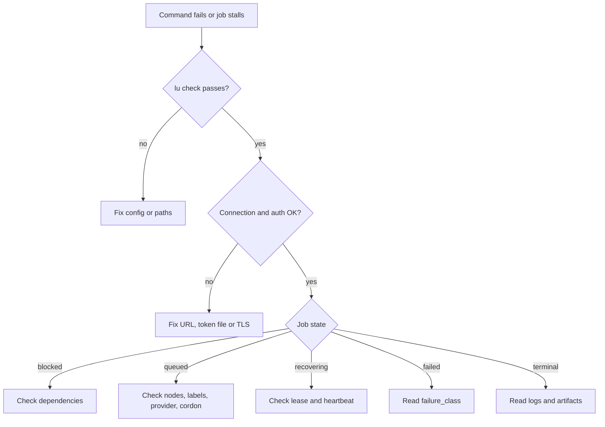

# Troubleshooting

Start with the failing layer: command setup, controller connection, then job state. Each table gives the check and the action.



## Command and connection

| Symptom | Check | Action |
| --- | --- | --- |
| `lu serve` exits with a config error | `lu check --config …` | The error names the table. Fix that table before starting. |
| `no controller URL: set LU_URL …` | Environment, then operator files | Set `LU_URL` and `LU_TOKEN_FILE`, or write `~/.config/lu/operator.toml` or `/etc/lu/operator.toml`. `--config` never supplies operator credentials. See [client guide](client-guide.md). |
| Token file refused | Owner, mode, type | Regular file, owned by the effective user, mode `0600` or tighter, no symlink or FIFO; at most 64 KiB for an agent token, 8 KiB for an operator token. |
| `401 unauthorized` | Token value, scope, hash | Missing, unknown and wrong-scope tokens all return `401`. Use an operator token for CLI/MCP and an agent token for agent routes. |
| `403 forbidden` | Node binding | A valid agent token is bound to one node; another node's job or heartbeat is refused. |
| `429 rate_limited` | `Retry-After` and source address | Ten failed token checks in 60 seconds block an address for the rest of the window. |
| TLS key refused | `[tls] key` | Regular file, owned by the controller user, mode `0600` or tighter, no symlink. |
| `cannot listen …` | `[controller] listen` | Use a socket address such as `127.0.0.1:7600`; a non-loopback address needs `[tls]`. |
| Database directory error | `[controller] db` parent | Create the parent directory and give the controller write access. |

Worked example — isolate a startup failure:

```sh
lu check --config /etc/lu/lu.toml
curl -fsS http://127.0.0.1:7600/v1/health
lu status --config /etc/lu/lu.toml
```

`/v1/health` needs no token. A non-loopback listener uses `https://`.

## Job state

State definitions, legal transitions and the full state table are in
[Job Lifecycle](lifecycle.md). For each state, check:

| State | Next check |
| --- | --- |
| `blocked` | `lu show <id>` lists each dependency and its state. |
| `queued` | `lu nodes --json`: an online, idle, non-draining node with every required label and provider. |
| `leased` / `running` | `lu node <node>` for the latest heartbeat and process tree. |
| `recovering` | Agent heartbeat and `recovery_grace_secs`; a late write with an old epoch is discarded. |
| `done`, `failed`, `cancelled` | `lu logs <id>` and `lu fetch <id>`; `lu retry <id>` resubmits the spec. |

A queued job that cannot be placed shows the first missing label in `lu show` and `lu top`. For what a drain or provider cordon does, see [Provider cordons and node drains](operations.md#provider-cordons-and-node-drains).

Worked example — diagnose a queued job:

```sh
lu show 01ARZ3NDEKTSV4RRFFQ69G5FAV
lu nodes --json
lu undrain node-a
```

## Failure classes

The full failure-class table, retry rules and agent-side classification are in
[Job Lifecycle](lifecycle.md#failure-classes-and-retries). Read `failure_class` with `lu show <id>`
before applying the checks below.

A `409 stale_epoch` means the agent write came from an old lease; the controller ignores it. A log append at the wrong offset returns `409 conflict` with `{"error":"conflict","message":"conflict","length":L}`; resume from `L`. A `429` carries `Retry-After` seconds.

Worked example — inspect a failure:

```sh
lu show 01ARZ3NDEKTSV4RRFFQ69G5FAV
lu logs 01ARZ3NDEKTSV4RRFFQ69G5FAV
lu fetch 01ARZ3NDEKTSV4RRFFQ69G5FAV --out results
lu retry 01ARZ3NDEKTSV4RRFFQ69G5FAV --provider openai
```

`lu retry` requires a terminal job. The new job has no idempotency key unless `--key` is given.

## Logs and artifacts

| Symptom | Cause | Action |
| --- | --- | --- |
| Empty log | Job has not started, or the harness has not written output. | Check state with `lu show <id>`. |
| `logs --follow` keeps waiting | It reads pages with `wait=25` until the controller reports a terminal state. | Let the job finish; exit `0` means `done`, `3` means `failed` or `cancelled`. |
| `lu fetch` exits `1` | No artifact was stored yet. | Wait for a terminal state, then retry with `--out`. |
| Existing file refused | `fetch` never overwrites by default. | Add `--force`. |
| Truncated stored log | Total log cap is 50 MiB. | The controller reserves room for a `[log truncated]` marker; the upload still succeeds. |

Artifact names are fixed: `diff.patch`, `run.log` and `report.json`. Files are `0600` in a `0700` job directory.

## MCP

| Symptom | Cause | Action |
| --- | --- | --- |
| `-32602` | Unknown argument, missing argument or bad bound. | Compare the call with the tool table in [mcp.md](mcp.md). |
| `isError: true` with job text | Job or controller failure. | Read `structuredContent.error`. |
| `isError: true` on every call | Controller unreachable when the server started. | Fix connection settings and restart `lu mcp`. |
| `submission limit reached` | More than 30 submissions in a rolling minute. | Wait the reported number of seconds. `lu_submit`, `lu_submit_many` and `lu_retry` share the budget. |
| `-32002` | Tool call before `initialize`. | Send `initialize` first. |

Worked example — read an argument error and a tool failure:

```json
{"jsonrpc":"2.0","id":1,"method":"tools/call","params":{"name":"lu_jobs","arguments":{"limit":500}}}
{"jsonrpc":"2.0","id":2,"method":"tools/call","params":{"name":"lu_cancel","arguments":{"id":"01ARZ3NDEKTSV4RRFFQ69G5FAV"}}}
```

The first call is `-32602` because `limit` is at most 100. The second returns a normal result with `isError: true` when the job cannot be cancelled.

## Recovery and backups

The store expects schema version `8`. A newer database is refused at startup; downgrades are not supported. Boot recovery moves `leased` and `running` jobs to `recovering` and keeps their node and epoch; see [lifecycle.md](lifecycle.md) for the transitions.

`lu backup` and `lu restore` procedures, including interrupted restores and artifact snapshots, are in [operations.md](operations.md#backup-and-restore).

For metric-based checks, see [monitoring.md](monitoring.md). For token and TLS rules, see [tokens-and-tls.md](tokens-and-tls.md); for the threat model, see [security.md](security.md).
